# 01 — Technology-neutral requirements baseline

Status: Phase 1 complete before the greenfield design. Reference: owner-accepted **NukMiris v0.8.1**, immutable tag commit `95decc812c228f25171ecfe647200447c83e2e45`. Main at review start was `c439586ca512297c589ddd3bc2ae783b37358b37`; its executable code, tests and configuration match that tag. This challenge changes documentation only. Test source was reviewed; no tests were run, providers contacted or private databases inspected during this challenge. The recorded 1,089 passing tests are existing evidence, not a new execution or a test-count target.

This document is intended to be sufficient input to another architect without reading the implementation. Normative behavior is described in Sections 2–8; supporting source/test references are optional verification in Section 9. It prescribes no runtime, framework, persistence technology, module structure, queue or deployment topology. Google Calendar and Meta WhatsApp are specified external product integrations, not freely interchangeable technologies in this parity exercise.

## 1. Evidence and classification

- **A — functional behavior:** required user/operator outcomes from accepted workflows.
- **B — security/reliability invariant:** safety properties that survive a different implementation.
- **C — implementation choice:** current mechanism or configurable default; challengeable without changing required outcomes.
- **D — historical/incidental POC behavior:** no greenfield compatibility duty under the owner's explicit fresh-start assumptions.
- **E — future scope:** not implemented functional parity.

These A–E labels describe requirement classes, not the earlier legacy-cleanup categories.

Origin markers: **D** documented/owner-confirmed; **T** asserted in accepted tests; **S** observed source behavior; **G** quality objective explicitly stated in this challenge. Source-only quirks are not silently promoted into product requirements. An unresolved item is numbered `U-*` below. Numeric commercial targets not supplied by the owner remain undecided.

Historical POC rows, schemas, state names, action strings and experimental functions need no migration/support. This does **not** permit discarding records between the steps of a current-version crash/recovery scenario. A new system must preserve its own outstanding operations, messages, appointments' operational identity and reminders across restart.

## 2. Actors, authority and concepts

| Actor | Authorized outcomes and limits |
| --- | --- |
| Customer | Contacts a particular business's WhatsApp number; browses, books, views and manages their own appointments; supplies a name when new; responds to reminders or withdraws permission. Same phone at two businesses represents two scoped relationships. |
| Business owner/staff | Chooses the business Calendar/settings, obtains appropriate customer permission and observes/manually edits Calendar appointments. Human handoff records are available for operational handling; no staff notification/reply UI is implemented parity. |
| Authorized platform operator | Configures providers/business mappings, records attributable permission evidence, checks connectivity, inspects/reconciles saved work and performs safe backup/restore. A dashboard, billing or self-service onboarding portal is not implied. |
| Meta WhatsApp | Supplies authenticated inbound identity/channel context, interactive actions, quoted-message context and message-status events; accepts outgoing replies/templates. API acceptance and device delivery are separate facts. |
| Google Calendar | **System of record for actual appointment existence, schedule and event version.** Calendar ownership metadata constrains what NukMiris may manage. Manual/untracked events can block time without becoming NukMiris-managed customer appointments. |

Required information concepts, not prescribed tables: business identity/settings/provider authorization; customer identity/name; conversation ownership/current view; observed external appointment; requested operation and outcome; accepted inbound identity; ordered outgoing intent/attempt/receipt; reminder schedule occurrence and current schedule identity; attendance response; permission evidence; diagnostic/audit and recovery/backup references. Platform operational metadata is authoritative for execution history, scope, attempted side effects and recovery; it does not override Google's current event truth.

## 3. Capabilities, actors' journeys and conversation behavior

### Capability behavior (`S01`, `O04`)

| Current capability | Required visible behavior | Existing configuration fact, not a mandated architecture |
| --- | --- | --- |
| Support | Main menu and scoped human handoff; appointment commands are paused; no scheduling mutation. | Runtime defaults to support. |
| Availability | Read business availability and browse/select a still-available time; explicitly indicate booking is not activated; no event creation/change. | Example configuration selects availability; it is not universal activation. |
| Booking | Immediate new booking and existing-customer appointment overview. | Requires authorized selected business Calendar. |
| Management disabled/enabled | Disabling prevents move/delete even with a valid-looking saved action; enabling permits owned rescheduling/cancellation. | Effective only with booking; a management flag in support/availability does not enable it. |
| Reminders off/dry-run/live | Separate administrative enablement and side-effect policies in Section 6. | Non-off requires booking, management, durable delivery and verified receiving-number routing; prerequisites are never auto-enabled. |
| Durable handling | Preserve accepted work/results through restart; refuse a downgrade that bypasses unresolved durable work. | Current optional non-durable mode is weaker and not a required commercial deployment option. |

Current test-only sender-to-business routing, exact environment variable names and combinations are C/D. Commercial tenant authority must come from the authenticated receiving business channel, never a customer-supplied tenant choice. Preserve the capability outcomes above rather than the POC's particular flag arrangement.

### Journey and interaction contract (`W03`–`W09`, `C04`–`C08`)

1. A customer receives a Spanish business-specific menu: **Agendar una cita**, **Reagendar / cancelar**, **Hablar con alguien**. Known customers can be greeted by stored name and shown their upcoming owned appointments when lookup is available, including when management mutations are disabled. Lookup errors must not become a false empty list.
2. Booking starts with **two time options + Más opciones**, then **two further options + Elegir fecha**. Skip empty More stages if only one/two choices exist. Date choice leads to all valid times on that day, paginated two at a time with useful more-times/another-date navigation. Browsing/date selection alone never reserves.
3. Selecting a current time submits booking immediately for a known customer. A new customer is asked for their name **after** selecting the time; valid input registers the scoped identity and submits that same selection. **No additional booking confirmation question.** Availability can change during name entry; execution must recheck.
4. Management lists only this customer's upcoming manageable appointments. With one appointment, rescheduling can enter availability directly; with several, first select the appointment. Cancellation commits when the owned appointment is selected. Rescheduling commits when the replacement time is selected. **No obsolete second confirmation screen.** No appointments yields exactly: `No encontré citas próximas. Si deseas agendar una nueva cita, escribe "cita".`
5. Global `menu`, with supported normalization/capitalization, abandons transient choices/unused offers, closes human handoff and shows a new menu. It never erases confirmed/unresolved operations, releases an uncertain operation's protection or reverses an appointment.
6. Human handoff owns ordinary text and interactive actions until Menu. Store original inbound messages under that business/customer; `cita`/`cancelar` in human mode must not run automation. Explicit reminder withdrawal is still honored, preserving the reservation and human conversation. No actual staff notification, assignment interface or staff reply delivery is promised.
7. Bounded Spanish intent recognition supports booking, moving and cancelling expressions; conflicting intents ask which action to begin. Recognition alone never mutates appointments. Inability-to-attend wording uses actual owned upcoming-appointment context; vague text never auto-cancels. Current name/date/selection/pending-result context and human priority must be respected.

Preserve original name/message values separately from normalized comparisons. Current name input is 3–120 normalized characters with a letter and rejects any ASCII digit anywhere (for example `Ana2`) and angle brackets; it does not enforce surnames or multiple words or verify legal identity (`U-NAME`). Names such as `Mañana Octubre García` and `Cita Reagendar Cancelar García` remain names during name entry. Explicit navigation commands can still override protected entry (`U-COMMAND`). Never ask the customer for a phone already supplied by verified WhatsApp identity.

### Date/label contract

Business-local civil dates determine “today,” weekday and year. Accept documented Spanish forms: `hoy`, `mañana`, `pasado mañana`, `en/dentro de N días/semanas`, weekdays with supported `este`/`próximo`/`que viene`, numeric day/month with optional **four-digit** year, Spanish month names/abbreviations and day-only `el día 13`. Missing month means next actual occurrence of that day; missing year means next actual valid date, not invalid-date overflow. Past/invalid/ambiguous/out-of-horizon input gives useful Spanish guidance without mutation and retains usable choices. A bare weekday meaning today may fall back one week only after a successful availability check finds no remaining starts; API failure or an explicit different empty date must not trigger that fallback. This is bounded grammar, not unrestricted NLU or free-text time selection.

Selectable appointment labels use `mié 23 jun 10:00`: lowercase Spanish abbreviated weekday/month, no day zero-padding and 24-hour `HH:mm`, in the business timezone. Apply consistently to booking, alternative times and existing management appointment options. Labels must not become identifiers; preserve full timestamps separately. Ordinary interactive reply buttons allow 1–3 options and titles at most 20 characters; lists allow at most 10 rows. Template-button rules are separate (Section 6).

### Semantic conversation transitions

These are meanings, not required literal persisted state strings. All action validity is scoped to the current view or recorded operation.

```mermaid
stateDiagram-v2
  [*] --> Main
  Main --> Browse: book
  Browse --> Browse: more / date / time pages
  Browse --> NeedName: select time; unknown customer
  Browse --> OperationResult: select time; known customer
  NeedName --> NeedName: invalid name
  NeedName --> OperationResult: valid name; execute selected time
  Main --> Manage: reschedule / cancel
  Manage --> BrowseReplacement: choose owned appointment to move
  BrowseReplacement --> OperationResult: choose replacement time
  Manage --> OperationResult: choose owned appointment to cancel
  Main --> Clarify: conflicting / unknown intent
  Clarify --> Browse: choose book
  Clarify --> Manage: choose management action
  Main --> Human: request person / qualifying main-menu free text
  Human --> Human: ordinary messages; opt-out recorded separately
  OperationResult --> OperationResult: status / safe repeat of recorded operation
  Browse --> Main: Menu
  NeedName --> Main: Menu
  Browse --> ExpiredView: expired action; recovery guidance
  NeedName --> ExpiredView: expired selection; no registration
  ExpiredView --> Main: customer sends Menu
  ExpiredView --> Browse: customer starts a fresh booking request
  Human --> Main: Menu
  OperationResult --> Main: Menu; durable operation retained
```

Transient view/name/intent default lifetime is **15 minutes**; stale, guessed, hidden-index or foreign actions must not initiate unauthorized appointment/customer effects; safe transient-session cleanup and recovery guidance remain permitted. Renewed views invalidate superseded choices. A durable operation/recovery action is not merely another browsing offer: repetition/restart must address the same operation, even when a view was replaced. Reminder response validity is tied to appointment start/current schedule, not the 15-minute browse timer.

## 4. Calendar availability and appointments

`C01`–`C09` require:

- One explicitly selected business Calendar, authorized for the requested reads/writes; no implicit `primary` fallback. A changed mapping or ownership mismatch fails safely.
- Per-business weekday/open/close, business-wide duration, start interval, post-appointment buffer, breaks and IANA timezone. Exclude past/nonexistent wall-clock starts, busy overlaps and required spacing; appointment plus buffer must fit hours/horizon and avoid breaks. With zero buffer, equality at busy/break boundaries is allowed; touching intervals are not overlapping. Overnight hours/recurring-appointment management are not current supported features. All-day busy events still block applicable time.
- Search through a maximum **365 civil calendar days in the business timezone, not 365 working days**, including when early months are full, and query a directly selected valid date even if earlier suggestions exist. Default discovery yields up to three available dates and all valid starts on those dates. Existing 30-day + 15-day batching is C; correctness, finite reach, failure behavior and a justified provider budget must survive a different search mechanism.
- A failed/timed-out/malformed availability result is an **unavailable check**, not an empty Calendar or valid partial answer. Recheck the chosen interval and known app reservations before a write; cooperate across all app operations targeting the same Calendar.
- Newly created events: title `{Customer Full Name} — Cita`; description has `Cliente`, international `WhatsApp`, `Estado: Reservada`, `Origen: NukMiris WhatsApp`. Phone comes from scoped identity. Omit service information; no catalog/selection exists. Do not rewrite old/unrelated events automatically.
- Lookup uses actual Google existence/time/ownership, not just a previous success record. Exclude other businesses/customers, untracked/manual, past, cancelled/absent and unsupported recurring appointments. Provider failure is not “no appointments.”
- Reschedule the **same event**, reread source version/ownership/time and target availability; ignore only its own old interval when searching. Retain customer details/unrelated event fields. Original reservation stays until a replacement is proven; failed/abandoned browsing never cancels it.
- Cancel the selected owned event once, finalize the corresponding operation and invalidate applicable reminders. Late callbacks cannot resurrect it or release a newer operation's protection.

Example **configuration**, not a global schedule: Juanita uses `America/Mexico_City`, Monday–Friday, 10:00–19:00, 60-minute appointments/starts, zero buffer, lunch 13:00–14:00. A busy 10–11 removes 10:00 while 11:00 can remain; zero buffer allows consecutive 10–11 and 11–12.

### Operation lifecycle versus appointment truth

```mermaid
stateDiagram-v2
  [*] --> Unsubmitted
  Unsubmitted --> Abandoned: decline / supersede / expiry
  Unsubmitted --> InFlight: valid scoped execution claim
  InFlight --> VerifiedApplied: provider evidence matches requested effect
  InFlight --> DefinitelyRejected: proof of rejection before effect
  InFlight --> Uncertain: possible submission; insufficient proof
  Uncertain --> VerifiedApplied: read-only reconciliation proves original effect
  Uncertain --> Uncertain: inconclusive / unavailable read
  VerifiedApplied --> VerifiedApplied: repeat original operation result
```



Booking/change/attendance-write operations use this safety meaning; exact state spellings differ. Google appointment state (currently active/moved/cancelled/past/unmanageable) and attendance are **separate** from original operation outcome. Current terminal request replay may return stored success without rereading Google; that is evidence of historical execution, not a fresh appointment lookup (`U-REPLAY`).

An ambiguous insert needs matching external identity, ownership and exact times. Provider “not found” alone cannot prove a late insert never occurred; keep uncertainty/protection and do not repeat blindly. Ambiguous cancellation can be proven by matching cancelled identity or provider 404/410. Ambiguous reschedule needs owned identity, the recorded change identity and target times. Finalization must not overwrite newer state/release newer protection. Calendar and platform updates are not one external atomic transaction. App serialization/rechecks do **not** eliminate manual/third-party writer races (`U-EXTERNAL`).

## 5. Security, data integrity and recovery invariants

- `I01`: Every customer, action, view, operation, event and receipt stays within authenticated business/customer/channel scope. Possession of another identifier or matching phone in another business grants no access.
- `I02`–`I03`: One current logical operation retains recognizable identity through repeats/crashes/lost replies. Only actions actually offered/authorized for that context may initiate changes. Distinguish a repeat of an operation from a new request for the same interval.
- `I04`–`I05`: Durable mode acknowledges supported inputs only after persistent acceptance. Duplicate provider identity cannot repeat effects; changed content under that identity is not silently substituted. Preserve accepted per-conversation processing/reply order and commit each reply group/results coherently. Interrupted output is not regenerated by rerunning a Calendar write.
- `I13`: Unsent ordinary replies expire by the applicable 24-hour customer-service-window boundary; browsing/clarification prompts expire no later than their own sessions. Retain expired output as diagnostic history without indefinitely blocking fresh work. Revalidate the provider's applicable window contract before commercial use.
- `I06`: Cooperating app operations cannot both finalize conflicting reserved intervals; stale workers/results cannot release successor protection. One business/Calendar must not acquire another's customer identity or operation scope.
- `I07`–`I09`: Classify definite safe failure versus unknown external outcome. Never produce false success or blindly replay a possibly accepted write/send. Retry only known safe transient failures, with bounded backoff/attempt/deadline policy and reviewable permanent/unknown outcomes. An operator's deliberately risky uncertain-message retry is distinct from automatic retry (`U-RETRY`).
- Correlate status evidence to the exact business, receiving/sending channel, customer recipient, outgoing attempt and provider message identity. Late or reordered receipts cannot downgrade delivered/read proof or resolve another customer's uncertain send.
- `I08`: Verified booking/change finalization and eligible reminder metadata change must agree durably, including operator reconciliation; a failed reminder-metadata update must not falsely finalize/release operation protection. This does not assert that Google participates in that local atomicity.
- `I10`: Use actual instants for elapsed reminder offsets and business-local dates for schedules/labels. Restart or timezone/date boundaries cannot reset deadlines or silently shift a nonexistent local appointment time.
- `I11`: Protect credentials/authorization and customer data. Verify required provider rights; do not infer validity from a file's existence. Preserve working authorization on failed consent; validate OAuth consent callback state/PKCE where applicable. Diagnostics must have an appropriately scoped/redacted form; local authorized status reports currently expose some customer fields. Retention/jurisdiction targets remain undecided.
- `I12`: Current-version accepted input, selected action/operation, sending attempt, reminder occurrence and attendance-write uncertainty must remain recoverable through process failure. A fresh test setup must preserve its data through the crash/restart steps. No exactly-once device-delivery or distributed transaction claim is permitted.

## 6. Reminders and attendance

### Eligibility, timing and lifecycle (`R01`–`R08`)

Enrollment covers new, verified NukMiris bookings after that business's explicit reminder activation; do not import pre-existing/untracked/manual appointments. Current code compares intent creation to activation (`U-ACTIVATION`). No reminders are enrolled prematurely for an uncertain booking; reconciliation can enroll an eligible finalized booking without sending anything at reconciliation time.

| Kind | Due instant relative to appointment start | Eligibility and visible behavior |
| --- | --- | --- |
| Seven-day | minus 168 elapsed hours | Enroll only if due is still strictly future at commit/replacement. |
| Attendance request | minus 24 hours | Enroll only if strictly future; asks for attendance with two existing actions. |
| Follow-up | minus 22 hours | Enroll its future occurrence only when the 24-hour request was enrolled. At submission require correlated **delivered/read** proof and no attendance confirmation/reschedule response; accepted-but-undelivered is insufficient. |
| Final | minus 2 hours | Enroll if strictly future; remains eligible after confirmation or nonresponse. Never cancel a reservation for nonresponse. |

Examples: 169 hours ahead permits all four; exactly 168 excludes seven-day; exactly 24 leaves final only; exactly two leaves no future occurrence. Submission may occur from due through **15 minutes late**, strictly before appointment start; older pending occurrences are skipped, never replayed after downtime. This is a submission allowance, **not a guaranteed device-arrival deadline**. Provider TTL and transport budget must still fit before the appointment.

Keep one applicable occurrence per current appointment schedule/kind; persist future/due/attempted/accepted/rejected/uncertain/skipped/previewed outcomes and delivery evidence. A crash after a possibly accepted send is not permission to send it again. Accepted, sent, delivered, read and failed are distinct facts; reordered statuses cannot downgrade stronger receipt evidence.

Attendance starts pending; a valid response to an actually dispatched current request can confirm the exact current business/customer/appointment/schedule before start. Successful confirmation appends ` — Confirmada` once to the meaningful event title and preserves ID, times, customer description/unrelated fields. Preserve owner-authored title suffixes; remove only an app-owned suffix when resetting a moved appointment. Unknown Calendar update remains uncertain and must not produce a success acknowledgment or duplicate patch.

```mermaid
stateDiagram-v2
  [*] --> PendingAttendance: eligible booking observed
  PendingAttendance --> Confirmed: verified confirmation effect
  PendingAttendance --> ChangeRequested: request rescheduling
  Confirmed --> ChangeRequested: request rescheduling
  ChangeRequested --> PendingAttendance: successful replacement; new schedule identity
  ChangeRequested --> PendingAttendance: abandon; previously unconfirmed
  ChangeRequested --> Confirmed: abandon; previously confirmed
  Confirmed --> Review: manual time change
  PendingAttendance --> PendingAttendance: manual unconfirmed move; new schedule identity
  PendingAttendance --> Cancelled: verified removal/cancellation
  Confirmed --> Cancelled: verified removal/cancellation
```



Requesting rescheduling opens the existing availability flow for that exact appointment, suppresses follow-up and keeps original reservation/final reminder until replacement. Abandonment restores previous attendance after the browse lifetime and retains evidence that the customer responded. Successful replacement resets pending attendance, rotates schedule/action identity, invalidates old pending jobs/tokens and creates only still-future occurrences. Cancellation invalidates remaining occurrences/actions. Detect manual deletion/cancellation and stop sends; unconfirmed manual movement regenerates schedule, while manually moving a confirmed appointment enters review. Lost ownership/invalid event/mapping also requires review. No completed/attended/no-show business workflow exists.

Quoted text binds to the exact sent current request; stale/foreign quotes never fall back to another appointment. Supported generic `Sí`, `Confirmo`, `Confirmada`, `Confirmado`, `Sí, confirmo` and rescheduling phrases (`Reagendar`, `Cambiar cita`, `Necesito cambiar`, `Otra fecha`, `Necesito reagendar`) may act only when targeting is unambiguous and context permits. Otherwise ask for the existing specific reminder button. Earlier confirmation messages can remain visible even after a newer one arrives; do not assume delivery order or let a delayed earlier reply confirm the wrong schedule (`U-GENERIC`).

### Permission, templates and modes (`R09`–`R11`)

Booking/channel identity, attendance confirmation, outgoing notice, template approval and administrative activation **do not grant future-message permission**. Live sending requires genuine recorded opt-in covering subsequent communications from the named business, with attributable occurrence/recording times, source, wording, evidence reference, recorder and scoped customer identity. Preserve withdrawal precedence when importing older evidence, reject conflicting evidence reuse, require an existing scoped customer for a grant and past/current evidence time, allow an unknown person's withdrawal before registration, and honor explicit STOP/withdrawal without cancelling appointments—including human mode. Permission collection itself is an external business process, not a new booking interaction.

Use each business's actual approved Utility templates, authorized WABA/sending number and matching language/content/variables/buttons/safe TTL. Non-approved, paused, disabled, rejected, unavailable, wrong-category/content/language/account/TTL states prevent further sending; no proactive free-form fallback. Meta remains final authority if status changes after a check. Evidence here is the baseline's owner-supplied official excerpts/SDK review, not a new current-policy fetch or live account certification.

Accepted Spanish body values: stored customer name, business name, full Spanish business-local date, 24-hour start time, in that order. No service placeholder. Body maximum 1,024 characters. Preserve these accepted semantic kinds and copy:

| Kind | Body |
| --- | --- |
| Seven-day and final (distinct kinds/assets) | `Hola {{1}}, te recordamos tu cita en {{2}} el {{3}} a las {{4}}. ¡Te esperamos!` |
| Request | `Hola {{1}}, te recordamos tu cita en {{2}} el {{3}} a las {{4}}. ¿Nos confirmas tu asistencia?` |
| Follow-up | `Hola {{1}}, todavía no recibimos tu confirmación para la cita en {{2}} el {{3}} a las {{4}}. ¿Nos confirmas si podrás asistir?` |

Request/follow-up have **Sí, confirmo** then **Necesito reagendar**; seven-day/final have no actions. These template labels fit the documented 25-character template limit, distinct from ordinary 20-character reply buttons. Configured initial language is `es_MX`. Literal Meta asset names/positional wire shape/API version are C; the selected actual assets must be approved and contract-matched. Current safe custom TTL caps are 900 seconds for the first three, 300 for final; the excerpted Utility range is 30–43,200 seconds. TTL is template metadata, not an invented per-send field. TTL cannot retract delivered messages or establish correct reply targeting.

- **Off:** no reminder enrollment, processing or sending while off; existing records/jobs are not erased. Re-enabling must revalidate current state/expiry.
- **Dry-run:** can enroll/observe/preview applicable occurrences and persist preview outcomes once, report permission gaps; no proactive send, template-approval request or Calendar attendance mutation. Ordinary booking/move/cancel remain independently active.
- **Live:** all enabled business templates/readiness and each actual send's scope/permission/appointment/template eligibility must pass. No automatic activation.
- Booking success adds exactly `Te enviaremos recordatorios antes de tu cita.` only for live mode, effective permission and at least one future pending reminder. No promise in off/dry-run or a booking with no future occurrence.

## 7. Operator, recovery and nonfunctional acceptance

`O01`–`O04`: provide authorized business/provider configuration, read-only connection/Calendar discovery checks, scoped queued/blocked/uncertain/failed and reminder/attendance status, attributable consent recording, repeatable read-only reconciliation of recorded operations, explicit reviewed retry and safe redacted restart diagnostics. Distinguish receipt time from original click/device-send time. Never erase uncertain work or manufacture an operation to force success. The current diagnostic/CLI names and exit-code quirks are C, not required interfaces.

Backups must represent a coherent current-version operational state, include pending operations/messages/reminders/permission evidence, verify integrity before retention pruning and verify restoration in an isolated destination. Failed backup/restore must preserve viable copies/live data. A platform restore does not undo writes already accepted by Google or messages sent by Meta. Credentials need a separate recovery plan; exact retention and offsite/availability objectives are `U-OPS`.

`Q01` (challenge goals, not claimed implemented): correctness, security/isolation, data integrity, understandable maintenance, deterministic testing, recovery, actionable observability, appropriate scalability/performance/cost and safe deployment. Acceptance must measure requirements/races/failure outcomes rather than line count or matching 1,089 tests. No commercial tenant volume, availability/latency SLO, RPO/RTO, jurisdiction/retention, budget or hosting region has been supplied. Do not invent numeric production commitments. Another architect must expose proposed targets as assumptions for owner approval.

Minimum acceptance scenario set: signed/invalid and duplicate ingress; two businesses sharing a sender; known/new-name booking with newly busy selection; two-plus-two/date navigation; invalid dates across midnight/DST/year/horizon; normal move/cancel and stale ownership/version; competing app operations with stale provider reads; crash before/after each possible external side effect; failed verification and safe repeated reconciliation; reply acceptance/lost response/reordered receipts; all reminder boundary instants; delivered-only follow-up; missing/revoked permission during checks; stale/quoted/generic replies after replacement; manual move/deletion/review; dry-run isolation; verified backup/isolated restore. A test must retain its own interrupted state across restart.

## 8. Explicit unresolved decisions and exclusions

| ID | Uncertainty / consequence; no invented requirement |
| --- | --- |
| U-NAME / U-COMMAND | “Full name” does not establish surname count/legal identity. Exact ASCII-digit/length filtering is current validation. Literal navigation words can override entry; multiword names preserve their data. Stricter name policy or redesigned command collision handling needs a decision. |
| U-DST | Gap times are rejected; fallback/fold duplicate local-time selection policy is not explicitly owner-approved. Preserve instants and make any proposed conservative policy explicit. |
| U-EXTERNAL | App locks/rechecks cannot atomically exclude manual or third-party Google writers. Required app concurrency safety is narrower than an absolute no-double-booking guarantee against all writers. Commercial policy for detected external overlap needs agreement. |
| U-REPLAY | Current terminal replay returns original recorded success, whereas current lookup rereads Google. A replacement should distinguish those concepts and disclose any changed customer wording/freshness policy. |
| U-ACTIVATION | Current eligibility compares intent creation time to business activation; “booked after enabling” could instead mean final commit time. Conservative parity excludes pre-activation intent/backfill until clarified. |
| U-GENERIC | Current generic unquoted confirmation suppression considers other accepted/uncertain requests across history without an age cutoff. The safety goal is exact targeting; no evidence justifies discarding old visible-message ambiguity merely because provider TTL elapsed. A bounded alternative needs a demonstrated safe policy. |
| U-RETRY | Existing operator tool can explicitly retry an uncertain message with duplication warning; ordinary automation cannot. Retain an explicit scoped operator decision/equivalent rather than silently converting it into safe automatic retry. |
| U-OPS | Hosting choice, uptime/cost/capacity/latency/RPO/RTO, legal retention/deletion/residency, operator authorization/offboarding and real staff handling process are unspecified commercial decisions. Current PC acceptance is not an always-on/live-provider certification. |

**C examples:** Node/JavaScript, Express, SQLite, local files/singleton, JSON/session strings, current UUID namespaces/hashes, callbacks/table names, 30/15 provider batches, polling/retry counts, local token filenames, Graph version and specific template asset names. **D exclusions:** pre-v0.8.1 formats/rows/schemas, historical inbox hash upgrades, legacy stubs/helper graph, test-only sender routing, old extra confirmation flows. **E exclusions:** Services Catalog/service durations, owner dashboard, customer billing, onboarding portal, extra channels, new customer features, recurrence/no-show workflows. No greenfield migration of POC data is needed; existing application/data must remain untouched throughout this challenge.

## 9. Requirements traceability matrix

All source/test links use the immutable accepted tag. Origin and class apply to the normative meaning above; path/line references expose evidence without making its mechanism mandatory. A test name/range is supporting evidence, not a new execution or proof of real provider approval.

| ID | Class/origin | Independent acceptance criterion | Source evidence | Test/document evidence |
| --- | --- | --- | --- | --- |
| S01 | A/B; D/T | Expose support/read-only/booking/management and reminder capabilities without auto-enabling prerequisites. | [main 41–99](https://github.com/vanasperena-ux/nukmiris/blob/95decc812c228f25171ecfe647200447c83e2e45/backend/whatsapp-webhook.js#L41-L99) | `legacy-compatibility.test.cjs:22–31,104–147`; `journal-compatibility.test.cjs:246–256` |
| W01 | A/B; external/T | Correct challenge; invalid signature changes nothing; authenticate exact received bytes. | [signature](https://github.com/vanasperena-ux/nukmiris/blob/95decc812c228f25171ecfe647200447c83e2e45/backend/lib/meta-signature.js#L5-L9), [ingress 1416–1445](https://github.com/vanasperena-ux/nukmiris/blob/95decc812c228f25171ecfe647200447c83e2e45/backend/whatsapp-webhook.js#L1416-L1445) | `connections.test.cjs:18–25`; `recovery-webhook.test.cjs:312–320` |
| W02 | B; T | Unknown receiving channel has no default tenant; same sender at two businesses remains isolated. | [routing/stores 100–205](https://github.com/vanasperena-ux/nukmiris/blob/95decc812c228f25171ecfe647200447c83e2e45/backend/whatsapp-webhook.js#L100-L205) | `availability-webhook.test.cjs:194–204,468–474` |
| W03 | A/B; D/T | Ask name only for new scoped identity after selected time; invalid name never books/registers. | [selection 1029–1068](https://github.com/vanasperena-ux/nukmiris/blob/95decc812c228f25171ecfe647200447c83e2e45/backend/whatsapp-webhook.js#L1029-L1068) | `booking-webhook.test.cjs:130–155,179–224`; `journal-compatibility.test.cjs:18–44` |
| W04 | A/B; D/T | Main shows three accepted choices/owned overview; Menu abandons only transient/unused work. | [menu 361–399](https://github.com/vanasperena-ux/nukmiris/blob/95decc812c228f25171ecfe647200447c83e2e45/backend/whatsapp-webhook.js#L361-L399), [Menu 1136–1145](https://github.com/vanasperena-ux/nukmiris/blob/95decc812c228f25171ecfe647200447c83e2e45/backend/whatsapp-webhook.js#L1136-L1145) | `booking-webhook.test.cjs:225–292,384–421` |
| W05 | A/B; D/T | Human mode stores original scoped text and suppresses automation; Menu/opt-out retain stated priority. | [human/withdrawal 1147–1168](https://github.com/vanasperena-ux/nukmiris/blob/95decc812c228f25171ecfe647200447c83e2e45/backend/whatsapp-webhook.js#L1147-L1168) | `support-only.test.cjs:224–235,267–280`; `reminder-webhook.test.cjs:201–215` |
| W06 | A/B; D/T | Bounded Spanish intent ambiguity/negation preserves active context and never mutates merely on recognition. | [intent rules](https://github.com/vanasperena-ux/nukmiris/blob/95decc812c228f25171ecfe647200447c83e2e45/backend/lib/intent-recognition.js#L3-L77) | `intent-recognition.test.cjs:22–59`; `management-webhook.test.cjs:164–179` |
| W07 | A; D/T | Two choices → two more → date; all valid daily times with pagination; no reservation during browsing. | [availability menu 43–114](https://github.com/vanasperena-ux/nukmiris/blob/95decc812c228f25171ecfe647200447c83e2e45/backend/lib/availability-menu.js#L43-L114) | `availability-webhook.test.cjs:127–192,234–242,356–366`; `BOOKING_UX.md` |
| W08 | A/B; D/T | Correct documented civil-date grammar, next day/month/year, ambiguity and weekday fallback; no silent overflow/mutation. | [date parser 21–92](https://github.com/vanasperena-ux/nukmiris/blob/95decc812c228f25171ecfe647200447c83e2e45/backend/lib/appointment-date.js#L21-L92) | `appointment-date.test.cjs:15–107`; `date-menu.test.cjs:32–67`; `NATURAL_DATES.md` |
| W09 | A/B; D/T/external | Correct Spanish compact timezone labels and applicable button/list limits; identity separate from labels. | [slot labels](https://github.com/vanasperena-ux/nukmiris/blob/95decc812c228f25171ecfe647200447c83e2e45/backend/lib/slot-label.js#L5-L10), [output limits](https://github.com/vanasperena-ux/nukmiris/blob/95decc812c228f25171ecfe647200447c83e2e45/backend/whatsapp-webhook.js#L305-L342) | `slot-label.test.cjs`; `management-webhook.test.cjs`; `APPOINTMENT_LABELS.md` |
| C01 | A/B; D/T | Explicit selected Calendar and per-business validated schedule; no primary fallback/unsupported overnight schedule. | [availability rules](https://github.com/vanasperena-ux/nukmiris/blob/95decc812c228f25171ecfe647200447c83e2e45/backend/lib/availability.js#L12-L89) | `availability.test.cjs:18–85`; `config/juanita.example.json` |
| C02 | A; D/T | Reach available dates through capped 365 days/direct date even after long closure. | [search policy](https://github.com/vanasperena-ux/nukmiris/blob/95decc812c228f25171ecfe647200447c83e2e45/backend/lib/availability-search.js#L5-L75) | `dynamic-availability.test.cjs:39–132,172–207` |
| C03 | B; T | Failed/malformed/partial provider query never becomes free/empty availability. | [provider reads](https://github.com/vanasperena-ux/nukmiris/blob/95decc812c228f25171ecfe647200447c83e2e45/backend/lib/google-calendar.js#L59-L87) | `dynamic-availability.test.cjs:134–152` |
| C04 | A/B; D/T | Selection executes once after fresh scope/time/conflict validation; no extra customer confirmation. | [booking execution](https://github.com/vanasperena-ux/nukmiris/blob/95decc812c228f25171ecfe647200447c83e2e45/backend/lib/booking.js#L170-L222) | `booking-webhook.test.cjs:179–234,294–337` |
| C05 | A; D/T | Customer title/phone/reserved/origin description on new events; no service placeholder or bulk rewrite. | [event fields](https://github.com/vanasperena-ux/nukmiris/blob/95decc812c228f25171ecfe647200447c83e2e45/backend/lib/booking.js#L182-L209) | `booking.test.cjs:92–163`; `CALENDAR_DETAILS.md` |
| C06 | A/B; T | Lookup rereads only upcoming owned manageable events; provider failure is not an empty list. | [lookup](https://github.com/vanasperena-ux/nukmiris/blob/95decc812c228f25171ecfe647200447c83e2e45/backend/lib/appointment-management.js#L79-L108) | `management.test.cjs:129–143,211–235` |
| C07 | A/B; D/T | Move same event only after source/version/target checks, preserve details and original on failure. | [change validation/execution](https://github.com/vanasperena-ux/nukmiris/blob/95decc812c228f25171ecfe647200447c83e2e45/backend/lib/appointment-management.js#L245-L289) | `management.test.cjs:65–128,144–220`; `management-webhook.test.cjs` |
| C08 | A/B; D/T | Selection cancels once; recorded removal/reminder invalidation cannot be resurrected by late callbacks. | [change finalization](https://github.com/vanasperena-ux/nukmiris/blob/95decc812c228f25171ecfe647200447c83e2e45/backend/lib/appointment-management.js#L189-L225) | `management.test.cjs:47–64,236–282`; `reconciliation-reminders.test.cjs:164–177` |
| C09 | A/B; T/S | Distinguish current Google appointment truth from stored terminal operation result. | [terminal replay/reconcile](https://github.com/vanasperena-ux/nukmiris/blob/95decc812c228f25171ecfe647200447c83e2e45/backend/lib/booking.js#L79-L104) | `management.test.cjs:211–235`; `U-REPLAY` |
| R01 | A/B; D/T | Only eligible new post-activation verified bookings/current schedule; no import or premature uncertain enrollment. | [enrollment](https://github.com/vanasperena-ux/nukmiris/blob/95decc812c228f25171ecfe647200447c83e2e45/backend/lib/appointment-reminders.js#L20-L111) | `reminders.test.cjs:22–87`; `reconciliation-reminders.test.cjs:66–154` |
| R02 | A; D/T | Strict-future 168/24/22/2-hour occurrences and parent request eligibility. | [schedule](https://github.com/vanasperena-ux/nukmiris/blob/95decc812c228f25171ecfe647200447c83e2e45/backend/lib/reminder-schedule.js#L6-L17) | `reminders.test.cjs:12–19`; `REMINDERS.md` |
| R03 | A/B; D/T | Submit only due through 15 minutes late, before start; respect provider TTL/transport budget; skip older work. | [eligibility/send checks](https://github.com/vanasperena-ux/nukmiris/blob/95decc812c228f25171ecfe647200447c83e2e45/backend/lib/appointment-reminders.js#L204-L253) | `reminders.test.cjs:291–314`; `reminder-compliance.test.cjs:208–216` |
| R04 | A/B; D/T | Follow-up needs matching delivered/read request and no confirmation/change response. | [follow-up check](https://github.com/vanasperena-ux/nukmiris/blob/95decc812c228f25171ecfe647200447c83e2e45/backend/lib/appointment-reminders.js#L204-L216) | `reminder-compliance.test.cjs:156–173` |
| R05 | A/B; D/T | Exact current actually dispatched request may confirm before start, patch title once, never false-ack uncertainty. | [attendance operation](https://github.com/vanasperena-ux/nukmiris/blob/95decc812c228f25171ecfe647200447c83e2e45/backend/lib/appointment-reminders.js#L315-L396) | `reminders.test.cjs:89–164,237–253`; `reminder-recovery.test.cjs:103–112` |
| R06 | A; D/T | Reminder change action selects exact appointment, keeps original/final, suppresses follow-up and restores abandoned attendance. | [reschedule request](https://github.com/vanasperena-ux/nukmiris/blob/95decc812c228f25171ecfe647200447c83e2e45/backend/lib/appointment-reminders.js#L399-L415) | `reminders.test.cjs:186–222`; `reminder-webhook.test.cjs:148–163` |
| R07 | A/B; D/T | Move/cancel invalidates old pending jobs/actions; replacement resets attendance and schedules only future occurrences. | [committed changes](https://github.com/vanasperena-ux/nukmiris/blob/95decc812c228f25171ecfe647200447c83e2e45/backend/lib/appointment-reminders.js#L53-L111) | `reminders.test.cjs:186–235`; `reconciliation-reminders.test.cjs` |
| R08 | A/B; T | Manual unconfirmed move regenerates; confirmed move/invalid owner enters review; deletion stops sends. | [manual synchronization](https://github.com/vanasperena-ux/nukmiris/blob/95decc812c228f25171ecfe647200447c83e2e45/backend/lib/appointment-reminders.js#L122-L173) | `reminders.test.cjs:255–289`; `reminder-setup.test.cjs:157–166` |
| R09 | A/B; D/T/policy | Genuine attributable scoped permission; withdrawal dominates older evidence, no booking/notice auto-grant. | [permission rules](https://github.com/vanasperena-ux/nukmiris/blob/95decc812c228f25171ecfe647200447c83e2e45/backend/lib/reminder-permissions.js#L3-L58) | `reminder-compliance.test.cjs:110–155,217–220`; `META_COMPLIANCE_REPORT.md:60–76` |
| R10 | A/B; D/T/external | Actual account/number approved Utility contract and safe TTL; unavailable blocks; accepted copy/actions retained. | [template contracts/verifier](https://github.com/vanasperena-ux/nukmiris/blob/95decc812c228f25171ecfe647200447c83e2e45/backend/lib/reminder-templates.js#L5-L98) | `reminder-templates.test.cjs:9–73`; `reminder-compliance.test.cjs:12–108`; `REMINDER_TEMPLATES.md` |
| R11 | A/B; D/T | Off/preview/live side-effect boundaries; normal booking independent; promise only with applicable live pending work/permission. | [mode/promise/readiness](https://github.com/vanasperena-ux/nukmiris/blob/95decc812c228f25171ecfe647200447c83e2e45/backend/lib/appointment-reminders.js#L113-L116), [readiness/tick](https://github.com/vanasperena-ux/nukmiris/blob/95decc812c228f25171ecfe647200447c83e2e45/backend/lib/appointment-reminders.js#L417-L448) | `reminders.test.cjs:43–50,324–331`; `reminder-webhook.test.cjs:102–113` |
| R12 | A/B; D/T | Quoted/generic replies target only the exact current dispatched request; delayed/stale/foreign context never retargets. | [reply targeting](https://github.com/vanasperena-ux/nukmiris/blob/95decc812c228f25171ecfe647200447c83e2e45/backend/lib/appointment-reminders.js#L278-L313), [reminder menu](https://github.com/vanasperena-ux/nukmiris/blob/95decc812c228f25171ecfe647200447c83e2e45/backend/lib/reminder-menu.js#L33-L49) | `reminder-compliance.test.cjs:174–206`; `reminder-webhook.test.cjs:181–198` |
| I01 | B; T | Business/customer/event/channel ownership checked at every boundary; no guessed-ID authority. | [ownership predicates](https://github.com/vanasperena-ux/nukmiris/blob/95decc812c228f25171ecfe647200447c83e2e45/backend/lib/appointment-management.js#L48-L92) | `journal-compatibility.test.cjs:109–144,206–230` |
| I02 | B; T | Repeat/lost result resolves same logical operation, never a blind second event. | [bound selection](https://github.com/vanasperena-ux/nukmiris/blob/95decc812c228f25171ecfe647200447c83e2e45/backend/whatsapp-webhook.js#L1062-L1068) | `booking.test.cjs:165–175,274–315`; `recovery-webhook.test.cjs:166–207` |
| I03 | B; T | Only offered/current scoped actions valid; expiry and supersession cannot authorize hidden/new choices. | [selection allowlist](https://github.com/vanasperena-ux/nukmiris/blob/95decc812c228f25171ecfe647200447c83e2e45/backend/lib/availability-menu.js#L25-L39) | `availability-webhook.test.cjs:368–394`; `journal-compatibility.test.cjs:82–89` |
| I04 | B; T | Durable ingress deduplicates identity/content, atomically accepts batch and returns retryable storage error. | [durable acceptance](https://github.com/vanasperena-ux/nukmiris/blob/95decc812c228f25171ecfe647200447c83e2e45/backend/lib/reliable-delivery.js#L113-L160) | `reliability.test.cjs:19–43`; `recovery-webhook.test.cjs:312–320` |
| I05 | B; T | Preserve ordered coherent reply groups and unknown outgoing outcome across restart; accepted ≠ delivered. | [ordered claims/outbox](https://github.com/vanasperena-ux/nukmiris/blob/95decc812c228f25171ecfe647200447c83e2e45/backend/lib/reliable-delivery.js#L183-L275) | `reliability.test.cjs:77–180`; `U-RETRY` |
| I06 | B; T | App conflicts serialized; delayed callbacks cannot overwrite newer results/protection. | [booking claim/conflicts](https://github.com/vanasperena-ux/nukmiris/blob/95decc812c228f25171ecfe647200447c83e2e45/backend/lib/booking.js#L131-L168) | `booking.test.cjs:218–255`; `management.test.cjs:283–375` |
| I07 | B; T | Unknown insert/change/send stays protected; operation-specific read-only evidence resolves it. | [booking reconciliation](https://github.com/vanasperena-ux/nukmiris/blob/95decc812c228f25171ecfe647200447c83e2e45/backend/lib/booking.js#L93-L104), [change reconciliation](https://github.com/vanasperena-ux/nukmiris/blob/95decc812c228f25171ecfe647200447c83e2e45/backend/lib/appointment-management.js#L213-L225) | `booking.test.cjs:274–315`; `management.test.cjs:236–282`; `reminder-recovery.test.cjs` |
| I08 | B; T | Finalized operation and corresponding reminder mutation agree across runtime/operator recovery. | [booking commit](https://github.com/vanasperena-ux/nukmiris/blob/95decc812c228f25171ecfe647200447c83e2e45/backend/lib/booking.js#L65-L76) | `reconciliation-reminders.test.cjs:66–225`; `scripts/reconcile-booking.js`; `scripts/reconcile-management.js` |
| I09 | B; T | Safe transient retry bounded; unknown outcomes/late receipts never become blind retry or downgraded proof. | [transport classification](https://github.com/vanasperena-ux/nukmiris/blob/95decc812c228f25171ecfe647200447c83e2e45/backend/lib/reliable-delivery.js#L267-L309) | `reliability.test.cjs:132–214`; `reminder-compliance.test.cjs` |
| I10 | B; D/T | Civil business dates and elapsed instants remain correct across DST/year/restart. | [availability clock](https://github.com/vanasperena-ux/nukmiris/blob/95decc812c228f25171ecfe647200447c83e2e45/backend/lib/availability.js#L35-L89) | `dynamic-availability.test.cjs:113–132`; `appointment-date.test.cjs:98–107`; reminder boundary tests |
| I11 | B; D/T/S | Verified authorization, protected grants, scoped/redacted diagnostics and no credential disclosure. | [OAuth consent](https://github.com/vanasperena-ux/nukmiris/blob/95decc812c228f25171ecfe647200447c83e2e45/backend/lib/booking-oauth.js#L9-L59) | `booking-oauth.test.cjs`; `restart-inspection.test.cjs`; `U-OPS` |
| I12 | B; T | Keep current-version work through injected failures/restarts; fresh DB only before the scenario. | [process fixture/recovery](https://github.com/vanasperena-ux/nukmiris/blob/95decc812c228f25171ecfe647200447c83e2e45/backend/test/recovery-webhook.test.cjs#L20-L138) | `reminder-recovery.test.cjs:85–112`; user challenge |
| I13 | A/B; T/external | Ordinary replies respect the customer-service window; prompts also respect session expiry; expired history does not block fresh work. | [reply deadlines/expiry](https://github.com/vanasperena-ux/nukmiris/blob/95decc812c228f25171ecfe647200447c83e2e45/backend/lib/reliable-delivery.js#L223-L257) | `reliability.test.cjs:92–107,180–189` |
| O01 | A/B; D/T | Configure valid scope/providers and diagnose read-only; refuse incompatible capabilities/configuration. | [configuration](https://github.com/vanasperena-ux/nukmiris/blob/95decc812c228f25171ecfe647200447c83e2e45/backend/lib/business-config.js#L17-L54) | `connections.test.cjs`; `scripts/connections.js`; `scripts/configure-business.js` |
| O02 | A/B; D/T | Scoped status/redacted diagnostics and repeatable reconciliation without forced writes/release/sends. | [inspection](https://github.com/vanasperena-ux/nukmiris/blob/95decc812c228f25171ecfe647200447c83e2e45/backend/scripts/inspect-restart.cjs#L40-L103) | `restart-inspection.test.cjs`; `reconciliation-reminders.test.cjs`; `scripts/reliability.js` |
| O03 | A/B; D/T | Verified coherent backups, bounded safe retention and isolated restore; keep current-version operational evidence. | [backup/restore](https://github.com/vanasperena-ux/nukmiris/blob/95decc812c228f25171ecfe647200447c83e2e45/backend/lib/database-backups.js#L7-L84) | `backups.test.cjs:18–110`; reminder setup/recovery tests |
| O04 | B; T | Changed route/capability blocks saved work; disabling durability cannot bypass unresolved input/output. | [configuration/protection](https://github.com/vanasperena-ux/nukmiris/blob/95decc812c228f25171ecfe647200447c83e2e45/backend/whatsapp-webhook.js#L85-L99) | `reliability.test.cjs:191–200`; `backups.test.cjs:93–110` |
| Q01 | A/B quality goal; G | Demonstrate correctness, isolation, deterministic recovery/observability and justified cost at agreed targets; mark numeric targets undecided. | Challenge Sections 1/4/5; `U-OPS` | Existing test suite/PC record is evidence of covered cases, not a commercial SLO, formal proof or count target. |

**Phase gate:** this requirement reconstruction is the input to Phase 2. Differences or unresolved assumptions must be declared in the architecture/ADRs; no implementation is authorized by this specification.
