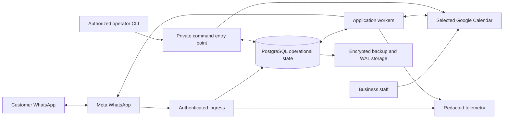
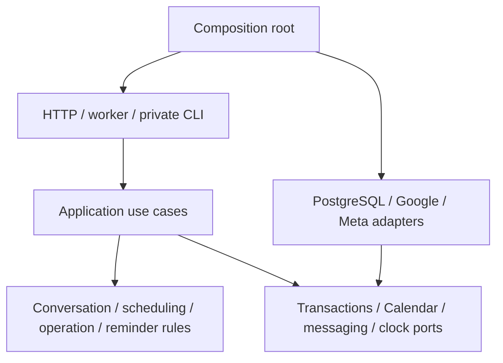
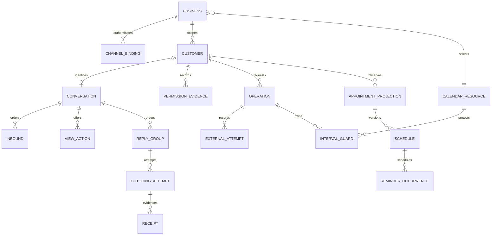
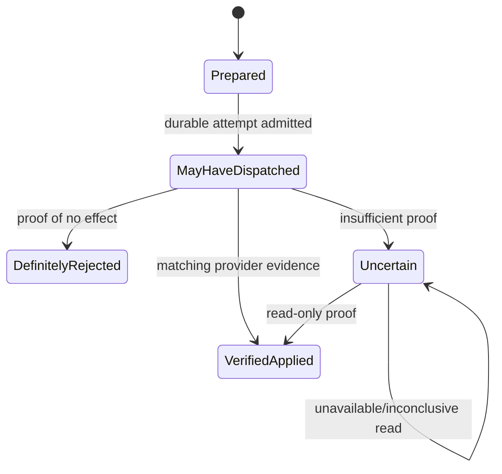
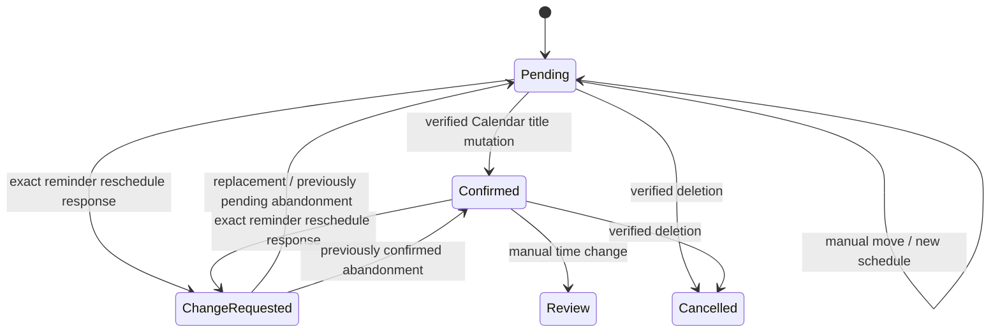

# 02 — Independent greenfield architecture

Status: proposed design, documentation only. Input: the completed [requirements baseline](01-Requirements-Baseline.md), Sections 1–8, and the architecture challenge brief. No application source, tests, database, existing architecture report or linked source evidence was inspected. This document proposes a new system; it makes no claim about the existing implementation. No provider interaction or implementation is authorized here.

## 1. Decision and planning assumptions

Recommend a **modular monolith in strict TypeScript on Node.js LTS, backed by PostgreSQL**, with independently runnable HTTP ingress and background workers from one application artifact. PostgreSQL holds durable inboxes, operations, guards, outboxes and reminder occurrences. Google remains the appointment system of record. Meta remains the authority for message acceptance and delivery evidence. Start without Redis, a message broker, a workflow service or microservices.

This recommendation favors explicit local transactions and inspectable recovery over infrastructure count. It cannot guarantee exactly-once external execution, device delivery or exclusion of independent Calendar writers.

**Proposed planning assumptions, not baseline facts:** an initially modest workload; one operating region chosen after residency review; an operator available to resolve blocked uncertain work; managed infrastructure acceptable to the owner; Windows development with Linux commercial hosting. Tenant volume, capacity, latency, availability, budget, support coverage, RPO/RTO and legal retention remain undecided. These assumptions must be checked before commercial commitment. No SLA is proposed by this document.

The boundary is the accepted product: support, availability, booking, optional management, human handoff records, reminders and attendance. There is no catalog, dashboard, billing, onboarding portal, additional channel or completed/no-show workflow. Historical POC data and formats need no migration. The new version's accepted inputs, operations and messages must survive its own failures and restarts.

## 2. Technology and topology choices

| Decision | Recommendation and reason | Credible alternative; cost of the choice |
| --- | --- | --- |
| Language/runtime | Strict TypeScript, supported Node LTS; good HTTP/provider tooling and one language for adapters and domain code. Validate every external value at runtime; use discriminated unions for outcomes. | C#/.NET is equally credible, particularly for a C# team and Windows expertise. Go offers simple binaries and strong concurrency tooling. Team proficiency should outweigh language novelty. TypeScript needs runtime schemas and discipline around promises. |
| HTTP framework | Fastify, with explicit raw-body signature handling, request limits and schema validation. Keep framework objects outside application/domain code. | Express is sufficient with more middleware conventions; a larger framework adds conventions but more dependency surface. Revisit based on maintainers' experience, not performance marketing. |
| Persistence | Managed PostgreSQL; transactions, composite foreign keys, range exclusion constraints, row locking and point-in-time recovery match the safety requirements. Explicit SQL through a small typed query layer and reviewed migrations. | SQLite is economical for a single-host installation, but operational ownership, failover and multiworker coordination would remain local responsibilities. A document store makes the required cross-record atomicity harder. PostgreSQL adds fixed cost and upgrade work. |
| Jobs | Typed durable work records in PostgreSQL; indexed due-time polling and `SKIP LOCKED` for safe claims. Notifications may wake workers but are never the durable trigger. | Redis queues add another recovery boundary; a workflow engine offers timers/history but substantial operating and learning cost. Adopt either only after measured contention or workflow complexity justifies it. |
| Time | UTC instants plus explicit IANA business timezone; a maintained timezone-aware library/Temporal implementation with pinned and tested timezone data. | Native ad hoc date arithmetic is cheaper initially but too error-prone around civil dates and DST. |
| Deployment | One versioned image, separate ingress/worker process roles, managed database, TLS endpoint, secret storage and encrypted backups. | One small VM is cheaper in direct charges but transfers patching, supervision and restore work to the operator. Serverless ingress is possible; ephemeral timers and local disk cannot hold durable work. |



Ingress can scale separately from slow provider work. A database outage prevents durable acceptance and returns a retryable webhook error. Provider outages normally block affected workflows while ingress remains available. Scale worker counts only within per-Calendar serialization and provider budgets; adding workers cannot accelerate one protected Calendar mutation.

## 3. Module boundaries and dependency direction

| Module | Owns |
| --- | --- |
| Channel boundary | Exact-byte signature verification, challenge response, authenticated receiving-number routing, provider payload parsing and receipt normalization. |
| Conversation | Bounded Spanish grammar, context priority, view revisions, offered actions, human ownership and Spanish presentation. No provider writes. |
| Scheduling | Civil-date interpretation, business hours/breaks/duration/spacing, availability and manageable-appointment rules. |
| Appointment execution | Stable operation identity, Calendar guards, immutable external attempts, reconciliation and conditional finalization. |
| Reminders/attendance | Enrollment, schedule generations, occurrences, targeting, attendance state and template policy. Uses appointment execution for Calendar changes. |
| Delivery | Ordered immutable reply groups, outgoing attempts and monotonic receipt evidence. Never reruns appointment execution to rebuild output. |
| Administration/security | Scoped operator authorization, configuration revisions, permission evidence, audits and recovery procedures. |

Domain rules depend on value types and ports. Application handlers orchestrate rules and transactions. PostgreSQL, Google, Meta, clock and secret adapters implement ports; they depend inward. Composition code alone knows all concrete adapters. Modules cannot write another module's tables directly: a transaction-scoped application unit of work composes the few cross-module commits that must agree. Avoid an event bus that hides required local atomicity.



## 4. Data and authority

Google answers whether an appointment currently exists, when it occurs and which event version exists. An `appointment_projection` records the last verified observation, ownership handles, schedule identity, attendance provenance and synchronization state. It is neither a substitute Calendar nor authority for fresh customer lookup. Platform records are authoritative for accepted requests, attempted effects, permission and execution history.



Each owned relationship carries business scope in composite keys/foreign keys, including customer, action, operation, receipt and event references. Unique constraints cover provider inbound identity within channel, view action identity, operation identity and `(schedule, reminder kind)`. Store original values separately from normalized comparisons. Record received-at, provider-reported time and processing time separately; receipt order is not device-send order.

A conversation can exist for an authenticated business/sender before the customer supplies a valid name. Its registered-customer reference is optional until successful registration; the scoped channel identity is already known. Persisting that provisional conversation/inbound evidence must not silently register a customer or fabricate a name. After validation, bind the scoped customer and selected operation atomically, without asking for the phone again.

A Calendar resource key identifies the actual provider resource across application workers, even if multiple authorized mappings target it. Coordination never grants customer authority across businesses. Store configuration/mapping revision with work; changed routing or capabilities block incompatible saved work instead of reinterpreting it under a new tenant. Immutable audit facts include actor, scope, reason, correlation identifiers and before/after references, without copying secrets into logs.

## 5. Conversations and customer journeys

Use a persisted, versioned state machine and a pure reducer. It produces a proposed state, requested application work and a reply specification. Effects are applied through application handlers. Serialize accepted inputs by conversation sequence; compare the expected conversation revision before committing a result. Concurrent read completion must not reinstall an obsolete view.

```mermaid
stateDiagram-v2
  [*] --> Menu
  Menu --> Browse: book
  Browse --> NeedName: choose time / unknown customer
  Browse --> PendingResult: choose time / known customer
  NeedName --> PendingResult: valid name / same selection
  Menu --> ChooseAppointment: manage
  ChooseAppointment --> Replacement: move owned appointment
  ChooseAppointment --> PendingResult: cancel owned appointment
  Replacement --> PendingResult: choose replacement
  Menu --> Human: handoff
  Human --> Human: ordinary text and actions recorded
  Menu --> Clarify: conflicting intent
  Clarify --> Browse: book selected
  Clarify --> ChooseAppointment: management selected
  Browse --> Menu: Menu
  NeedName --> Menu: Menu
  Browse --> ExpiredView: expired action / recovery guidance
  NeedName --> ExpiredView: expired selection / no registration
  ExpiredView --> Menu: Menu
  ExpiredView --> Browse: fresh booking request
  Replacement --> Menu: Menu / abandon
  Human --> Menu: Menu
  PendingResult --> Menu: Menu; operation survives
```



Opaque random action tokens refer to persisted allowlisted actions: business, customer, channel, view revision, purpose, exact payload and expiry. A token is a lookup handle, not authority. Validate all dimensions, capability and current context on every use. Browsing/name/clarification views default to 15 minutes; renewed views supersede old offers. Consumed execution actions remain linked to their durable operation so repetition resolves that operation instead of creating another. Reminder actions use schedule/start validity, not browsing expiry.

The Spanish menu is **Agendar una cita**, **Reagendar / cancelar**, **Hablar con alguien**. Show a known name and upcoming owned appointments when a fresh lookup succeeds, including when management is disabled. A failed lookup says the check is unavailable; it cannot display a false empty result.

Booking presents two starts and **Más opciones**, then two more and **Elegir fecha**, skipping empty stages. A selected date exposes all valid starts, two per page, with more-times/another-date navigation. Browsing creates no reservation. Known-customer selection immediately submits; an unknown customer supplies a name afterward, then the same selection is rechecked and submitted without another confirmation. Invalid names never register/book. Preserve the baseline's 3–120 normalized-character, letter-containing validation and rejection of any ASCII digit or angle bracket; preserve names that contain intent words.

Management freshly lists owned, upcoming, nonrecurring manageable events. A single move candidate can enter replacement browsing directly; several require selection. Choosing cancellation or a replacement time commits the corresponding operation immediately. Empty management uses exactly `No encontré citas próximas. Si deseas agendar una nueva cita, escribe "cita".`

Priority is explicit withdrawal, global normalized Menu, human ownership, protected entry/pending-operation context, then bounded intent recognition. Human mode stores original text/actions and suppresses appointment automation until Menu; withdrawal still applies. No staff notification or reply delivery is added. Ambiguous intent asks which action to begin; inability-to-attend text uses actual owned appointments and never cancels by inference.

Date grammar implements the baseline's relative days/weeks, qualified weekdays, Spanish month names/abbreviations, day/month with optional four-digit year, and day-only next occurrence. Reject invalid overflow, past, ambiguous and out-of-horizon values with useful guidance. Only a successful empty check permits today's bare weekday to fall forward one week. Render all selectable labels as `mié 23 jun 10:00` in the business timezone, retaining full instants as identity. Enforce ordinary 1–3 buttons/20-character titles, lists of at most ten rows, and separate template limits.

## 6. Calendar execution and concurrency

Availability reads the explicitly authorized selected Calendar, with no `primary` fallback. Fully consume and validate provider responses, including pagination and all-day busy events. Compute candidate starts using weekday hours, breaks, duration, interval, buffer, horizon and business-local dates; appointment plus buffer must fit. Exclude nonexistent local times and elapsed starts. Unsupported overnight hours and recurring management fail validation.

Search completed windows through at most 365 business-calendar days; stop after obtaining the first three available dates and all valid starts on those dates. A proposed 31-day window means at most twelve base queries before pagination, not twelve guaranteed HTTP calls. Direct date selection queries that date. Apply configured call/page/time budgets and per-Calendar rate limits, established by load tests; budget exhaustion, partial or malformed results mean **check unavailable**, never an empty Calendar or a misleading partial answer. Cache only bounded read results with their observation age; execution always rechecks.

**Local transaction boundaries:**

1. **Acceptance:** persist authenticated inbound batch identities, original-content hashes and per-conversation order before acknowledgment. Duplicate identity/content is a no-op; changed content is quarantined, never substituted.
2. **Execution admission:** lock current action/conversation and Calendar guard coordination rows; validate scope/revision/capability, create the stable operation and reserve required ranges. A PostgreSQL exclusion constraint prevents overlapping active guard coverage for the same Calendar. Normalize a single operation's source/target ranges into a union, so its own overlapping move ranges do not conflict with each other. Existing source protection transfers conditionally to that operation rather than being duplicated. Protect target spacing and, for a move, the source reservation until success is proven. No Google call runs inside this SQL transaction.
3. **Attempt admission:** after fresh source/availability checks, persist an immutable external request identity, expected event version, exact effect, dispatch owner and attempt state **before** possible submission. Revalidate guards/configuration. Retain known active app reservations as well as unresolved guards, so stale Google reads cannot admit a conflicting cooperating booking after an earlier success.
4. **Finalization:** conditionally commit verified outcome, latest appointment observation, schedule/attendance changes, reminder invalidation/enrollment, guard transition and reply group together. Compare operation, attempt and schedule generation. A failure rolls back all these local changes. Operator reconciliation uses the same finalizer.

```mermaid
sequenceDiagram
  participant C as Conversation handler
  participant D as PostgreSQL
  participant W as Calendar executor
  participant G as Google
  C->>D: Commit operation + interval protection
  W->>G: Read ownership/version and target availability
  W->>D: Commit immutable attempt before possible dispatch
  W->>G: Submit one recorded conditional mutation
  alt verified effect
    G-->>W: Matching event/version evidence
    W->>D: Atomic outcome + schedule/reminders + reply
  else timeout/crash/ambiguous response
    W->>D: Uncertain; keep protection
    W->>G: Read-only reconciliation of original identity
    Note over W,D: No blind replacement write; absence may be inconclusive
  end
```

A Calendar write gate orders cooperating checks and submissions. Database claim epochs fence **local commits only**; Google does not enforce application lease tokens. Once an attempt may dispatch, a new worker may reconcile it but cannot acquire permission to repeat its write because a lease expired. The original dispatcher owns the sole submission permission for that attempt. Process supervision must establish termination before replacing a dispatcher generation; possibly outstanding requests still retain protection. A worker paused immediately before its HTTP call must not be rendered harmless merely by asserting that its lease expired.

Known-safe pre-submission/transient rejection can permit a separately recorded bounded retry, after proving the previous dispatcher cannot still submit. All ambiguous attempts remain protected. Read-only jobs may use expiring claims safely. Terminal callbacks compare identities/generations and cannot release a successor's guards. Conservative blocks may reduce availability; they are preferable to inventing certainty.

Disable implicit SDK, HTTP-client and proxy retries for Calendar mutations and Meta sends unless a particular response is proven safe under the recorded-attempt policy. One application invocation must not conceal several external submissions.

Booking uses a stable, Google-valid event ID derived from the operation and private metadata identifying application, business/customer, operation and schedule. These aid identity/reconciliation; they do not create a distributed transaction. Set `{Customer Full Name} — Cita` and the required `Cliente`, international `WhatsApp`, `Estado: Reservada`, `Origen: NukMiris WhatsApp` description, with no service field.

Move rereads the same event, validates ownership/version, ignores only its old interval and patches only necessary fields. Use documented conditional writes with the observed ETag; confirm support through provider contracts. Preserve unrelated fields. Cancel targets the selected owned identity once. Attendance writes use the same machinery. If a required conditional guarantee is unavailable, stop/review instead of assuming it exists.

Every move and attendance mutation includes its recorded operation/mutation marker in the same conditional event write, merging rather than replacing unrelated private metadata. Reconciliation checks that marker, owned event identity and expected resulting fields together. Matching target times or title alone cannot prove this attempt applied the change.



An uncertain insert requires matching external identity, ownership and exact times; “not found” alone never authorizes another insert. A move needs event identity, recorded mutation identity and target times. Cancellation can be proven by matching cancelled identity or authoritative 404/410. Historical replay reports the original operation result; current appointment lookup separately rereads Google. Never represent recorded success as a fresh guarantee that the appointment still exists.

An independent writer can insert after the final check. Conditional event writes protect source-version edits, not the entire Calendar's free/busy state. Detect overlap by post-write observation and periodic synchronization, retain evidence and place affected work in review. Do not silently cancel either reservation. Absolute external no-double-booking and the customer/operator resolution policy require a separate agreement.

## 7. Durable transport and ordering

Verify the webhook challenge and signature over exact received bytes before parsing or state mutation. Resolve tenant only from authenticated receiving channel/WABA context; unknown channels have no default tenant. Atomic acceptance includes supported status events. Storage failure returns a retryable error. Limit payload size and redact rejected payload diagnostics.

Use different deduplication semantics for incoming customer messages and delivery statuses. Several valid statuses share one provider message ID: `sent`, `delivered` and `read` must all be retained. Normalize a status event identity from the authorized message/recipient scope, status kind and provider event time/relevant content under the pinned contract; repeated identical facts are idempotent. Never quarantine a legitimate delivery advance merely because its message ID already exists.

Each accepted conversation input has a durable sequence. Handlers commit complete immutable reply groups with results; external operation completion becomes a durable conversation event rather than replaying the original handler. Menu may replace transient views while an uncertain operation remains intact. A pending head-of-line result can have an explicit saved “processing/uncertain” response; subsequent business processing must not reorder committed replies.

Delivery sends group parts in saved order, recording attempts before possible network submission. Do not regenerate content or rerun Calendar writes after interrupted delivery. An uncertain head send blocks later sends until correlated evidence or an explicit operator decision resolves the ordering barrier. A definite permanent failure is recorded and surfaced before advancing policy permits later work.

The sole-dispatcher rule in Section 6 also applies to every Meta reply and reminder send. Polling/claim leases can reassign unarmed work, but an armed, possibly dispatchable attempt is never reassigned on expiry. A paused worker may still send. A replacement can reconcile receipt evidence; it cannot gain a second send permission from a timer, process restart or missing receipt. A fail-stop dispatcher generation and durable attempt identity are required, with explicit unresolved state when termination or acceptance cannot be established.

Unsent ordinary replies expire by the applicable 24-hour customer-service-window deadline; browsing and clarification prompts expire no later than their current sessions. Persist the triggering customer time, receipt time and computed deadline separately, rejecting implausible timestamps under an explicit provider-contract policy. Expired prompts remain history and cease blocking fresh conversation work. An uncertain attempt is not made safe to resend merely because its reply deadline elapsed.

Persist API acceptance, provider message ID, sent, delivered, read and failure facts separately. Retain monotonic receipt evidence despite duplicates/reordering. Receipt absence proves neither non-delivery nor failure. Automatically retry only demonstrably safe transient failures, with attempt/deadline caps and jittered backoff; ambiguous sends stop. A scoped operator can deliberately retry an uncertain message after inspecting a concrete duplication warning, with actor/reason recorded. No exactly-once delivery promise follows.

Receipt correlation must match business, authorized channel, customer recipient, recorded outgoing attempt and provider message identity. A valid webhook signature alone does not authorize attaching its status to an arbitrary tenant or attempt.

## 8. Reminders, permission and attendance

Enrollment requires a verified new managed booking whose intent was created after explicit business activation. No historical import/backfill or premature uncertain enrollment. Finalization and eligible metadata change are one local transaction. Each current schedule has unique occurrences at start minus **168, 24, 22 and 2 elapsed hours**, enrolling only strictly future instants. Follow-up additionally requires its request to have been enrolled. Persist future, attempted, accepted, rejected, uncertain, skipped and previewed facts; restart never resets deadlines.

Workers claim due occurrences, reread Google and validate business/channel/mapping, mode, schedule identity, permission, template contract and start. Submission is allowed from due through fifteen minutes late, strictly before start; older work is skipped. Require the actual template metadata TTL plus a conservative transport budget to fit before start, using caps 900 seconds for seven-day/request/follow-up and 300 for final, within the documented provider range. No invented per-send TTL field. TTL cannot retract delivered messages or guarantee arrival.

Permission is an attributable evidence ledger: scoped identity, occurrence/recording times, source, exact wording, evidence reference and recorder. Booking, channel identity, attendance, notice, approval and activation cannot grant it. Withdrawal works before registration and in human mode; older imported grants cannot override it and evidence references cannot be reused inconsistently. Dispatch admission is serialized with permission changes and rechecked after potentially slow provider checks. An accepted explicit withdrawal establishes a suppression barrier before later proactive admissions. Already admitted/accepted external sends cannot be recalled; never promise otherwise.

A grant requires an already registered customer in that business and a past/current evidence occurrence time. A pre-registration withdrawal is recorded against the authenticated scoped sender identity and must still suppress a later registered relationship; it is not permission to fabricate a customer record.

Live requires verified actual WABA/number and approved Utility assets with matching language (`es_MX` initially), category, exact variables/content/actions and safe TTL. Paused, unavailable, mismatched or otherwise non-approved assets block sending; no proactive free-form fallback. Provider status can still change after a check. Body variables are customer name, business name, full Spanish business-local date and 24-hour time, with no service placeholder and at most 1,024 characters. Preserve these contracts:

| Kind | Spanish body |
| --- | --- |
| Seven-day and final, distinct assets | `Hola {{1}}, te recordamos tu cita en {{2}} el {{3}} a las {{4}}. ¡Te esperamos!` |
| Request | `Hola {{1}}, te recordamos tu cita en {{2}} el {{3}} a las {{4}}. ¿Nos confirmas tu asistencia?` |
| Follow-up | `Hola {{1}}, todavía no recibimos tu confirmación para la cita en {{2}} el {{3}} a las {{4}}. ¿Nos confirmas si podrás asistir?` |

Request/follow-up offer **Sí, confirmo**, then **Necesito reagendar**, within the separate 25-character template-button limit; other kinds have no actions. Follow-up requires correlated **delivered/read** evidence for the current request and no confirmation/change response. Acceptance is insufficient. Final remains eligible after confirmation/nonresponse. Nonresponse never cancels a reservation.

Attendance targets an actually dispatched request and exact business/customer/event/schedule before start. Match quoted provider IDs exactly; invalid/stale/foreign quotes never fall back. Specific tokens retain their dispatched request relationship. Generic supported confirmations/rescheduling text require unambiguous targeting and permitted conversation context; human/protected entry priority still applies. Historical accepted/uncertain visible requests remain potential ambiguity regardless of TTL. Require the existing specific button when uncertain; do not guess the newest appointment.



Confirmation appends ` — Confirmada` once, preserving event identity/time/customer details and owner suffixes. Store provenance for the app-added segment; remove only a provably app-owned segment when resetting after a move. Ambiguous title edits require review. Unknown patches cannot produce a success acknowledgment or a second patch.

Reminder rescheduling opens the exact appointment's ordinary replacement flow, suppresses follow-up and retains original reservation/final reminder. Expiry/abandonment restores prior attendance while preserving response evidence. Successful replacement rotates schedule/action identity, resets pending attendance and invalidates old pending occurrences; create only future ones. Cancellation stops remaining work. Before sends and during bounded periodic observation, detect deletion, unconfirmed manual movement, confirmed manual movement and lost ownership: stop, regenerate or review as the baseline specifies. Observation failure blocks sending.

Off performs no reminder enrollment, processing or sending, including for previously queued occurrences, and preserves history. Dry-run can enroll/observe and persist one preview per occurrence, reporting permission gaps without proactive sends, approval requests or attendance mutations. Live revalidates every send and never activates prerequisites automatically. Re-enabling rechecks current state/deadlines. Booking/move/cancel remain independent. Append exactly `Te enviaremos recordatorios antes de tu cita.` only with live mode, effective permission and future pending work.

## 9. Isolation, operator access and secrets

Use application scope checks plus PostgreSQL row-level security for owned data, with transaction-local business context and a non-owner application role. Connection pooling must not retain tenant context. Composite foreign keys prevent cross-scope references even in background paths. Give global maintenance narrowly separate roles; test those exceptions explicitly. Identifiers and matching phone numbers are never authorization.

Tenant discovery and cross-business due-work discovery are explicit narrow exceptions: a read-only routing lookup resolves a verified channel, and a restricted queue function returns only an eligible work identity and its business. Subsequent work uses the ordinary scoped role and transaction-local context. Avoid giving normal handlers or worker bodies an ambient table-owner/`BYPASSRLS` connection; narrowly privileged functions require a fixed search path, minimal grants and isolation tests.

Provide private CLI commands through an authenticated operator entry point using short-lived identity, MFA and explicit business grants. An operator-supplied business argument selects scope only after authorization. Separate read-only inspection, configuration, permission recording, reconciliation and deliberate risky retry privileges; audit attributable actions. No public administrative/customer portal is added. Read-only diagnostics default to redaction; deliberate customer-data inspection requires the relevant grant.

Store provider refresh tokens encrypted with a managed key/secret service and restrict decryption to the relevant runtime role. Avoid secrets in images, repository, command history and telemetry. Verify actual rights/selected Calendar and channel connectivity, not file presence. OAuth consent uses validated state/PKCE where applicable; failed consent preserves working credentials. Rotate secrets and test restoration separately from database backups.

Offboarding disables new admission, suppresses reminders, blocks dispatch and inventories unresolved operations before revoking provider access. Preserve necessary recovery/audit evidence under an agreed retention policy; do not silently abandon uncertain effects. Revoke operator memberships and cached credentials. Retention, deletion, residency and business staff handling remain owner/legal decisions; safe deletion must account for still-visible message ambiguity and outstanding recovery records.

## 10. Operations, recovery and commercial deployment

Structured telemetry carries business-safe identifiers, inbound/operation/attempt/schedule correlation, configuration revision and error classification. Classify validation, forbidden scope, definite provider rejection, safe transient failure, unknown external outcome and local storage failure. Never log raw names, phone numbers, message bodies or tokens by default. Audit evidence access separately.

Monitor oldest accepted input, outbox head age, uncertain operations/sends, due lag/skips, Calendar review states, provider latency/rate limits, permission/template blocks, database saturation and backup age. Alerts must link to a scoped diagnosis/runbook, with thresholds established from agreed targets. Liveness checks process responsiveness; readiness checks database/schema/configuration. Report provider/capability degradation separately so one disconnected tenant does not make all ingress unhealthy. Readiness does not certify live-provider policy approval.

Version configuration in the database; validate hours/timezone, selected Calendar, provider rights and capability prerequisites before activation. Support/availability must never write appointments; disabled management blocks saved actions; reminders require booking, management, durable delivery and verified routing. There is no commercial non-durable bypass. Deploy reviewed migrations and one compatible application version; drain admissions/dispatch on shutdown, then preserve unfinished attempts. Rollback must not reinterpret armed attempts or erase unknown schema data.

Use managed PostgreSQL backups and continuous WAL archiving, encrypted offsite copies, integrity checks and scheduled isolated restore drills. Backups include operational state, permission evidence, messages and reminder outcomes. Prune only after a newer verified viable copy exists. Credentials/configuration keys need a separate tested recovery plan.

**A restored snapshot is dispatch-quarantined.** Start it isolated with sends/Calendar writes disabled and a new recovery generation; stop old dispatchers. Determine the snapshot-to-incident gap from WAL, surviving logs/audits and provider evidence. Reconcile known attempts read-only using original identities. Do not assume a restored “not attempted” record was never attempted after the snapshot. Google metadata can expose orphaned effects for review but does not justify manufacturing an original request. Meta may provide no proof that a missing send never happened. Where the gap cannot be reconstructed, retain holds and explicit uncertainty; require scoped reviewed recovery decisions before selective resumption. Restoring cannot undo Google writes or retract messages. Data lost beyond the chosen RPO cannot be promised recoverable; the owner must approve that exposure.

If missing gap records prevent identifying an operation, interval or recipient, hold the entire potentially affected Calendar and business dispatch scope; keep the whole restored service quarantined if those scopes are also unknown. Known-record reconciliation alone is insufficient. A new generation number does not fence external providers. Reopening a scope requires recovered evidence or an attributable owner-approved decision accepting the specific unresolved external effects and resulting duplicate/conflict exposure.

For Windows development, use Node LTS and disposable PostgreSQL through Docker Desktop/WSL2 or an isolated development database, fake providers and an injected clock. Never point automated development flows at live accounts. Commercially, propose an always-on managed container/VM runtime plus managed PostgreSQL, TLS, secret management, backup storage and bounded telemetry. A personal PC has sleep, connectivity and power failure modes inconsistent with unattended operation.

At low volume the main fixed charges are application uptime, database, backups and telemetry; variable charges include Meta template messaging, provider usage, storage/egress and operational support. A single application instance lowers charges but extends downtime during failure/deploy; replicas and database standby improve recovery at higher fixed cost. Self-hosting can reduce the invoice while increasing operator labor and on-call risk. Regional redundancy is a separate cost/complexity decision. Use `compute + database/standby + backups + secrets/telemetry + provider usage + support labor` as the budget model; obtain region-specific quotes after volume, retention and recovery targets are agreed. No figures here are current vendor quotes or a committed service level.

## 11. Verification and implementation shape

Test requirements and failure outcomes, not test count. Pure tests cover grammar/name priority, civil dates, schedule math, presentation limits and reducers. Model/state-machine tests generate stale actions, Menu, human ownership and duplicate inputs. PostgreSQL integration tests exercise actual constraints, RLS, transaction rollback, due claims and concurrent competing operations with deliberately stale provider reads.

Use deterministic clocks with explicit midnight/year/DST and exact 168/24/22/2-hour boundaries. Provider simulators control acceptance, malformed pagination, timeouts, delayed commits, ETags, manual writers and reordered receipts. Crash at every local commit/network boundary, restart against the **same** database and verify no second write/send, lost protection or false acknowledgment. Include paused stale workers resuming after claim expiry. Contract tests validate raw signatures, Google identity/conditional-write behavior and Meta payload/template/status contracts against pinned official contracts; separately gated sandbox checks must never be confused with production certification.

End-to-end acceptance covers all Section 7 baseline scenarios, including two businesses sharing a sender, new-name selection becoming busy, unavailable lookup, quoted/generic replies after replacement, withdrawn permission during slow checks, dry-run isolation and restoring a backup predating external side effects. Restore drills assert quarantine and explicitly unresolved gaps. Capacity tests establish worker/provider budgets and deployment sizing after workload targets exist.

Proposed repository structure, created only during a later authorized implementation:

```text
apps/                 http, worker, private operator entry points
modules/              conversation, scheduling, execution, reminders, delivery, administration
ports/                transaction, Calendar, messaging, clock, secrets contracts
adapters/             postgres, google, meta, telemetry
db/migrations/        reviewed schema and constraints
tests/                domain, database, contracts, failure-scenarios, acceptance
ops/                  deployment configuration, runbooks, restore drills
docs/                 requirements and architecture decisions
```

Important interfaces are illustrative pseudocode, not implementation:

```typescript
type Outcome<T> =
  | { kind: "verified"; evidence: T }
  | { kind: "definitelyRejected"; reason: SafeFailure }
  | { kind: "uncertain"; attemptId: AttemptId };

interface Clock { now(): Instant }
interface ConversationRules {
  reduce(state: Conversation, input: ScopedInput, now: Instant): ProposedTransition;
}
interface CalendarPort {
  read(scope: AuthorizedCalendar, query: CompleteQuery): Promise<CheckedCalendarRead>;
  submit(attempt: PersistedExclusiveSubmission): Promise<Outcome<EventEvidence>>;
  reconcile(original: RecordedAttempt): Promise<ReconciliationEvidence>;
}
interface MessagingPort {
  submit(attempt: PersistedExclusiveSubmission): Promise<Outcome<Acceptance>>;
}
interface Transactions {
  acceptAuthenticatedBatch(batch: VerifiedBatch): Promise<AcceptanceReceipt>;
  admitOperation(action: ScopedCurrentAction): Promise<OperationReference>;
  finalizeIfCurrent(proof: VerifiedOperationEvidence): Promise<CommitResult>;
}
```

Only the execution coordinator can construct a persisted submission permission; its name does not imply external fencing. Port outcomes carry evidence instead of a generic success boolean. Application code must not catch an ambiguous transport exception and reclassify it as definitely rejected.

## 12. Unresolved decisions carried forward

| Baseline uncertainty | Conservative proposal / decision still required |
| --- | --- |
| U-NAME / U-COMMAND | Preserve bounded validation and original names; exact navigation commands override entry while multiword intent-containing names remain names. No surname/legal-identity policy added. |
| U-DST | Reject gaps. Proposed conservative fold policy: omit ambiguous repeated wall-clock starts until the owner approves an explicit selectable-instant policy; never silently choose an offset. This is an assumption needing acceptance. |
| U-EXTERNAL | Protect cooperating operations and source versions; detect independent conflicts and hold for review. Agree commercial resolution policy before launch. |
| U-REPLAY | Label replay as the previously recorded operation outcome; fresh lookup separately reports current Google truth. Customer wording needs acceptance. |
| U-ACTIVATION | Use intent-creation-after-activation eligibility, excluding pre-activation intents and backfill. |
| U-GENERIC | Preserve ambiguity from historical accepted/uncertain requests; require existing specific actions when targeting cannot be proved. TTL/age alone never clears ambiguity. |
| U-RETRY | Retain explicitly authorized, audited uncertain-message retry with duplication warning; automation cannot make that decision. |
| U-OPS | Approve hosting/region, capacity, latency/availability objectives, RPO/RTO, retention/deletion/residency, budget, operator grants/offboarding and actual staff handling before commercial readiness is claimed. |

The next phase may record these decisions and assess the existing implementation independently. This proposal authorizes no rebuild, migration or provider change.
