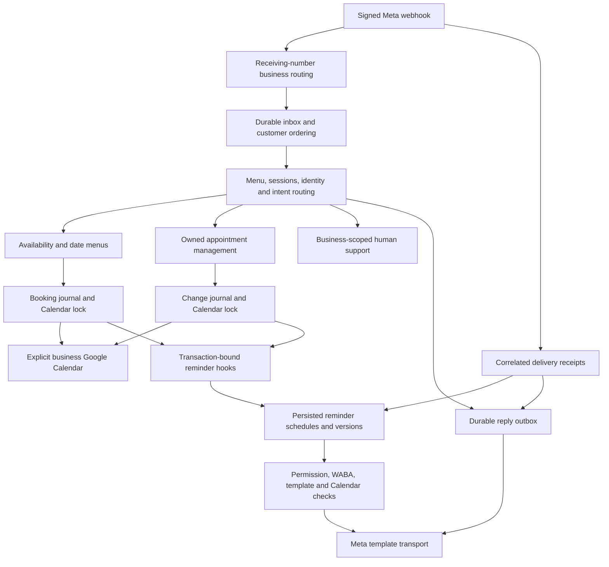

# NukMiris v0.8.0 — Legacy Code Audit and Safe Cleanup Assessment

Audit date: October 26, 2026, America/Mexico_City. **Audit only: no application, test, dependency, schema, configuration, template or customer-data changes are included.** The owner explicitly resumed this assessment after accepting v0.8.0 as the baseline. This report supersedes the earlier, interrupted assessment; it does not authorize cleanup or a merge.

## 1. Executive summary

The supported booking, management and reminder paths use business-scoped modules. The older Calendar implementation remains in `backend/whatsapp-webhook.js`, but seven functions immediately throw, and the dispatcher intercepts old commands, buttons and sessions before the older flow can resume. There is **no supported production path to the old Calendar API calls** in the audited source. This is a source-based conclusion, not an assumption taken from the v0.7.3 walkthrough.

The smallest demonstrably safe future cleanup is **398 physical lines after seven unconditional throws, plus five bindings used only by those dead tails: 403 physical lines in total**. Keep the seven disabling stubs and the active compatibility checks. One additional unused test import binding can be removed without deleting its containing line or the exported function. A separate group of **503 helper-function lines** appears obsolete, but remains **Category B**, because deleting it together with the overlapping dispatcher branches needs stronger compatibility/mode tests. Do not count those lines as approved or safe removals.

Two findings materially affect the assessment:

1. **Services Catalog is absent from this commit.** The task lists service selection and service-specific duration as existing functionality, but source and schema implement business-wide duration only. No service-selection code or tests can be preserved or audited as an implemented feature. Adding a catalog is outside this task.
2. **A reconciliation/reminder integration gap was reproduced with synthetic data.** The standalone booking reconciliation tool constructs the booking service without the reminder commit hook. It can finalize an uncertain booking without enrolling its reminder schedule. This needs separate correctness work and regression tests; it is not authorization to change or remove the reconciliation tool.

All current reminder modules remain necessary, including inactive-looking recovery, approval, permission, receipt and version checks. The two identical seven-day/final template bodies are intentional and must not be consolidated into a single template/job identity.

## 2. Exact baseline, branch and evidence boundaries

| Item | Verified value |
| --- | --- |
| Application version | `0.8.0`, from [package.json:1–9](https://github.com/vanasperena-ux/nukmiris/blob/7215deb6b682d87ab4be086df4dba75fc18c87b4/backend/package.json#L1-L9) |
| Exact audited commit | `7215deb6b682d87ab4be086df4dba75fc18c87b4` |
| Branch at inspection start | Local `work`; its HEAD matched remote `main` at the SHA above |
| Report branch | `audit/v0.8.0-legacy-code`, created from that commit; no merge into `main` |
| Owner-accepted application/test reference | `52b0ded7979480905daca470368cb044618c53a7`, recorded in [BASELINE.md:3–13](https://github.com/vanasperena-ux/nukmiris/blob/7215deb6b682d87ab4be086df4dba75fc18c87b4/backend/BASELINE.md#L3-L13) |
| Changes between accepted source and audited HEAD | Ten Markdown files recording baseline acceptance; **zero application, test, dependency, configuration or version changes** |
| Historical comparison | v0.7.3 owner-verification commit `8368d92c036e514ac399e17cdf5d9dc6c0a32743`; frozen walkthrough source `2d69b6257064982e1b9b295186eb8ff12cfcbbd5` |
| Baseline automated result | 648 passed, 0 failed/cancelled/skipped; 5 suites |
| Actual PC verification | Owner reported all 648 tests passed and supplied the first two-hour reminder preview plus persisted `dry_run: 1`; this is the accepted v0.8.0 baseline |
| Live integration boundary | Live reminder delivery, account approval/TTL responses and attendance-button/Calendar writes are not established by that dry-run acceptance |

The 648-test cloud result was obtained before the interruption against `52b0ded`; its complete application/test tree is identical to the audited commit. That result was verified and reused rather than represented as a new execution at a different source revision. The owner's Windows result is separately recorded in the baseline document. The owner now reports that the WhatsApp access-token issue is resolved; this audit did not inspect tokens or recheck the live account.

Reference documents reviewed: the historical [v0.7.3 walkthrough](NukMiris-v0.7.3-Code-Walkthrough.txt), [baseline record](../../backend/BASELINE.md), [reminder architecture/testing guide](../../backend/REMINDERS.md), [accepted template definitions](../../backend/REMINDER_TEMPLATES.md) and [production compliance review](../../backend/META_COMPLIANCE_REPORT.md). Their historical claims were checked against the current source rather than used as evidence that a function is unreachable.

Scope covered all 102 tracked files: the entry point, 25 libraries, 11 operational scripts, package scripts/dependencies/lockfile, example configuration, 24 test files and five test helpers, fixture schema, documentation, website and archived-handoff provenance. The archive's filenames were inventoried; its historical scripts were not loaded or executed. Untracked local credentials, `.env`, actual databases/backups, installed dependency trees and customer attachments were not audit inputs. No real Google/Meta calls or WhatsApp sends were made. The one additional recovery experiment used only an in-memory synthetic database and file-free mock Calendar events.

Source authority: the current code, the complete import/export and npm-script references, and dispatcher control flow. Every `LEGACY` block in the historical walkthrough was mapped to current source below. Repository-wide searches included source, tests, scripts and prose; searching only the entry point or treating zero test coverage as proof of deadness would be insufficient. No production `eval`, computed module loading or exported access to the private legacy functions was found. Literal `require()` calls, callback injection, factory-returned methods, SQL state strings, regex-dispatched button IDs and lazy `require("open")` were considered. Static searches are not proof about arbitrary external ad hoc scripts or future versions; uncertain API/compatibility cases remain B or C.

## 3. Current architecture and changes since v0.7.3

The compatibility transport remains reachable when reliability is disabled; the diagram shows the accepted durable deployment. Operational scripts are separate entry points and must not be judged unused because the webhook does not import them.

| Concern | Current implementation and proof |
| --- | --- |
| Routing, customer records, sessions, support | [whatsapp-webhook.js:79–218](https://github.com/vanasperena-ux/nukmiris/blob/7215deb6b682d87ab4be086df4dba75fc18c87b4/backend/whatsapp-webhook.js#L79-L218): receiving-number mapping, `AsyncLocalStorage`, business/customer composite lookups and support storage. Development sender-routing is an explicitly supported narrower mode, not the booking default. |
| Availability | [google-calendar.js:52–91](https://github.com/vanasperena-ux/nukmiris/blob/7215deb6b682d87ab4be086df4dba75fc18c87b4/backend/lib/google-calendar.js#L52-L91) reads the explicit business Calendar and settings. [availability-search.js:1–78](https://github.com/vanasperena-ux/nukmiris/blob/7215deb6b682d87ab4be086df4dba75fc18c87b4/backend/lib/availability-search.js#L1-L78) orchestrates 30-day discovery plus 15-day extensions, three target dates and a separate 365-day maximum. [availability.js:12–90](https://github.com/vanasperena-ux/nukmiris/blob/7215deb6b682d87ab4be086df4dba75fc18c87b4/backend/lib/availability.js#L12-L90) enforces hours, duration, intervals, breaks, buffer, busy periods and timezone/DST boundaries. |
| Customer interaction | [availability-menu.js:11–191](https://github.com/vanasperena-ux/nukmiris/blob/7215deb6b682d87ab4be086df4dba75fc18c87b4/backend/lib/availability-menu.js#L11-L191), [appointment-date.js:20–94](https://github.com/vanasperena-ux/nukmiris/blob/7215deb6b682d87ab4be086df4dba75fc18c87b4/backend/lib/appointment-date.js#L20-L94), [intent-recognition.js:3–79](https://github.com/vanasperena-ux/nukmiris/blob/7215deb6b682d87ab4be086df4dba75fc18c87b4/backend/lib/intent-recognition.js#L3-L79), [intent-menu.js:6–27](https://github.com/vanasperena-ux/nukmiris/blob/7215deb6b682d87ab4be086df4dba75fc18c87b4/backend/lib/intent-menu.js#L6-L27), [management-menu.js:10–181](https://github.com/vanasperena-ux/nukmiris/blob/7215deb6b682d87ab4be086df4dba75fc18c87b4/backend/lib/management-menu.js#L10-L181), [slot-label.js:5–13](https://github.com/vanasperena-ux/nukmiris/blob/7215deb6b682d87ab4be086df4dba75fc18c87b4/backend/lib/slot-label.js#L5-L13): two choices, two further choices, date/time selection, Spanish parsing, owned management and consistent labels. |
| Immediate new booking | [whatsapp-webhook.js:1432–1508](https://github.com/vanasperena-ux/nukmiris/blob/7215deb6b682d87ab4be086df4dba75fc18c87b4/backend/whatsapp-webhook.js#L1432-L1508) selects a slot, collects a new customer's name if required and submits the same scoped booking request without an added confirmation question. [booking.js:43–238](https://github.com/vanasperena-ux/nukmiris/blob/7215deb6b682d87ab4be086df4dba75fc18c87b4/backend/lib/booking.js#L43-L238) owns event identity, availability rechecks, journals, locks and ambiguous-write recovery. |
| Rescheduling/cancellation | [appointment-management.js:37–311](https://github.com/vanasperena-ux/nukmiris/blob/7215deb6b682d87ab4be086df4dba75fc18c87b4/backend/lib/appointment-management.js#L37-L311) lists and rereads owned events, checks ETags, journals operations, shares the Calendar lock, preserves unrelated event fields and reconciles uncertain outcomes. The menu calls it directly after selection. |
| Reliable messages | [reliable-delivery.js:11–69](https://github.com/vanasperena-ux/nukmiris/blob/7215deb6b682d87ab4be086df4dba75fc18c87b4/backend/lib/reliable-delivery.js#L11-L69), [reliable-delivery.js:71–291](https://github.com/vanasperena-ux/nukmiris/blob/7215deb6b682d87ab4be086df4dba75fc18c87b4/backend/lib/reliable-delivery.js#L71-L291), [reliable-delivery.js:294–349](https://github.com/vanasperena-ux/nukmiris/blob/7215deb6b682d87ab4be086df4dba75fc18c87b4/backend/lib/reliable-delivery.js#L294-L349): durable deduplication, snapshots, continuation recovery, per-customer ordering, expiry, receipts, bounded transport and explicit retries. |
| v0.8.0 additions | Five new libraries: `appointment-reminders.js`, `reminder-schedule.js`, `reminder-templates.js`, `reminder-menu.js`, `reminder-permissions.js`; `scripts/reminders.js`; six additive reminder/attendance/permission tables; booking/change commit hooks; backup-table coverage; template-button/context/timestamp handling; six reminder test files and two reminder fixtures. |
| Reminder runtime | [appointment-reminders.js:20–118](https://github.com/vanasperena-ux/nukmiris/blob/7215deb6b682d87ab4be086df4dba75fc18c87b4/backend/lib/appointment-reminders.js#L20-L118) enrolls new bookings after activation and handles committed changes. [reminder-schedule.js:6–17](https://github.com/vanasperena-ux/nukmiris/blob/7215deb6b682d87ab4be086df4dba75fc18c87b4/backend/lib/reminder-schedule.js#L6-L17) schedules 168/24/22/2 elapsed-hour offsets only while future. [appointment-reminders.js:129–255](https://github.com/vanasperena-ux/nukmiris/blob/7215deb6b682d87ab4be086df4dba75fc18c87b4/backend/lib/appointment-reminders.js#L129-L255), [appointment-reminders.js:257–448](https://github.com/vanasperena-ux/nukmiris/blob/7215deb6b682d87ab4be086df4dba75fc18c87b4/backend/lib/appointment-reminders.js#L257-L448) implement rechecks, dry-run/live distinction, retries, receipts, confirmation, rescheduling, expiry and recovery. |
| Production safeguards added within v0.8.0 | [reminder-templates.js:5–101](https://github.com/vanasperena-ux/nukmiris/blob/7215deb6b682d87ab4be086df4dba75fc18c87b4/backend/lib/reminder-templates.js#L5-L101), [reminder-permissions.js:3–58](https://github.com/vanasperena-ux/nukmiris/blob/7215deb6b682d87ab4be086df4dba75fc18c87b4/backend/lib/reminder-permissions.js#L3-L58), [appointment-reminders.js:205–255](https://github.com/vanasperena-ux/nukmiris/blob/7215deb6b682d87ab4be086df4dba75fc18c87b4/backend/lib/appointment-reminders.js#L205-L255), [appointment-reminders.js:287–316](https://github.com/vanasperena-ux/nukmiris/blob/7215deb6b682d87ab4be086df4dba75fc18c87b4/backend/lib/appointment-reminders.js#L287-L316): safe template TTL, exact approved Utility definitions per WABA/sender, evidence-backed permission/withdrawal, delivered/read prerequisite for the follow-up, and stale quoted/generic-response protection. |
| Deployment scope | Existing PC/one SQLite runtime; no owner dashboard, service catalog, independent owner-credential onboarding, distributed coordination or always-on hosting is implemented by this release. |

### Services Catalog discrepancy

No `service_id`, service catalog table, service selection state or catalog module exists in the current runtime, scripts or fixture schema. [business-config.js:5–15](https://github.com/vanasperena-ux/nukmiris/blob/7215deb6b682d87ab4be086df4dba75fc18c87b4/backend/lib/business-config.js#L5-L15) reads `appointment_duration_minutes` from business settings; [availability.js:72–80](https://github.com/vanasperena-ux/nukmiris/blob/7215deb6b682d87ab4be086df4dba75fc18c87b4/backend/lib/availability.js#L72-L80) uses that single configured duration. [booking.js:193–210](https://github.com/vanasperena-ux/nukmiris/blob/7215deb6b682d87ab4be086df4dba75fc18c87b4/backend/lib/booking.js#L193-L210) creates customer/phone/status/origin event details with **no placeholder service**. The active rescheduling PATCH preserves the description by omission, but this is not evidence of catalog selection or service-specific duration. The task's catalog expectations therefore describe absent functionality, not dead code to remove. No service-related changes or tests are implemented in this audit.

## 4. Classification and summary inventory

**A**: demonstrably dead or unused, with no required side effect or compatibility duty. **B**: apparently obsolete but requires more verification. **C**: must retain. **D**: functional code suitable only for a separately approved refactor. These classifications apply to the precise regions below, not every line in an enclosing function/file. A future dead-code cleanup must not remove B, C or D code. Tests alone do not silently promote B to A; that requires an updated assessment and owner approval.

### 4.1 Category A — exact dead regions

For A01–A07, remove only the statements/blank lines after the first unconditional throw and before the function's closing brace. Retain the signature, throw/error text and closing brace (C01). These regions cannot execute regardless of flags, input, saved state or Promise resolution. No earlier side effects are being removed.

| ID | File | Lines | Legacy component | Classification | Evidence | Risk | Recommended action |
| --- | --- | --- | --- | --- | --- | --- | --- |
| A01 | `backend/whatsapp-webhook.js` | [whatsapp-webhook.js:244–260](https://github.com/vanasperena-ux/nukmiris/blob/7215deb6b682d87ab4be086df4dba75fc18c87b4/backend/whatsapp-webhook.js#L244-L260) | `connectCalendar` OAuth/client initialization tail | A | Throw at 243; no caller, export or callback reference to this private function. Superseded by `lib/google-calendar.js` and OAuth CLI. | Low if stub retained | Remove 17 lines only after authorization. |
| A02 | Same | [whatsapp-webhook.js:530–545](https://github.com/vanasperena-ux/nukmiris/blob/7215deb6b682d87ab4be086df4dba75fc18c87b4/backend/whatsapp-webhook.js#L530-L545) | `getBusyPeriods` FreeBusy tail | A | Throw at 529; callers are `isFreeOnCalendar` at 552 and `findSlots` at 568. Current FreeBusy is [google-calendar.js:63–79](https://github.com/vanasperena-ux/nukmiris/blob/7215deb6b682d87ab4be086df4dba75fc18c87b4/backend/lib/google-calendar.js#L63-L79). | Low if stub retained | Remove 16 lines. |
| A03 | Same | [whatsapp-webhook.js:632–653](https://github.com/vanasperena-ux/nukmiris/blob/7215deb6b682d87ab4be086df4dba75fc18c87b4/backend/whatsapp-webhook.js#L632-L653) | `findCustomerAppointments` event-list tail | A | Throw at 631; callers at 1177/1201. Current owned lookup is [appointment-management.js:80–108](https://github.com/vanasperena-ux/nukmiris/blob/7215deb6b682d87ab4be086df4dba75fc18c87b4/backend/lib/appointment-management.js#L80-L108). | Low if stub retained | Remove 22 lines. |
| A04 | Same | [whatsapp-webhook.js:740–786](https://github.com/vanasperena-ux/nukmiris/blob/7215deb6b682d87ab4be086df4dba75fc18c87b4/backend/whatsapp-webhook.js#L740-L786) | `createAppointment` old event insertion tail | A | Throw at 739; private caller `selectSlot` at 975. Current insertion is [booking.js:167–222](https://github.com/vanasperena-ux/nukmiris/blob/7215deb6b682d87ab4be086df4dba75fc18c87b4/backend/lib/booking.js#L167-L222). | Low if stub retained | Remove 47 lines; preserve current ownership fields/event format. |
| A05 | Same | [whatsapp-webhook.js:795–875](https://github.com/vanasperena-ux/nukmiris/blob/7215deb6b682d87ab4be086df4dba75fc18c87b4/backend/whatsapp-webhook.js#L795-L875) | `rescheduleAppointment` old PATCH/lock tail | A | Throw at 794; private caller `selectSlot` at 947. Current change service is [appointment-management.js:246–294](https://github.com/vanasperena-ux/nukmiris/blob/7215deb6b682d87ab4be086df4dba75fc18c87b4/backend/lib/appointment-management.js#L246-L294). | Low if stub retained | Remove 81 lines; do not touch shared SQL locks. |
| A06 | Same | [whatsapp-webhook.js:1094–1168](https://github.com/vanasperena-ux/nukmiris/blob/7215deb6b682d87ab4be086df4dba75fc18c87b4/backend/whatsapp-webhook.js#L1094-L1168) | `chooseAppointment` old reread/dispatch tail | A | Throw at 1093; old dispatcher caller at 1783. | Low if stub retained | Remove 75 lines; retain old-button rejection elsewhere. |
| A07 | Same | [whatsapp-webhook.js:1225–1364](https://github.com/vanasperena-ux/nukmiris/blob/7215deb6b682d87ab4be086df4dba75fc18c87b4/backend/whatsapp-webhook.js#L1225-L1364) | `confirmCancellation` old yes/no/delete tail | A | Throw at 1224; old dispatcher caller at 1788. Current delete is [appointment-management.js:270–275](https://github.com/vanasperena-ux/nukmiris/blob/7215deb6b682d87ab4be086df4dba75fc18c87b4/backend/lib/appointment-management.js#L270-L275). | Low if stub retained | Remove 140 lines. |
| A08 | Same | [whatsapp-webhook.js:10–11](https://github.com/vanasperena-ux/nukmiris/blob/7215deb6b682d87ab4be086df4dba75fc18c87b4/backend/whatsapp-webhook.js#L10-L11), [whatsapp-webhook.js:50](https://github.com/vanasperena-ux/nukmiris/blob/7215deb6b682d87ab4be086df4dba75fc18c87b4/backend/whatsapp-webhook.js#L50), [whatsapp-webhook.js:55](https://github.com/vanasperena-ux/nukmiris/blob/7215deb6b682d87ab4be086df4dba75fc18c87b4/backend/whatsapp-webhook.js#L55), [whatsapp-webhook.js:76](https://github.com/vanasperena-ux/nukmiris/blob/7215deb6b682d87ab4be086df4dba75fc18c87b4/backend/whatsapp-webhook.js#L76) | Local imports `authenticate`, `google`; `CALENDAR_ID`, `CREDENTIALS`, `calendar` | A, **only together with/after A01–A07** | All their local consumers are in the seven dead tails. No application operation needs these local bindings once their dead consumers are gone. Active modules/scripts retain their own imports. | Low for these five lines; high if confused with package dependencies | Remove five binding/declaration lines after the tails; retain the six installed dependencies. |
| A09 | `backend/test/dynamic-availability.test.cjs` | [dynamic-availability.test.cjs:8](https://github.com/vanasperena-ux/nukmiris/blob/7215deb6b682d87ab4be086df4dba75fc18c87b4/backend/test/dynamic-availability.test.cjs#L8) | Destructured `selectedDate` import binding | A | Only occurrence in that test file; actual `selectedDate` implementation remains called by booking/management. Other imports on this line are used. | Low | Remove this binding only, not the function, export, module or containing import line. |

### 4.2 Category B — obsolete helpers and their complete local references

All 15 functions below are private to `whatsapp-webhook.js`. The only external prose references to these names, beyond the historical walkthrough, are `startRescheduling` and `startCancellation` in `backend/CALENDAR_DETAILS.md`; they describe disabled helpers. No other tracked JavaScript/CJS source, npm script, test import, callback binding or dynamic lookup calls these functions. Their **local** callers are listed explicitly. They are kept in B because their deletion would ordinarily be bundled with dispatcher simplification, and maintaining every supported mode and persisted-state rejection has not been proven by an exhaustive matrix.

| ID | File | Lines | Legacy component / original purpose | Classification | Evidence: all local callers/references outside definition | Risk | Recommended action |
| --- | --- | --- | --- | --- | --- | --- | --- |
| B01 | `backend/whatsapp-webhook.js` | [whatsapp-webhook.js:267–272](https://github.com/vanasperena-ux/nukmiris/blob/7215deb6b682d87ab4be086df4dba75fc18c87b4/backend/whatsapp-webhook.js#L267-L272) | `formatTime`: fixed-zone, 12-hour legacy display | B | `offerSlots` 677/697/720; `selectSlot` 969/981; `askWhichAppointment` 1046; `offerCancellationConfirmation` 1079; A07 at 1245/1325. Current display uses shared active modules. | Medium if shared-display assumptions are wrong | Retain until legacy caller graph and dispatcher retirement are tested. |
| B02 | Same | [whatsapp-webhook.js:274–276](https://github.com/vanasperena-ux/nukmiris/blob/7215deb6b682d87ab4be086df4dba75fc18c87b4/backend/whatsapp-webhook.js#L274-L276) | `keyFor`: old in-memory slot-lock key | B | `findSlots` 614; `selectSlot` 917. | Medium; do not mistake it for SQL lock identity | Same. |
| B03 | Same | [whatsapp-webhook.js:289–306](https://github.com/vanasperena-ux/nukmiris/blob/7215deb6b682d87ab4be086df4dba75fc18c87b4/backend/whatsapp-webhook.js#L289-L306) | `displayWhatsAppNumber`: old registration display | B | `beginRegistration` 464; `receiveName` 516; A04 at 749. | Medium; identity/display contracts differ | Same; keep actual customer identifiers unchanged. |
| B04 | Same | [whatsapp-webhook.js:367–378](https://github.com/vanasperena-ux/nukmiris/blob/7215deb6b682d87ab4be086df4dba75fc18c87b4/backend/whatsapp-webhook.js#L367-L378) | `slotButtonTitle`: numeric-month old labels | B | `offerSlots` 725; `askWhichAppointment` 1034/1039. Current labels use `slotLabel`. | Low once graph is verified | Same; do not delete `lib/slot-label.js`. |
| B05 | Same | [whatsapp-webhook.js:424–438](https://github.com/vanasperena-ux/nukmiris/blob/7215deb6b682d87ab4be086df4dba75fc18c87b4/backend/whatsapp-webhook.js#L424-L438) | `showManageMenu`: creates `manage_menu` | B | Dispatcher 1776; active management handles `menu:...:manage` earlier and uses `management_menu`. | Medium; old/new state names are similar | Retain until mode/legacy-state matrix passes. |
| B06 | Same | [whatsapp-webhook.js:452–474](https://github.com/vanasperena-ux/nukmiris/blob/7215deb6b682d87ab4be086df4dba75fc18c87b4/backend/whatsapp-webhook.js#L452-L474) | `beginRegistration`: name before old slot search | B | Dispatcher 1765; supported modes intercept `cita` first. Current name collection follows selected slot. | Medium; new-customer regression risk | Retain until new-customer and legacy registration tests prove removal. |
| B07 | Same | [whatsapp-webhook.js:476–522](https://github.com/vanasperena-ux/nukmiris/blob/7215deb6b682d87ab4be086df4dba75fc18c87b4/backend/whatsapp-webhook.js#L476-L522) | `receiveName`: old registration continuation | B | Dispatcher 1797; `registration` is rejected earlier at 1712–1715. Uses active `validateFullName`/customer storage, then old `offerSlots` at 521. | Medium | Retain shared validator/store even if this helper is later reclassified. |
| B08 | Same | [whatsapp-webhook.js:551–558](https://github.com/vanasperena-ux/nukmiris/blob/7215deb6b682d87ab4be086df4dba75fc18c87b4/backend/whatsapp-webhook.js#L551-L558) | `isFreeOnCalendar`: old conflict wrapper | B | A05 at 841; `selectSlot` 934. Always reaches disabling `getBusyPeriods` before returning. | Medium if confused with active checks | Retain until surrounding old selection graph is independently retired. |
| B09 | Same | [whatsapp-webhook.js:564–624](https://github.com/vanasperena-ux/nukmiris/blob/7215deb6b682d87ab4be086df4dba75fc18c87b4/backend/whatsapp-webhook.js#L564-L624) | `findSlots`: eight-day search over `HOURS=[10,11,15]` | B | `offerSlots` at 661; calls disabling `getBusyPeriods` at 568 before its search loop. | Medium; active full-schedule search must remain | Do not substitute or alter `availability-search.js`/`availability.js`. |
| B10 | Same | [whatsapp-webhook.js:660–732](https://github.com/vanasperena-ux/nukmiris/blob/7215deb6b682d87ab4be086df4dba75fc18c87b4/backend/whatsapp-webhook.js#L660-L732) | `offerSlots`: old three-slot messages/states | B | `receiveName` 521; A06 at 1167; `startRescheduling` 1192; dispatcher 1766. | Medium; owns old action/session construction | Includes unused `reply` construction, but assess as one obsolete unit rather than changing messages piecemeal. |
| B11 | Same | [whatsapp-webhook.js:882–1003](https://github.com/vanasperena-ux/nukmiris/blob/7215deb6b682d87ab4be086df4dba75fc18c87b4/backend/whatsapp-webhook.js#L882-L1003) | `selectSlot`: old numbered selection/local locks | B | Dispatcher 1795; old sessions/buttons are intercepted first. Depends on B02/B08 and disabled A04/A05 functions. | High if guards are removed with it | Retain until old inputs are covered across modes; never replace the current immediate booking callback. |
| B12 | Same | [whatsapp-webhook.js:1013–1054](https://github.com/vanasperena-ux/nukmiris/blob/7215deb6b682d87ab4be086df4dba75fc18c87b4/backend/whatsapp-webhook.js#L1013-L1054) | `askWhichAppointment`: old numbered/list choices | B | `startRescheduling` 1188; `startCancellation` 1212. | Medium; current pagination uses `owned:` actions | Retain pending graph verification. |
| B13 | Same | [whatsapp-webhook.js:1056–1090](https://github.com/vanasperena-ux/nukmiris/blob/7215deb6b682d87ab4be086df4dba75fc18c87b4/backend/whatsapp-webhook.js#L1056-L1090) | `offerCancellationConfirmation`: old extra question | B | A06 at 1165; `startCancellation` 1216. | Medium; do not reintroduce this screen | Retain pending graph verification. |
| B14 | Same | [whatsapp-webhook.js:1175–1193](https://github.com/vanasperena-ux/nukmiris/blob/7215deb6b682d87ab4be086df4dba75fc18c87b4/backend/whatsapp-webhook.js#L1175-L1193) | `startRescheduling`: old lookup entry | B | Dispatcher 1770; lookup always throws at 631. Active `managementMenu.handleText` consumes the command first when enabled. | Medium | Retain pending matrix; no operational tool uses it. |
| B15 | Same | [whatsapp-webhook.js:1199–1217](https://github.com/vanasperena-ux/nukmiris/blob/7215deb6b682d87ab4be086df4dba75fc18c87b4/backend/whatsapp-webhook.js#L1199-L1217) | `startCancellation`: old lookup entry | B | Dispatcher 1774; same disabled lookup and active-management interception. | Medium | Same. |
| B16 | Same | [whatsapp-webhook.js:1718–1755](https://github.com/vanasperena-ux/nukmiris/blob/7215deb6b682d87ab4be086df4dba75fc18c87b4/backend/whatsapp-webhook.js#L1718-L1755), [whatsapp-webhook.js:1761–1797](https://github.com/vanasperena-ux/nukmiris/blob/7215deb6b682d87ab4be086df4dba75fc18c87b4/backend/whatsapp-webhook.js#L1761-L1797) | Late legacy regex/validity calculations and fallback dispatch arms | B | Old session rejection and the earlier appointment-action gate make legacy action branches inactive. **The surrounding human-support/menu/unknown-button rejection remains active.** | High; careless block deletion would alter security/UX | Verify and isolate exact dead arms; no wholesale deletion of either cited range. |
| B17 | Same | [whatsapp-webhook.js:51](https://github.com/vanasperena-ux/nukmiris/blob/7215deb6b682d87ab4be086df4dba75fc18c87b4/backend/whatsapp-webhook.js#L51), [whatsapp-webhook.js:233–234](https://github.com/vanasperena-ux/nukmiris/blob/7215deb6b682d87ab4be086df4dba75fc18c87b4/backend/whatsapp-webhook.js#L233-L234) | `HOURS`, `lockedSlots`, `lockedEvents` | B | Used by B09/B11/B13 and A05/A07. `busyCustomers` at 232 and `processedMessages` at 235 are active and excluded. | Medium | Keep until callers are reclassified; never replace/delete database locks. |
| B18 | HTTP test fixtures | [booking-webhook.test.cjs:35](https://github.com/vanasperena-ux/nukmiris/blob/7215deb6b682d87ab4be086df4dba75fc18c87b4/backend/test/booking-webhook.test.cjs#L35), [management-webhook.test.cjs:28](https://github.com/vanasperena-ux/nukmiris/blob/7215deb6b682d87ab4be086df4dba75fc18c87b4/backend/test/management-webhook.test.cjs#L28), [availability-webhook.test.cjs:35](https://github.com/vanasperena-ux/nukmiris/blob/7215deb6b682d87ab4be086df4dba75fc18c87b4/backend/test/availability-webhook.test.cjs#L35) | Retired `NUKMIRIS_LOOKAHEAD_DAYS` fixture settings | B | No current runtime reads this environment key; the explicit ignored-variable regression at [dynamic-availability.test.cjs:168](https://github.com/vanasperena-ux/nukmiris/blob/7215deb6b682d87ab4be086df4dba75fc18c87b4/backend/test/dynamic-availability.test.cjs#L168) is intentional and must remain. | Low/medium; fixture intent could be obscured | Clarify/remove redundant fixture assignments only after checking restoration and test intent. Do not remove injected `lookaheadDays` parameters. |
| B19 | Public factory/module surfaces | [appointment-reminders.js:458–471](https://github.com/vanasperena-ux/nukmiris/blob/7215deb6b682d87ab4be086df4dba75fc18c87b4/backend/lib/appointment-reminders.js#L458-L471), [reliable-delivery.js:311–349](https://github.com/vanasperena-ux/nukmiris/blob/7215deb6b682d87ab4be086df4dba75fc18c87b4/backend/lib/reliable-delivery.js#L311-L349) | Exposed `SUFFIX` key, reminder worker `run`, delivery worker `drain` | B, **exposed members only** | No external repository caller found for these specific public members; their underlying constant/functions are used internally. Lifecycle methods are live. External diagnostics could rely on these surfaces. | Medium contract risk; negligible line saving | Do not remove the constant, functions, factories or exports wholesale. Retain these members unless a separate API review proves retirement safe. |

### 4.3 Category C and D inventory

| ID | File | Lines | Component | Classification | Evidence | Risk | Recommended action |
| --- | --- | --- | --- | --- | --- | --- | --- |
| C01 | `backend/whatsapp-webhook.js` | [whatsapp-webhook.js:242–243](https://github.com/vanasperena-ux/nukmiris/blob/7215deb6b682d87ab4be086df4dba75fc18c87b4/backend/whatsapp-webhook.js#L242-L243), [whatsapp-webhook.js:528–529](https://github.com/vanasperena-ux/nukmiris/blob/7215deb6b682d87ab4be086df4dba75fc18c87b4/backend/whatsapp-webhook.js#L528-L529), [whatsapp-webhook.js:630–631](https://github.com/vanasperena-ux/nukmiris/blob/7215deb6b682d87ab4be086df4dba75fc18c87b4/backend/whatsapp-webhook.js#L630-L631), [whatsapp-webhook.js:738–739](https://github.com/vanasperena-ux/nukmiris/blob/7215deb6b682d87ab4be086df4dba75fc18c87b4/backend/whatsapp-webhook.js#L738-L739), [whatsapp-webhook.js:793–794](https://github.com/vanasperena-ux/nukmiris/blob/7215deb6b682d87ab4be086df4dba75fc18c87b4/backend/whatsapp-webhook.js#L793-L794), [whatsapp-webhook.js:1092–1093](https://github.com/vanasperena-ux/nukmiris/blob/7215deb6b682d87ab4be086df4dba75fc18c87b4/backend/whatsapp-webhook.js#L1092-L1093), [whatsapp-webhook.js:1223–1224](https://github.com/vanasperena-ux/nukmiris/blob/7215deb6b682d87ab4be086df4dba75fc18c87b4/backend/whatsapp-webhook.js#L1223-L1224) | Seven disabling signatures/throws, plus their closing braces | C | Fail-closed boundary remains even if an old caller is accidentally reached. | High if removed without the complete compatibility graph | Preserve in first cleanup; no current authorization to retire them. |
| C02 | Same | [whatsapp-webhook.js:1539–1572](https://github.com/vanasperena-ux/nukmiris/blob/7215deb6b682d87ab4be086df4dba75fc18c87b4/backend/whatsapp-webhook.js#L1539-L1572), [whatsapp-webhook.js:1600–1637](https://github.com/vanasperena-ux/nukmiris/blob/7215deb6b682d87ab4be086df4dba75fc18c87b4/backend/whatsapp-webhook.js#L1600-L1637), [whatsapp-webhook.js:1700–1716](https://github.com/vanasperena-ux/nukmiris/blob/7215deb6b682d87ab4be086df4dba75fc18c87b4/backend/whatsapp-webhook.js#L1700-L1716), [whatsapp-webhook.js:1752–1756](https://github.com/vanasperena-ux/nukmiris/blob/7215deb6b682d87ab4be086df4dba75fc18c87b4/backend/whatsapp-webhook.js#L1752-L1756) | Global menu, human support, disabled-action and obsolete-session/unknown-button guards | C | Actively handle current messages, persisted legacy states and historical buttons; tests exercise them. | High | Retain compact compatibility handling regardless of UI retirement. |
| C03 | Same | [whatsapp-webhook.js:132–218](https://github.com/vanasperena-ux/nukmiris/blob/7215deb6b682d87ab4be086df4dba75fc18c87b4/backend/whatsapp-webhook.js#L132-L218), [whatsapp-webhook.js:308–321](https://github.com/vanasperena-ux/nukmiris/blob/7215deb6b682d87ab4be086df4dba75fc18c87b4/backend/whatsapp-webhook.js#L308-L321), [whatsapp-webhook.js:1432–1508](https://github.com/vanasperena-ux/nukmiris/blob/7215deb6b682d87ab4be086df4dba75fc18c87b4/backend/whatsapp-webhook.js#L1432-L1508), [whatsapp-webhook.js:1681–1697](https://github.com/vanasperena-ux/nukmiris/blob/7215deb6b682d87ab4be086df4dba75fc18c87b4/backend/whatsapp-webhook.js#L1681-L1697) | Business context, sessions, customer registration/name validation, selected-slot binding | C | Current factories and callbacks call these directly. `validateFullName` also has a legacy caller; that does not make it obsolete. | Critical | Preserve composite identity and current registration timing. |
| C04 | Main/menu/service modules | [whatsapp-webhook.js:1474–1508](https://github.com/vanasperena-ux/nukmiris/blob/7215deb6b682d87ab4be086df4dba75fc18c87b4/backend/whatsapp-webhook.js#L1474-L1508), [management-menu.js:108–178](https://github.com/vanasperena-ux/nukmiris/blob/7215deb6b682d87ab4be086df4dba75fc18c87b4/backend/lib/management-menu.js#L108-L178), [booking.js:93–128](https://github.com/vanasperena-ux/nukmiris/blob/7215deb6b682d87ab4be086df4dba75fc18c87b4/backend/lib/booking.js#L93-L128), [booking.js:220–237](https://github.com/vanasperena-ux/nukmiris/blob/7215deb6b682d87ab4be086df4dba75fc18c87b4/backend/lib/booking.js#L220-L237), [appointment-management.js:212–240](https://github.com/vanasperena-ux/nukmiris/blob/7215deb6b682d87ab4be086df4dba75fc18c87b4/backend/lib/appointment-management.js#L212-L240), [appointment-management.js:295–311](https://github.com/vanasperena-ux/nukmiris/blob/7215deb6b682d87ab4be086df4dba75fc18c87b4/backend/lib/appointment-management.js#L295-L311) | `booking:`/`change:` yes/no/retry/status, decline/reconcile, lookup adapter | C | Persisted journal-bound old confirmation buttons and recovery continuations still use them. Current code also uses retry/status. | Critical | Keep despite removal of extra confirmation screens. |
| C05 | Calendar, booking, management | [google-calendar.js:52–91](https://github.com/vanasperena-ux/nukmiris/blob/7215deb6b682d87ab4be086df4dba75fc18c87b4/backend/lib/google-calendar.js#L52-L91), [booking.js:8–238](https://github.com/vanasperena-ux/nukmiris/blob/7215deb6b682d87ab4be086df4dba75fc18c87b4/backend/lib/booking.js#L8-L238), [appointment-management.js:8–311](https://github.com/vanasperena-ux/nukmiris/blob/7215deb6b682d87ab4be086df4dba75fc18c87b4/backend/lib/appointment-management.js#L8-L311) | Explicit mappings, current writes, ownership, requests and SQL locks | C | Live runtime, operational scripts, commit callbacks and tests all reference these. | Critical | No schema, event-ID, ownership, lock or journal cleanup. |
| C06 | Menus/date/intent/messages | [availability-menu.js:11–193](https://github.com/vanasperena-ux/nukmiris/blob/7215deb6b682d87ab4be086df4dba75fc18c87b4/backend/lib/availability-menu.js#L11-L193), [management-menu.js:10–183](https://github.com/vanasperena-ux/nukmiris/blob/7215deb6b682d87ab4be086df4dba75fc18c87b4/backend/lib/management-menu.js#L10-L183), [appointment-date.js:1–94](https://github.com/vanasperena-ux/nukmiris/blob/7215deb6b682d87ab4be086df4dba75fc18c87b4/backend/lib/appointment-date.js#L1-L94), [intent-recognition.js:1–79](https://github.com/vanasperena-ux/nukmiris/blob/7215deb6b682d87ab4be086df4dba75fc18c87b4/backend/lib/intent-recognition.js#L1-L79), [intent-menu.js:1–27](https://github.com/vanasperena-ux/nukmiris/blob/7215deb6b682d87ab4be086df4dba75fc18c87b4/backend/lib/intent-menu.js#L1-L27), [slot-label.js:1–13](https://github.com/vanasperena-ux/nukmiris/blob/7215deb6b682d87ab4be086df4dba75fc18c87b4/backend/lib/slot-label.js#L1-L13), [appointment-messages.js:1–38](https://github.com/vanasperena-ux/nukmiris/blob/7215deb6b682d87ab4be086df4dba75fc18c87b4/backend/lib/appointment-messages.js#L1-L38) | Current availability/management UX, Spanish parsers, formatting and escape text | C | Active routes pass these as callbacks; their input contracts differ. | High | Preserve two-plus-two/date UX, full timestamps and labels; no new question. |
| C07 | Delivery/main | [reliable-delivery.js:11–349](https://github.com/vanasperena-ux/nukmiris/blob/7215deb6b682d87ab4be086df4dba75fc18c87b4/backend/lib/reliable-delivery.js#L11-L349), [whatsapp-webhook.js:98–103](https://github.com/vanasperena-ux/nukmiris/blob/7215deb6b682d87ab4be086df4dba75fc18c87b4/backend/whatsapp-webhook.js#L98-L103), [whatsapp-webhook.js:1371–1387](https://github.com/vanasperena-ux/nukmiris/blob/7215deb6b682d87ab4be086df4dba75fc18c87b4/backend/whatsapp-webhook.js#L1371-L1387), [whatsapp-webhook.js:1845–1877](https://github.com/vanasperena-ux/nukmiris/blob/7215deb6b682d87ab4be086df4dba75fc18c87b4/backend/whatsapp-webhook.js#L1845-L1877) | Durable delivery and explicit compatibility-mode transport/queue/deduplication | C | Reliability is optional; non-durable modes remain tested and unresolved work blocks unsafe fallback. | Critical | Keep both supported modes and their guards; do not purge historical inbox/outbox records. |
| C08 | All reminder modules and hooks | [appointment-reminders.js:20–471](https://github.com/vanasperena-ux/nukmiris/blob/7215deb6b682d87ab4be086df4dba75fc18c87b4/backend/lib/appointment-reminders.js#L20-L471), [reminder-schedule.js:1–112](https://github.com/vanasperena-ux/nukmiris/blob/7215deb6b682d87ab4be086df4dba75fc18c87b4/backend/lib/reminder-schedule.js#L1-L112), [reminder-templates.js:1–101](https://github.com/vanasperena-ux/nukmiris/blob/7215deb6b682d87ab4be086df4dba75fc18c87b4/backend/lib/reminder-templates.js#L1-L101), [reminder-permissions.js:1–58](https://github.com/vanasperena-ux/nukmiris/blob/7215deb6b682d87ab4be086df4dba75fc18c87b4/backend/lib/reminder-permissions.js#L1-L58), [reminder-menu.js:1–53](https://github.com/vanasperena-ux/nukmiris/blob/7215deb6b682d87ab4be086df4dba75fc18c87b4/backend/lib/reminder-menu.js#L1-L53), [whatsapp-webhook.js:121–131](https://github.com/vanasperena-ux/nukmiris/blob/7215deb6b682d87ab4be086df4dba75fc18c87b4/backend/whatsapp-webhook.js#L121-L131), [whatsapp-webhook.js:1906–1926](https://github.com/vanasperena-ux/nukmiris/blob/7215deb6b682d87ab4be086df4dba75fc18c87b4/backend/whatsapp-webhook.js#L1906-L1926) | Scheduling, permission, templates, receipts, attendance, recovery and callback wiring | C | Current v0.8.0 feature, including saved jobs/operations and late status callbacks. Default-off is not deadness. | Critical | Retain every interval, version/token, uncertainty, live gate and existing template contract. |
| C09 | Search/configuration adapters | [google-calendar.js:52–60](https://github.com/vanasperena-ux/nukmiris/blob/7215deb6b682d87ab4be086df4dba75fc18c87b4/backend/lib/google-calendar.js#L52-L60), [appointment-management.js:37–40](https://github.com/vanasperena-ux/nukmiris/blob/7215deb6b682d87ab4be086df4dba75fc18c87b4/backend/lib/appointment-management.js#L37-L40), [appointment-management.js:109–115](https://github.com/vanasperena-ux/nukmiris/blob/7215deb6b682d87ab4be086df4dba75fc18c87b4/backend/lib/appointment-management.js#L109-L115), [availability-menu.js:11–24](https://github.com/vanasperena-ux/nukmiris/blob/7215deb6b682d87ab4be086df4dba75fc18c87b4/backend/lib/availability-menu.js#L11-L24), [management-menu.js:10–12](https://github.com/vanasperena-ux/nukmiris/blob/7215deb6b682d87ab4be086df4dba75fc18c87b4/backend/lib/management-menu.js#L10-L12), [availability.js:46–57](https://github.com/vanasperena-ux/nukmiris/blob/7215deb6b682d87ab4be086df4dba75fc18c87b4/backend/lib/availability.js#L46-L57) | Injected `lookaheadDays`, business policies and low-level default horizon | C | Direct fixtures and callers use injected bounds; the active search passes its explicit policy. | High if shortened discovery or validation results change | Do not confuse retired environment configuration with supported service parameters. |
| C10 | Package and OAuth helpers | [package.json:10–47](https://github.com/vanasperena-ux/nukmiris/blob/7215deb6b682d87ab4be086df4dba75fc18c87b4/backend/package.json#L10-L47), [google-connect.js:6–9](https://github.com/vanasperena-ux/nukmiris/blob/7215deb6b682d87ab4be086df4dba75fc18c87b4/backend/scripts/google-connect.js#L6-L9), [google-connect.js:35–55](https://github.com/vanasperena-ux/nukmiris/blob/7215deb6b682d87ab4be086df4dba75fc18c87b4/backend/scripts/google-connect.js#L35-L55), [booking-oauth.js:3–64](https://github.com/vanasperena-ux/nukmiris/blob/7215deb6b682d87ab4be086df4dba75fc18c87b4/backend/lib/booking-oauth.js#L3-L64) | All six dependencies, override and live authentication paths | C | Every dependency has a live runtime or operational import; `open` is lazy. The UUID override supports an auth dependency. | High | No package/lockfile or scope change; A08 removes local bindings only. |
| C11 | Operational scripts | [package.json:13–36](https://github.com/vanasperena-ux/nukmiris/blob/7215deb6b682d87ab4be086df4dba75fc18c87b4/backend/package.json#L13-L36), [reconcile-booking.js:11–30](https://github.com/vanasperena-ux/nukmiris/blob/7215deb6b682d87ab4be086df4dba75fc18c87b4/backend/scripts/reconcile-booking.js#L11-L30), [reconcile-management.js:11–30](https://github.com/vanasperena-ux/nukmiris/blob/7215deb6b682d87ab4be086df4dba75fc18c87b4/backend/scripts/reconcile-management.js#L11-L30), [reminders.js:15–99](https://github.com/vanasperena-ux/nukmiris/blob/7215deb6b682d87ab4be086df4dba75fc18c87b4/backend/scripts/reminders.js#L15-L99), [inspect-restart.cjs:43–103](https://github.com/vanasperena-ux/nukmiris/blob/7215deb6b682d87ab4be086df4dba75fc18c87b4/backend/scripts/inspect-restart.cjs#L43-L103), [reliability.js:11–56](https://github.com/vanasperena-ux/nukmiris/blob/7215deb6b682d87ab4be086df4dba75fc18c87b4/backend/scripts/reliability.js#L11-L56), [database-backup.js:11–39](https://github.com/vanasperena-ux/nukmiris/blob/7215deb6b682d87ab4be086df4dba75fc18c87b4/backend/scripts/database-backup.js#L11-L39) | Preparation, read-only diagnosis, permissions, retries, reconciliation, backup/restore | C | npm targets and operator guides are entry points. The reconciliation gap is a reason to test/fix separately, not delete. | Critical | Keep every command and its data/credential protections. |
| C12 | Website/archive/reference material | [index.html:1–64](https://github.com/vanasperena-ux/nukmiris/blob/7215deb6b682d87ab4be086df4dba75fc18c87b4/index.html#L1-L64), [privacy.html:1–152](https://github.com/vanasperena-ux/nukmiris/blob/7215deb6b682d87ab4be086df4dba75fc18c87b4/privacy.html#L1-L152), [README.md:1–19](https://github.com/vanasperena-ux/nukmiris/blob/7215deb6b682d87ab4be086df4dba75fc18c87b4/docs/handoffs/README.md#L1-L19) | Public pages, privacy URL, redacted handoff/checksum and frozen walkthrough | C | Public assets and intentionally preserved engineering provenance are not runtime-imported modules. External account URLs cannot be proved unused from imports. | High for public URLs; historical traceability risk | Keep; do not execute archive scripts or edit frozen numbered source. |
| C13 | Metadata/config/tests | [business-config.js:17–58](https://github.com/vanasperena-ux/nukmiris/blob/7215deb6b682d87ab4be086df4dba75fc18c87b4/backend/lib/business-config.js#L17-L58), [booking.js:193–210](https://github.com/vanasperena-ux/nukmiris/blob/7215deb6b682d87ab4be086df4dba75fc18c87b4/backend/lib/booking.js#L193-L210), [appointment-management.js:273–286](https://github.com/vanasperena-ux/nukmiris/blob/7215deb6b682d87ab4be086df4dba75fc18c87b4/backend/lib/appointment-management.js#L273-L286), [reminder-templates.js:5–47](https://github.com/vanasperena-ux/nukmiris/blob/7215deb6b682d87ab4be086df4dba75fc18c87b4/backend/lib/reminder-templates.js#L5-L47), [database-backups.js:7–21](https://github.com/vanasperena-ux/nukmiris/blob/7215deb6b682d87ab4be086df4dba75fc18c87b4/backend/lib/database-backups.js#L7-L21) | Existing private metadata, mappings, templates, backups and synthetic fixtures | C | Metadata ties current events/actions/journals together; fixtures verify compatibility. | Critical | No service placeholders, schema edits, reformatting old events or data removal. |
| D01 | Normalization/date helpers | [whatsapp-webhook.js:280–285](https://github.com/vanasperena-ux/nukmiris/blob/7215deb6b682d87ab4be086df4dba75fc18c87b4/backend/whatsapp-webhook.js#L280-L285), [reliable-delivery.js:55](https://github.com/vanasperena-ux/nukmiris/blob/7215deb6b682d87ab4be086df4dba75fc18c87b4/backend/lib/reliable-delivery.js#L55), [appointment-messages.js:5–15](https://github.com/vanasperena-ux/nukmiris/blob/7215deb6b682d87ab4be086df4dba75fc18c87b4/backend/lib/appointment-messages.js#L5-L15), [reminder-templates.js:25–28](https://github.com/vanasperena-ux/nukmiris/blob/7215deb6b682d87ab4be086df4dba75fc18c87b4/backend/lib/reminder-templates.js#L25-L28) | Similar active recipient and date/time functions | D | Main recipient helper coerces to string; durable helper does not. Full messages and compact labels have different output contracts. | Medium/high if consolidated blindly | Consider contract tests and a separate refactor only; preserve stored Meta identity. |
| D02 | Booking/management/reminder/delivery | [booking.js:65–90](https://github.com/vanasperena-ux/nukmiris/blob/7215deb6b682d87ab4be086df4dba75fc18c87b4/backend/lib/booking.js#L65-L90), [appointment-management.js:64–74](https://github.com/vanasperena-ux/nukmiris/blob/7215deb6b682d87ab4be086df4dba75fc18c87b4/backend/lib/appointment-management.js#L64-L74), [appointment-reminders.js:12–18](https://github.com/vanasperena-ux/nukmiris/blob/7215deb6b682d87ab4be086df4dba75fc18c87b4/backend/lib/appointment-reminders.js#L12-L18), [appointment-reminders.js:42–51](https://github.com/vanasperena-ux/nukmiris/blob/7215deb6b682d87ab4be086df4dba75fc18c87b4/backend/lib/appointment-reminders.js#L42-L51), [reliable-delivery.js:5–10](https://github.com/vanasperena-ux/nukmiris/blob/7215deb6b682d87ab4be086df4dba75fc18c87b4/backend/lib/reliable-delivery.js#L5-L10) | Transaction, ownership and timestamp helpers | D | Similar names conceal different row shapes, clock types, state transitions and lock ownership. | High | Keep per-module semantics; no generic ownership/transaction replacement in dead-code cleanup. |
| D03 | `backend/whatsapp-webhook.js` | [whatsapp-webhook.js:79–238](https://github.com/vanasperena-ux/nukmiris/blob/7215deb6b682d87ab4be086df4dba75fc18c87b4/backend/whatsapp-webhook.js#L79-L238), [whatsapp-webhook.js:1510–1813](https://github.com/vanasperena-ux/nukmiris/blob/7215deb6b682d87ab4be086df4dba75fc18c87b4/backend/whatsapp-webhook.js#L1510-L1813), [whatsapp-webhook.js:1883–1971](https://github.com/vanasperena-ux/nukmiris/blob/7215deb6b682d87ab4be086df4dba75fc18c87b4/backend/whatsapp-webhook.js#L1883-L1971) | Large composition root, stores, dispatcher and lifecycle | D | Active imports, closures, callbacks and startup/close side effects span these regions. | High | Later modularization can be useful, but must preserve callback order, signatures and lifecycle. |
| D04 | CLI preparation/configuration | [business-config.js:17–58](https://github.com/vanasperena-ux/nukmiris/blob/7215deb6b682d87ab4be086df4dba75fc18c87b4/backend/lib/business-config.js#L17-L58), [reminders.js:15–54](https://github.com/vanasperena-ux/nukmiris/blob/7215deb6b682d87ab4be086df4dba75fc18c87b4/backend/scripts/reminders.js#L15-L54), [package.json:13–36](https://github.com/vanasperena-ux/nukmiris/blob/7215deb6b682d87ab4be086df4dba75fc18c87b4/backend/package.json#L13-L36) | Repeated local-env/database/backup selection and operator defaults | D | All are used; safe consolidation requires preserving command-specific modes and backup/mapping guarantees. | Medium | Separate operational refactor only; do not change scopes/default tenants while cleaning dead code. |

## 5. Reassessment of every historical LEGACY block

The walkthrough has **18 marked LEGACY blocks covering 22 private functions**. All remain present in v0.8.0. This table maps historical ranges to current source; old line numbers must not be used to edit the current file. Each component region has one classification in section 4; a historical explanatory block can contain several distinct classified regions.

| Walkthrough block | v0.7.3 original lines | v0.8.0 current region | Assessment |
| --- | --- | --- | --- |
| F01-B12 — connection | 219–243 | [whatsapp-webhook.js:242–261](https://github.com/vanasperena-ux/nukmiris/blob/7215deb6b682d87ab4be086df4dba75fc18c87b4/backend/whatsapp-webhook.js#L242-L261) | A01 tail; C01 stub. |
| F01-B13 — old date/key | 244–258 | [whatsapp-webhook.js:267–276](https://github.com/vanasperena-ux/nukmiris/blob/7215deb6b682d87ab4be086df4dba75fc18c87b4/backend/whatsapp-webhook.js#L267-L276) | B01/B02. |
| F01-B15 — phone display | 268–288 | [whatsapp-webhook.js:289–306](https://github.com/vanasperena-ux/nukmiris/blob/7215deb6b682d87ab4be086df4dba75fc18c87b4/backend/whatsapp-webhook.js#L289-L306) | B03. |
| F01-B18 — button formatter | 348–360 | [whatsapp-webhook.js:367–378](https://github.com/vanasperena-ux/nukmiris/blob/7215deb6b682d87ab4be086df4dba75fc18c87b4/backend/whatsapp-webhook.js#L367-L378) | B04. |
| F01-B20 — management submenu | 405–420 | [whatsapp-webhook.js:424–438](https://github.com/vanasperena-ux/nukmiris/blob/7215deb6b682d87ab4be086df4dba75fc18c87b4/backend/whatsapp-webhook.js#L424-L438) | B05. |
| F01-B22 — name wizard | 429–504 | [whatsapp-webhook.js:452–522](https://github.com/vanasperena-ux/nukmiris/blob/7215deb6b682d87ab4be086df4dba75fc18c87b4/backend/whatsapp-webhook.js#L452-L522) | B06/B07; active shared name validator is C03. |
| F01-B23 — busy/free helpers | 505–540 | [whatsapp-webhook.js:528–558](https://github.com/vanasperena-ux/nukmiris/blob/7215deb6b682d87ab4be086df4dba75fc18c87b4/backend/whatsapp-webhook.js#L528-L558) | A02 tail, C01 stub, B08 wrapper. |
| F01-B24 — old slot search | 541–606 | [whatsapp-webhook.js:564–624](https://github.com/vanasperena-ux/nukmiris/blob/7215deb6b682d87ab4be086df4dba75fc18c87b4/backend/whatsapp-webhook.js#L564-L624) | B09. |
| F01-B25 — old appointment query | 607–636 | [whatsapp-webhook.js:630–654](https://github.com/vanasperena-ux/nukmiris/blob/7215deb6b682d87ab4be086df4dba75fc18c87b4/backend/whatsapp-webhook.js#L630-L654) | A03 tail; C01 stub. |
| F01-B26 — offers | 637–714 | [whatsapp-webhook.js:660–732](https://github.com/vanasperena-ux/nukmiris/blob/7215deb6b682d87ab4be086df4dba75fc18c87b4/backend/whatsapp-webhook.js#L660-L732) | B10. |
| F01-B27 — insertion | 715–769 | [whatsapp-webhook.js:738–787](https://github.com/vanasperena-ux/nukmiris/blob/7215deb6b682d87ab4be086df4dba75fc18c87b4/backend/whatsapp-webhook.js#L738-L787) | A04 tail; C01 stub. |
| F01-B28 — movement | 770–858 | [whatsapp-webhook.js:793–876](https://github.com/vanasperena-ux/nukmiris/blob/7215deb6b682d87ab4be086df4dba75fc18c87b4/backend/whatsapp-webhook.js#L793-L876) | A05 tail; C01 stub. |
| F01-B29 — selection | 859–985 | [whatsapp-webhook.js:882–1003](https://github.com/vanasperena-ux/nukmiris/blob/7215deb6b682d87ab4be086df4dba75fc18c87b4/backend/whatsapp-webhook.js#L882-L1003) | B11. |
| F01-B30 — appointment list | 986–1036 | [whatsapp-webhook.js:1013–1054](https://github.com/vanasperena-ux/nukmiris/blob/7215deb6b682d87ab4be086df4dba75fc18c87b4/backend/whatsapp-webhook.js#L1013-L1054) | B12. |
| F01-B31 — cancellation question | 1037–1072 | [whatsapp-webhook.js:1056–1090](https://github.com/vanasperena-ux/nukmiris/blob/7215deb6b682d87ab4be086df4dba75fc18c87b4/backend/whatsapp-webhook.js#L1056-L1090) | B13. |
| F01-B32 — choose old appointment | 1073–1152 | [whatsapp-webhook.js:1092–1169](https://github.com/vanasperena-ux/nukmiris/blob/7215deb6b682d87ab4be086df4dba75fc18c87b4/backend/whatsapp-webhook.js#L1092-L1169) | A06 tail; C01 stub. |
| F01-B33 — management entry points | 1153–1199 | [whatsapp-webhook.js:1175–1217](https://github.com/vanasperena-ux/nukmiris/blob/7215deb6b682d87ab4be086df4dba75fc18c87b4/backend/whatsapp-webhook.js#L1175-L1217) | B14/B15. |
| F01-B34 — cancellation processor | 1200–1347 | [whatsapp-webhook.js:1223–1365](https://github.com/vanasperena-ux/nukmiris/blob/7215deb6b682d87ab4be086df4dba75fc18c87b4/backend/whatsapp-webhook.js#L1223-L1365) | A07 tail; C01 stub. |

### Why no supported mode reaches old Calendar I/O

The accepted modes are validated at [whatsapp-webhook.js:59–68](https://github.com/vanasperena-ux/nukmiris/blob/7215deb6b682d87ab4be086df4dba75fc18c87b4/backend/whatsapp-webhook.js#L59-L68). Their service construction is fixed at [whatsapp-webhook.js:116–131](https://github.com/vanasperena-ux/nukmiris/blob/7215deb6b682d87ab4be086df4dba75fc18c87b4/backend/whatsapp-webhook.js#L116-L131), rather than selected by customer-controlled text. [whatsapp-webhook.js:1964–1971](https://github.com/vanasperena-ux/nukmiris/blob/7215deb6b682d87ab4be086df4dba75fc18c87b4/backend/whatsapp-webhook.js#L1964-L1971) exports only `app`, `start` and `close`; none of the 22 private legacy functions is exported. Existing test fixtures import the runtime and mock service/transport boundaries, not private legacy helper names.

| Mode/configuration | What happens before the late legacy branches |
| --- | --- |
| `support` | The `isAppointmentAction` gate rejects appointment commands and old booking/management actions as paused. Human support and main menu remain live. |
| `availability` | `cita`/`horarios` and a current main-menu booking button go to `availabilityFlow`; no booking write service exists. Unsupported management actions are rejected. |
| `booking`, management disabled | Booking commands/buttons use active availability and booking modules. Rescheduling/cancellation are rejected; menu details use the read-only lookup adapter. |
| `booking`, management enabled | Booking uses the current flow; management commands/buttons are consumed by `managementMenu.handleText`/`handleInteractive` before the legacy fallback. |
| Reminders off/dry-run/live | Reminder text interception recognizes confirmation/reschedule responses, not `cita`; current reminder callbacks never call old Calendar helpers. Non-off reminders require booking, management, reliability and receiving-number routing. |
| Reliability disabled/enabled | This changes queue/transport and recovery handling, not the old Calendar implementation. Unresolved durable work prevents unsafe compatibility startup. Booking still requires receiving-number routing. |

Exact gates: [whatsapp-webhook.js:1573–1599](https://github.com/vanasperena-ux/nukmiris/blob/7215deb6b682d87ab4be086df4dba75fc18c87b4/backend/whatsapp-webhook.js#L1573-L1599), [whatsapp-webhook.js:1600–1637](https://github.com/vanasperena-ux/nukmiris/blob/7215deb6b682d87ab4be086df4dba75fc18c87b4/backend/whatsapp-webhook.js#L1600-L1637), [whatsapp-webhook.js:1638–1670](https://github.com/vanasperena-ux/nukmiris/blob/7215deb6b682d87ab4be086df4dba75fc18c87b4/backend/whatsapp-webhook.js#L1638-L1670), [whatsapp-webhook.js:1712–1756](https://github.com/vanasperena-ux/nukmiris/blob/7215deb6b682d87ab4be086df4dba75fc18c87b4/backend/whatsapp-webhook.js#L1712-L1756). Saved `book`, `reschedule`, `cancel`, `choose_cancel`, `choose_reschedule`, `registration` and `manage_menu` states are deleted/rejected before their former dispatch arms. Old `book:`, `reschedule:`, `appointment:` and `cancel:` actions are intercepted earlier. Current `booking:`, `change:`, `owned:`, `availability:` and `reminder:` payloads are separate protocols and must remain.

Even an accidental call to one of the old writer/read entry functions encounters an unconditional error before Google I/O. The global `calendar` binding has no reachable initialization. Removing a disabling throw or substituting the modern client into an old helper would **enable different behavior** and is explicitly excluded from cleanup.

### Calendar constants and timezone findings

`CALENDAR_ID="primary"` is obsolete only in the main module's dead tails (A08). The active adapter and configuration writer explicitly reject `primary`: [google-calendar.js:59–62](https://github.com/vanasperena-ux/nukmiris/blob/7215deb6b682d87ab4be086df4dba75fc18c87b4/backend/lib/google-calendar.js#L59-L62), [business-config.js:17–21](https://github.com/vanasperena-ux/nukmiris/blob/7215deb6b682d87ab4be086df4dba75fc18c87b4/backend/lib/business-config.js#L17-L21). Active FreeBusy, reads, inserts, patches and deletes take the stored business Calendar ID. There is no fallback to the old constant in the supported path.

`HOURS=[10,11,15]` belongs to B09; current availability walks the configured opening/closing range and `startIntervalMinutes`. The fixed `ZONE` at [whatsapp-webhook.js:49](https://github.com/vanasperena-ux/nukmiris/blob/7215deb6b682d87ab4be086df4dba75fc18c87b4/backend/whatsapp-webhook.js#L49) is **not an A candidate**: the explicit development-routing fallback still uses it at [whatsapp-webhook.js:132–139](https://github.com/vanasperena-ux/nukmiris/blob/7215deb6b682d87ab4be086df4dba75fc18c87b4/backend/whatsapp-webhook.js#L132-L139). Current receiving-number booking/date/reminder paths derive timezone from business settings. Retire that development default only in a separate compatibility decision. Likewise, an operational CLI's default business selection is not the runtime's receiving-business identity; do not replace the signed mapping with an environment default.

## 6. Persisted-state and compatibility dependencies

| Stored state or historical action | Current protection and compatibility duty | Retirement condition |
| --- | --- | --- |
| `registration`, `book`, `reschedule`, `cancel`, `choose_cancel`, `choose_reschedule`, `manage_menu` | C02 rejects these states; Menu can clear them safely. Their old producing functions are B, not a reason to delete their consumer guards. | Reclassify obsolete producers/dispatch arms only after the full mode/state/input matrix. Keep a small rejecting handler for remaining records and old messages. |
| `booking_confirm` | [whatsapp-webhook.js:1700–1704](https://github.com/vanasperena-ux/nukmiris/blob/7215deb6b682d87ab4be086df4dba75fc18c87b4/backend/whatsapp-webhook.js#L1700-L1704) rejects arbitrary text instead of treating it as permission to book. Global Menu runs first. | Keep fail-closed behavior while old rows/backups may contain this state; absence from new flows is insufficient. |
| `management_confirm` | [management-menu.js:172–175](https://github.com/vanasperena-ux/nukmiris/blob/7215deb6b682d87ab4be086df4dba75fc18c87b4/backend/lib/management-menu.js#L172-L175) consumes text without changing an appointment; journal-bound `change:` buttons are still interpreted separately. | Requires evidence about saved journals and historical actions; retain protection in an A-only cleanup. |
| Old `book:`, `reschedule:`, `appointment:`, `cancel:` buttons | Earlier disabled-action handling prevents writes; generic invalid-option handling also remains necessary. | WhatsApp messages may outlive sessions indefinitely. Permanent rejection can be small; expiration alone does not justify accepting or ignoring an unknown action without review. |
| `booking:<request>:yes/no/retry/status` | Scoped request lookup, expiry/decline, idempotency and reconciliation. This includes historical confirmation buttons and current recovery buttons. | Do not retire in this task. A UI confirmation screen being gone does not make its request protocol dead. |
| `change:<request>:yes/no/retry/status` | [management-menu.js:141–151](https://github.com/vanasperena-ux/nukmiris/blob/7215deb6b682d87ab4be086df4dba75fc18c87b4/backend/lib/management-menu.js#L141-L151) deliberately preserves prior journal-bound confirmation buttons. | Same; no conversion to new requests, no bypass of ownership checks. |
| `booking_result`, `management_result`, operation continuations | Duplicate selections and restarts reuse the saved request; late reads cannot release a newer lock. | These are current states; retain. |
| Reminder jobs/attempts/attendance operations and action tokens | Accepted, uncertain and old-version records can receive later signed statuses. Version/ownership/context checks prevent stale messages acting on a replacement. | Retain records and recovery semantics. A completed dry-run job must never replay as a live send. Any eventual retention/migration design is separate work. |
| Pre-compliance inbox JSON/hash | [reliable-delivery.js:143–154](https://github.com/vanasperena-ux/nukmiris/blob/7215deb6b682d87ab4be086df4dba75fc18c87b4/backend/lib/reliable-delivery.js#L143-L154) deduplicates old messages lacking newly preserved context/timestamp fields. | Requires an explicit data/backups retention policy and migration evidence, not a search for current producers. |

No live database was queried to claim that these historical states are absent. Retirement evidence would need owner-authorized aggregate checks, restored-copy compatibility tests and agreement about the oldest supported data/protocol. It must not require deleting real rows or rewriting old WhatsApp messages. Restored backups can bring old records back; rollback compatibility is part of the decision.

## 7. Estimated removable lines

These are **physical source lines, including comments/blanks inside the specified regions**, not executable statements or a coverage percentage. Counts were calculated from exact non-overlapping ranges at the audited SHA.

| Group | Estimate | Interpretation |
| --- | --- | --- |
| A01–A07 | 398 lines | `17 + 16 + 22 + 47 + 81 + 75 + 140`; retain seven signatures/throws/closing braces. |
| A08 | 5 lines | Two main-module imports and three declarations; remove only after the dead consumers. |
| A09 | One imported name | `selectedDate` shares a line with used imports; **zero guaranteed full-line saving**. |
| First A-only cleanup total | **403 physical lines + one binding** | Main file would shrink from 1,971 to approximately 1,568 lines before optional blank/comment tidying. No tidy-up is assumed or authorized. |
| B01–B15 | 503 function lines | Separate from the 398 dead tails. **Excluded** from safe removal; testing/reassessment could still require small replacement adapters. |
| B16–B19 | Not included in removal total | Overlapping live dispatcher ranges, three supporting globals, fixture settings and public API members. Whole-range deletion or double-counting would overstate savings. |
| C / D | 0 safe removable lines | Retain; a smaller file or fewer branches is not proof of equivalent behavior. |

## 8. Security and reliability findings

These are findings, not implemented corrections. Severity describes potential operational impact under the stated conditions; this is not a production penetration test or certification. None authorizes schema, authentication, infrastructure or scheduling changes.

| ID / priority | Finding and actual evidence | Consequence / boundary | Required separate action |
| --- | --- | --- | --- |
| R01 — high reliability | [reconcile-booking.js:21–25](https://github.com/vanasperena-ux/nukmiris/blob/7215deb6b682d87ab4be086df4dba75fc18c87b4/backend/scripts/reconcile-booking.js#L21-L25) constructs `createBookingService` without `onCommitted`; [booking.js:43–46](https://github.com/vanasperena-ux/nukmiris/blob/7215deb6b682d87ab4be086df4dba75fc18c87b4/backend/lib/booking.js#L43-L46) defaults the hook to a no-op. The running app supplies the reminder hook at [whatsapp-webhook.js:125–131](https://github.com/vanasperena-ux/nukmiris/blob/7215deb6b682d87ab4be086df4dba75fc18c87b4/backend/whatsapp-webhook.js#L125-L131). A synthetic uncertain-insert/reconciliation experiment finalized the request as confirmed using the CLI-style service construction while `appointment_attendance` remained absent. | An otherwise eligible booking finalized through this operator path can miss its reminder enrollment. A later normal `confirm` returns an already-confirmed result and does not replay the terminal hook. This does not invalidate the owner's normal-path dry-run result. | Add CLI/reminder integration regressions and propose a separately authorized correctness fix. `reconcile-management.js` similarly omits the hook; test cancellation/reschedule/confirmed-attendance cases before claiming those paths fully reminder-aware. Only the booking case was reproduced here. |
| R02 — medium operational reliability | [reliable-delivery.js:183–205](https://github.com/vanasperena-ux/nukmiris/blob/7215deb6b682d87ab4be086df4dba75fc18c87b4/backend/lib/reliable-delivery.js#L183-L205), [reliable-delivery.js:250–291](https://github.com/vanasperena-ux/nukmiris/blob/7215deb6b682d87ab4be086df4dba75fc18c87b4/backend/lib/reliable-delivery.js#L250-L291), [reliable-delivery.js:294–349](https://github.com/vanasperena-ux/nukmiris/blob/7215deb6b682d87ab4be086df4dba75fc18c87b4/backend/lib/reliable-delivery.js#L294-L349): a definitive failed reply blocks later messages for that customer until explicit retry/expiry processing. A returned `failed` result does not invoke the worker's exception-only `onError` callback. Startup verifies Google but does not call the Meta access checker. | A Meta 401 can look like a silent booking failure, even though availability and reply construction succeeded. This matches the previously diagnosed incident; the owner now reports the token issue resolved. | Preserve ordering/idempotency. Separately consider sanitized actionable failure logging/readiness checks, with 401→credential correction→scoped retry and expired-prompt tests. Do not bypass the queue. |
| R03 — high before independent multi-owner deployment | [whatsapp-webhook.js:38–40](https://github.com/vanasperena-ux/nukmiris/blob/7215deb6b682d87ab4be086df4dba75fc18c87b4/backend/whatsapp-webhook.js#L38-L40), [whatsapp-webhook.js:121–131](https://github.com/vanasperena-ux/nukmiris/blob/7215deb6b682d87ab4be086df4dba75fc18c87b4/backend/whatsapp-webhook.js#L121-L131), [google-calendar.js:16–35](https://github.com/vanasperena-ux/nukmiris/blob/7215deb6b682d87ab4be086df4dba75fc18c87b4/backend/lib/google-calendar.js#L16-L35): shared environment Meta token and shared local Google authorization; database mappings scope business calendars and senders. [reminder-templates.js:67–96](https://github.com/vanasperena-ux/nukmiris/blob/7215deb6b682d87ab4be086df4dba75fc18c87b4/backend/lib/reminder-templates.js#L67-L96) checks WABA membership/approval but does not provide independent credential onboarding. | Current isolation checks are real, but this is not independent owner authorization/offboarding or a hosted tenant credential vault. No cross-business data leak was established by this audit. | Treat independent owner credentials, access control and offboarding as separately designed work. Do not delete existing scoping because infrastructure is shared. |
| R04 — medium schema assurance | [schema.sql:63–77](https://github.com/vanasperena-ux/nukmiris/blob/7215deb6b682d87ab4be086df4dba75fc18c87b4/backend/test/fixtures/schema.sql#L63-L77) declares separate support-conversation business/customer foreign keys, not a composite business/customer constraint. [whatsapp-webhook.js:179–213](https://github.com/vanasperena-ux/nukmiris/blob/7215deb6b682d87ab4be086df4dba75fc18c87b4/backend/whatsapp-webhook.js#L179-L213) supplies scoped application lookups. Booking/reminder tables have stronger composite identities. | Application scoping protects normal calls; the fixture schema alone cannot prevent a mismatched support customer reference written through another path. Actual PC schema/data was not inspected. | Verify schema provenance and add a synthetic negative integrity test before any future schema work. No migration is proposed as part of dead-code cleanup. |
| R05 — medium availability/fairness | [reliable-delivery.js:311–349](https://github.com/vanasperena-ux/nukmiris/blob/7215deb6b682d87ab4be086df4dba75fc18c87b4/backend/lib/reliable-delivery.js#L311-L349) drains work serially; [appointment-reminders.js:424–448](https://github.com/vanasperena-ux/nukmiris/blob/7215deb6b682d87ab4be086df4dba75fc18c87b4/backend/lib/appointment-reminders.js#L424-L448) bounds work by item count and [appointment-reminders.js:458–469](https://github.com/vanasperena-ux/nukmiris/blob/7215deb6b682d87ab4be086df4dba75fc18c87b4/backend/lib/appointment-reminders.js#L458-L469) reschedules after completion. Main compatibility transport at [whatsapp-webhook.js:331–348](https://github.com/vanasperena-ux/nukmiris/blob/7215deb6b682d87ab4be086df4dba75fc18c87b4/backend/whatsapp-webhook.js#L331-L348) has no explicit AbortSignal; several booking/management API reads/writes also have no explicit timeout option, unlike timed availability/reminder calls. | A slow provider can delay unrelated work or push reminders past the agreed window. The audit did not establish library-default timeouts or demonstrate an outage on the current PC. Ten items per batch is not a throughput guarantee. | Add slow/hung-provider, fairness and scheduling tests before separately changing deadlines/concurrency. Preserve uncertain-send/write handling. |
| R06 — medium privacy/observability | [appointment-reminders.js:20–22](https://github.com/vanasperena-ux/nukmiris/blob/7215deb6b682d87ab4be086df4dba75fc18c87b4/backend/lib/appointment-reminders.js#L20-L22), [appointment-reminders.js:243–249](https://github.com/vanasperena-ux/nukmiris/blob/7215deb6b682d87ab4be086df4dba75fc18c87b4/backend/lib/appointment-reminders.js#L243-L249), [reminders.js:79–92](https://github.com/vanasperena-ux/nukmiris/blob/7215deb6b682d87ab4be086df4dba75fc18c87b4/backend/scripts/reminders.js#L79-L92) intentionally expose customer fields in local preview/status output; [inspect-restart.cjs:43–98](https://github.com/vanasperena-ux/nukmiris/blob/7215deb6b682d87ab4be086df4dba75fc18c87b4/backend/scripts/inspect-restart.cjs#L43-L98) offers a redacted diagnostic alternative. | Local logs/reports need appropriate access and retention if later hosted. This report contains no actual customer values or credentials. | Prefer scoped/redacted diagnostics for support; design retention/access policy separately. Do not remove identity fields needed for sending/ownership. |
| R07 — medium scaling/recovery boundary | [reliable-delivery.js:79–90](https://github.com/vanasperena-ux/nukmiris/blob/7215deb6b682d87ab4be086df4dba75fc18c87b4/backend/lib/reliable-delivery.js#L79-L90), [database-backups.js:31–84](https://github.com/vanasperena-ux/nukmiris/blob/7215deb6b682d87ab4be086df4dba75fc18c87b4/backend/lib/database-backups.js#L31-L84), [whatsapp-webhook.js:1883–1932](https://github.com/vanasperena-ux/nukmiris/blob/7215deb6b682d87ab4be086df4dba75fc18c87b4/backend/whatsapp-webhook.js#L1883-L1932): one local runtime owner, local backups and PC timers. No distributed queue/lease or hosting exists. | Separate database copies cannot coordinate bookings/reminders; an offline PC cannot run a scheduled job. This is a known accepted prototype boundary. | Preserve singleton ownership and backups. Future hosting/scaling requires explicit design and tests; do not replace this safety boundary with a process-local legacy lock. |
| R08 — maintenance / low immediate exploitability | The obsolete broad Calendar OAuth path and global `primary` tail remain visible in source (A01/A08), while [google-connect.js:35–55](https://github.com/vanasperena-ux/nukmiris/blob/7215deb6b682d87ab4be086df4dba75fc18c87b4/backend/scripts/google-connect.js#L35-L55) and [booking-oauth.js:10–60](https://github.com/vanasperena-ux/nukmiris/blob/7215deb6b682d87ab4be086df4dba75fc18c87b4/backend/lib/booking-oauth.js#L10-L60) provide active scope-checked authorization. | Dead code can mislead future maintainers into re-enabling an unsafe path, but it is currently unreachable. Removing it does not revoke or narrow already-granted OAuth access. | Prefer the A-only tail/binding cleanup. Retain the active availability authenticator, booking OAuth/PKCE and existing-grant compatibility. |

### Reproducible R01 experiment, without live systems

The experiment reused `test/helpers/reminder-fixture.cjs`: create one future synthetic intent after activation; let the mock insert store the event, then raise a synthetic 503; make verification reads fail so the request remains `uncertain`; restore mock reads; construct `createBookingService({db, availability, enabled:true, getClient: mock})` with the same omitted callback as the CLI; call `reconcile`. Assertions passed for `status === "confirmed"` and absent reminder tracking. The database was in memory and closed afterward. No new test/source file was added. This proves the service-construction gap, not an executed live CLI incident.

## 9. Existing tests, gaps and validation boundaries

The existing full suite has **648 passing tests**, including 540 earlier regressions plus reminder/compliance cases. Source inspection of these tests supports the distinctions below; no statement-coverage percentage or exhaustive mode coverage is claimed. Temporary subprocesses, file mocks, synthetic data and signed loopback requests are not live Meta/Google verification.

| Area | Existing passing tests and evidence | Missing / additional tests before relevant cleanup | PC or live validation |
| --- | --- | --- | --- |
| New/existing customer booking | [booking-webhook.test.cjs:179–234](https://github.com/vanasperena-ux/nukmiris/blob/7215deb6b682d87ab4be086df4dba75fc18c87b4/backend/test/booking-webhook.test.cjs#L179-L234), [booking-webhook.test.cjs:294–337](https://github.com/vanasperena-ux/nukmiris/blob/7215deb6b682d87ab4be086df4dba75fc18c87b4/backend/test/booking-webhook.test.cjs#L294-L337): name once, immediate selection, existing identity, duplicate taps and newly busy slots. | Before B06/B07 retirement, combine fresh/expired legacy `registration`/`booking_confirm` with known/unknown customers across every supported mode and remind-off/dry-run/live configuration. Shared validators/stores must remain. | After approved cleanup, one designated new-customer booking and one existing-customer booking; no extra confirmation question. |
| Services and duration | Business duration/buffer/hour rules: [availability.test.cjs:15–85](https://github.com/vanasperena-ux/nukmiris/blob/7215deb6b682d87ab4be086df4dba75fc18c87b4/backend/test/availability.test.cjs#L15-L85), [management.test.cjs:183–210](https://github.com/vanasperena-ux/nukmiris/blob/7215deb6b682d87ab4be086df4dba75fc18c87b4/backend/test/management.test.cjs#L183-L210). | **Catalog implementation and tests are absent**, not merely untested. Do not add a catalog or claim catalog preservation in cleanup. | Confirm current business duration remains unchanged; no service-selection test is available for this version. |
| Availability/date/labels | [dynamic-availability.test.cjs:34–113](https://github.com/vanasperena-ux/nukmiris/blob/7215deb6b682d87ab4be086df4dba75fc18c87b4/backend/test/dynamic-availability.test.cjs#L34-L113), [dynamic-availability.test.cjs:154–219](https://github.com/vanasperena-ux/nukmiris/blob/7215deb6b682d87ab4be086df4dba75fc18c87b4/backend/test/dynamic-availability.test.cjs#L154-L219), [availability-webhook.test.cjs:149–288](https://github.com/vanasperena-ux/nukmiris/blob/7215deb6b682d87ab4be086df4dba75fc18c87b4/backend/test/availability-webhook.test.cjs#L149-L288), [appointment-date.test.cjs:1–114](https://github.com/vanasperena-ux/nukmiris/blob/7215deb6b682d87ab4be086df4dba75fc18c87b4/backend/test/appointment-date.test.cjs#L1-L114), [slot-label.test.cjs:1–143](https://github.com/vanasperena-ux/nukmiris/blob/7215deb6b682d87ab4be086df4dba75fc18c87b4/backend/test/slot-label.test.cjs#L1-L143). | Before B09/B10 removal, explicitly couple all-mode routing with assertions that no old fixed-hour search/client is invoked. Preserve the retired-env-key regression. | Two choices, more options, date input, full daily hours, lunch/closing constraints and correct timezone labels. |
| Reschedule/cancel | [management-webhook.test.cjs:201–235](https://github.com/vanasperena-ux/nukmiris/blob/7215deb6b682d87ab4be086df4dba75fc18c87b4/backend/test/management-webhook.test.cjs#L201-L235), [management-webhook.test.cjs:305–375](https://github.com/vanasperena-ux/nukmiris/blob/7215deb6b682d87ab4be086df4dba75fc18c87b4/backend/test/management-webhook.test.cjs#L305-L375), [management-webhook.test.cjs:427–466](https://github.com/vanasperena-ux/nukmiris/blob/7215deb6b682d87ab4be086df4dba75fc18c87b4/backend/test/management-webhook.test.cjs#L427-L466), [management.test.cjs:36–183](https://github.com/vanasperena-ux/nukmiris/blob/7215deb6b682d87ab4be086df4dba75fc18c87b4/backend/test/management.test.cjs#L36-L183). | Test valid historical `change:yes/no` requests through signed HTTP, not only expired/declined cases and direct service calls, before changing protocol/dispatcher code. | One move and one cancellation using designated appointments, each once. |
| Ownership/multiple businesses | [booking.test.cjs:248–285](https://github.com/vanasperena-ux/nukmiris/blob/7215deb6b682d87ab4be086df4dba75fc18c87b4/backend/test/booking.test.cjs#L248-L285), [management.test.cjs:129–155](https://github.com/vanasperena-ux/nukmiris/blob/7215deb6b682d87ab4be086df4dba75fc18c87b4/backend/test/management.test.cjs#L129-L155), [booking-webhook.test.cjs:416–426](https://github.com/vanasperena-ux/nukmiris/blob/7215deb6b682d87ab4be086df4dba75fc18c87b4/backend/test/booking-webhook.test.cjs#L416-L426), [reminder-compliance.test.cjs:40–109](https://github.com/vanasperena-ux/nukmiris/blob/7215deb6b682d87ab4be086df4dba75fc18c87b4/backend/test/reminder-compliance.test.cjs#L40-L109), [reminder-compliance.test.cjs:191–200](https://github.com/vanasperena-ux/nukmiris/blob/7215deb6b682d87ab4be086df4dba75fc18c87b4/backend/test/reminder-compliance.test.cjs#L191-L200). | Before broad extraction, expand the legacy state/button matrix to foreign business/customer tokens paired with valid-looking local sessions. Separate negative schema test for R04. | Verify the selected business Calendar and sender; use synthetic tests for adversarial cross-business cases. |
| Conflicts/concurrency | [booking.test.cjs:218–247](https://github.com/vanasperena-ux/nukmiris/blob/7215deb6b682d87ab4be086df4dba75fc18c87b4/backend/test/booking.test.cjs#L218-L247), [management.test.cjs:313–347](https://github.com/vanasperena-ux/nukmiris/blob/7215deb6b682d87ab4be086df4dba75fc18c87b4/backend/test/management.test.cjs#L313-L347), [reminders.test.cjs:333–356](https://github.com/vanasperena-ux/nukmiris/blob/7215deb6b682d87ab4be086df4dba75fc18c87b4/backend/test/reminders.test.cjs#L333-L356). | No multi-host or independent-database coordination coverage; adding it is not part of cleanup. | Preserve current one-worker deployment; ordinary overlap checks with designated data only. |
| Manual Calendar changes | [booking-webhook.test.cjs:393–415](https://github.com/vanasperena-ux/nukmiris/blob/7215deb6b682d87ab4be086df4dba75fc18c87b4/backend/test/booking-webhook.test.cjs#L393-L415), [management.test.cjs:211–248](https://github.com/vanasperena-ux/nukmiris/blob/7215deb6b682d87ab4be086df4dba75fc18c87b4/backend/test/management.test.cjs#L211-L248), [reminders.test.cjs:255–289](https://github.com/vanasperena-ux/nukmiris/blob/7215deb6b682d87ab4be086df4dba75fc18c87b4/backend/test/reminders.test.cjs#L255-L289). | Add CLI-finalized management changes with reminders and existing attendance status (R01). Do not assume the normal app hook and CLI path are identical. | Unconfirmed move regenerates future jobs; moved confirmed appointment is held for review; manual events remain excluded. |
| Duplicate webhook/old buttons | [reliability.test.cjs:19–43](https://github.com/vanasperena-ux/nukmiris/blob/7215deb6b682d87ab4be086df4dba75fc18c87b4/backend/test/reliability.test.cjs#L19-L43), [support-only.test.cjs:194–207](https://github.com/vanasperena-ux/nukmiris/blob/7215deb6b682d87ab4be086df4dba75fc18c87b4/backend/test/support-only.test.cjs#L194-L207), [management-webhook.test.cjs:181–199](https://github.com/vanasperena-ux/nukmiris/blob/7215deb6b682d87ab4be086df4dba75fc18c87b4/backend/test/management-webhook.test.cjs#L181-L199), [reminder-compliance.test.cjs:222–250](https://github.com/vanasperena-ux/nukmiris/blob/7215deb6b682d87ab4be086df4dba75fc18c87b4/backend/test/reminder-compliance.test.cjs#L222-L250). | Full fresh/expired/persisted-state × text/button/list × mode/reliability matrix before B16 simplification. Existing support-only rejection tests are not that full matrix. | Current saved choice within expiry works after restart; older/foreign/guessed actions do not alter appointments. |
| Restart and uncertain Calendar operations | [recovery-webhook.test.cjs:88–138](https://github.com/vanasperena-ux/nukmiris/blob/7215deb6b682d87ab4be086df4dba75fc18c87b4/backend/test/recovery-webhook.test.cjs#L88-L138), [recovery-webhook.test.cjs:175–237](https://github.com/vanasperena-ux/nukmiris/blob/7215deb6b682d87ab4be086df4dba75fc18c87b4/backend/test/recovery-webhook.test.cjs#L175-L237), [recovery-webhook.test.cjs:239–322](https://github.com/vanasperena-ux/nukmiris/blob/7215deb6b682d87ab4be086df4dba75fc18c87b4/backend/test/recovery-webhook.test.cjs#L239-L322), [booking.test.cjs:286–326](https://github.com/vanasperena-ux/nukmiris/blob/7215deb6b682d87ab4be086df4dba75fc18c87b4/backend/test/booking.test.cjs#L286-L326), [management.test.cjs:249–295](https://github.com/vanasperena-ux/nukmiris/blob/7215deb6b682d87ab4be086df4dba75fc18c87b4/backend/test/management.test.cjs#L249-L295). | End-to-end subprocess CLI booking reconciliation plus reminder enrollment, and CLI management reconciliation plus schedule invalidation/reset. No test currently invokes either reconciliation script. | Retain owner-approved recovery checks; do not force repeated live writes merely to simulate exact crash timing. |
| Reminders: eligibility/intervals/expiry | [reminders.test.cjs:12–88](https://github.com/vanasperena-ux/nukmiris/blob/7215deb6b682d87ab4be086df4dba75fc18c87b4/backend/test/reminders.test.cjs#L12-L88), [reminders.test.cjs:154–185](https://github.com/vanasperena-ux/nukmiris/blob/7215deb6b682d87ab4be086df4dba75fc18c87b4/backend/test/reminders.test.cjs#L154-L185), [reminders.test.cjs:291–332](https://github.com/vanasperena-ux/nukmiris/blob/7215deb6b682d87ab4be086df4dba75fc18c87b4/backend/test/reminders.test.cjs#L291-L332). | Worker lifecycle/overload/fairness/slow-provider scenarios before D03 or R05 changes. | Owner's first final-reminder dry-run and persisted result already passed; other interval/live evidence remains separate. |
| Attendance and change effects | [reminders.test.cjs:89–153](https://github.com/vanasperena-ux/nukmiris/blob/7215deb6b682d87ab4be086df4dba75fc18c87b4/backend/test/reminders.test.cjs#L89-L153), [reminders.test.cjs:186–254](https://github.com/vanasperena-ux/nukmiris/blob/7215deb6b682d87ab4be086df4dba75fc18c87b4/backend/test/reminders.test.cjs#L186-L254), [reminder-webhook.test.cjs:115–164](https://github.com/vanasperena-ux/nukmiris/blob/7215deb6b682d87ab4be086df4dba75fc18c87b4/backend/test/reminder-webhook.test.cjs#L115-L164). | CLI reconciliation hook regressions above; broader lifecycle/worker tests if extracting/removing composition code. | After explicit live activation only: real confirm button, Calendar suffix/private state once, reminder reschedule and cancellation effects. |
| Reminder duplicates/recovery | [reminder-recovery.test.cjs:85–112](https://github.com/vanasperena-ux/nukmiris/blob/7215deb6b682d87ab4be086df4dba75fc18c87b4/backend/test/reminder-recovery.test.cjs#L85-L112), [reminder-compliance.test.cjs:157–216](https://github.com/vanasperena-ux/nukmiris/blob/7215deb6b682d87ab4be086df4dba75fc18c87b4/backend/test/reminder-compliance.test.cjs#L157-L216), [reminders.test.cjs:301–356](https://github.com/vanasperena-ux/nukmiris/blob/7215deb6b682d87ab4be086df4dba75fc18c87b4/backend/test/reminders.test.cjs#L301-L356). | Avoid treating the three reminder subprocess tests as proof of CLI booking-recovery enrollment. | Actual late receipts/replies and provider-delivery order are not established by mocks or the dry-run. |
| Meta/Google failures | [connections.test.cjs:80–100](https://github.com/vanasperena-ux/nukmiris/blob/7215deb6b682d87ab4be086df4dba75fc18c87b4/backend/test/connections.test.cjs#L80-L100), [reliability.test.cjs:132–180](https://github.com/vanasperena-ux/nukmiris/blob/7215deb6b682d87ab4be086df4dba75fc18c87b4/backend/test/reliability.test.cjs#L132-L180), [booking.test.cjs:176–217](https://github.com/vanasperena-ux/nukmiris/blob/7215deb6b682d87ab4be086df4dba75fc18c87b4/backend/test/booking.test.cjs#L176-L217), [management.test.cjs:223–295](https://github.com/vanasperena-ux/nukmiris/blob/7215deb6b682d87ab4be086df4dba75fc18c87b4/backend/test/management.test.cjs#L223-L295), [reminder-compliance.test.cjs:62–109](https://github.com/vanasperena-ux/nukmiris/blob/7215deb6b682d87ab4be086df4dba75fc18c87b4/backend/test/reminder-compliance.test.cjs#L62-L109). | R02: explicit 401→token correction→scoped retry→queued Menu, including expired saved offers and no repeated Calendar mutation. R05: hung/slow calls. | Owner reports token problem solved. Live provider outages, approval metadata and message statuses are separate checks. |
| Missing/disabled configuration | [support-only.test.cjs:194–246](https://github.com/vanasperena-ux/nukmiris/blob/7215deb6b682d87ab4be086df4dba75fc18c87b4/backend/test/support-only.test.cjs#L194-L246), [booking-webhook.test.cjs:431–436](https://github.com/vanasperena-ux/nukmiris/blob/7215deb6b682d87ab4be086df4dba75fc18c87b4/backend/test/booking-webhook.test.cjs#L431-L436), [reminder-setup.test.cjs:102–118](https://github.com/vanasperena-ux/nukmiris/blob/7215deb6b682d87ab4be086df4dba75fc18c87b4/backend/test/reminder-setup.test.cjs#L102-L118), [reminder-setup.test.cjs:119–156](https://github.com/vanasperena-ux/nukmiris/blob/7215deb6b682d87ab4be086df4dba75fc18c87b4/backend/test/reminder-setup.test.cjs#L119-L156). | Complete dispatcher matrix around old management/main-menu actions for all accepted flag combinations, including current matching menu IDs. | Keep existing configured mode; use synthetic cases instead of toggling real production flags to probe disabled behavior. |
| Permission/templates/TTL/context | [reminder-compliance.test.cjs:12–109](https://github.com/vanasperena-ux/nukmiris/blob/7215deb6b682d87ab4be086df4dba75fc18c87b4/backend/test/reminder-compliance.test.cjs#L12-L109), [reminder-compliance.test.cjs:110–221](https://github.com/vanasperena-ux/nukmiris/blob/7215deb6b682d87ab4be086df4dba75fc18c87b4/backend/test/reminder-compliance.test.cjs#L110-L221), [reminder-webhook.test.cjs:181–217](https://github.com/vanasperena-ux/nukmiris/blob/7215deb6b682d87ab4be086df4dba75fc18c87b4/backend/test/reminder-webhook.test.cjs#L181-L217). | No mock can prove the account returned current approval/TTL, device callback behavior or genuine consent evidence. Do not write tests that invent permission from booking. | Approved exact Utility templates for the correct WABA/sender, safe TTL, recorded genuine permission and actual callbacks before live sends. |
| Backups and Windows cleanup | [backups.test.cjs:18–110](https://github.com/vanasperena-ux/nukmiris/blob/7215deb6b682d87ab4be086df4dba75fc18c87b4/backend/test/backups.test.cjs#L18-L110), [reminder-setup.test.cjs:19–101](https://github.com/vanasperena-ux/nukmiris/blob/7215deb6b682d87ab4be086df4dba75fc18c87b4/backend/test/reminder-setup.test.cjs#L19-L101), [reminder-recovery.test.cjs:85–112](https://github.com/vanasperena-ux/nukmiris/blob/7215deb6b682d87ab4be086df4dba75fc18c87b4/backend/test/reminder-recovery.test.cjs#L85-L112). Owner confirmed all 648 PC tests passed after cleanup fixes. | Future cleanup should run CI on Windows Node 24 as well as Linux; maintain close-before-delete ordering. | Run `npm.cmd test`; verified backup and isolated restore only if needed for the approved implementation round. |

### Minimum regression additions before B can be reconsidered

1. A table-driven signed-webhook compatibility matrix covering `support`, `availability`, `booking` with management off/on, valid routing modes, reliability off/on, current and historical session shapes, expiry, human-support priority, text versus button/list input, repeated delivery and current matching menu IDs. Assert reply/side effects and that no legacy OAuth/`primary` Calendar operation is attempted.
2. Fresh and expired `booking_confirm`, `management_confirm` and old registration states, plus old `book:`, `reschedule:`, `appointment:` and `cancel:` actions, paired with business/customer mismatches and restarts. Keep small fail-closed guards.
3. Explicit still-valid historical `booking:`/`change:` confirmation actions tied to their journal, proving immediate new flows remain unchanged and uncertain/current operations retain recovery access.
4. Separate integration tests for the R01 CLI/reminder gap before changing any service construction or commit-hook architecture. These are correctness tests, not permission to combine a fix with dead-code removal.

None of these tests was added to the repository in this audit. Existing tests must not be deleted merely because they mention old states; many assert security/compatibility behavior.

## 10. Code that must not be removed

The C inventory is the explicit protected list. In particular:

- Raw-body capture, Meta verification/signature checks, receiving-number mapping, `AsyncLocalStorage`, business/customer session and identity predicates.
- Current name validation and registration, human support, global Menu, intent/date parsing, current buttons/lists, action allowlists, offer expiry and label limits.
- Current business hours/duration/buffer/breaks, explicit Calendar selection and 365-day policy; no reversion to old fixed hours or `primary`.
- Immediate selection semantics, deterministic event IDs, ownership metadata, journals, locks, ETags, idempotency and current booking/management factories.
- All valid journal-bound historical buttons, saved result/continuation states, disabled/legacy state rejection and compatibility-mode safeguards.
- Durable inbox/outbox, hash backward compatibility, receipts, uncertain-operation handling, operator retry/reconciliation, backup/isolated restore and singleton runtime ownership.
- All v0.8.0 reminder intervals and eligibility, new-booking-only activation, schedule versions, tokens, attempts, receipts, permission/withdrawal evidence, WABA/template/TTL validation, confirmation journals and hooks.
- Manual-Calendar reconciliation, exclusion of manual/untracked events, confirmed-manual-move review holds, reschedule abandonment behavior and pending-reminder invalidation.
- Current template names/text/variable order/language/buttons, separate seven-day/final identities, original full timestamps and existing event fields.
- Existing data, schemas, credentials/environment files, package versions/dependencies, fixture data and historical provenance. A function used only by tests or npm commands is not automatically obsolete.

## 11. Safe implementation sequence and proposed future PRs

**No cleanup is implemented by this report.** Each future PR must branch from the preserved accepted source/a separately approved predecessor, keep the original v0.8.0 reference available, avoid new features or database/external-system changes, run the complete suite, and receive explicit owner approval before merging. Do not merge this report or any cleanup into `main` without that approval. No cleanup authorizations are implied by passing tests.

| Proposed PR / branch | Exact scope | Prerequisites and validation | Exclusions / merge gate |
| --- | --- | --- | --- |
| 1 — `cleanup/v0.8.0-legacy-regressions` | Add the missing synthetic compatibility cases needed to preserve the old-input contract; no application changes. | Preserve all current tests; run the full suite and Windows Node 24 checks. Where a new test exposes a real bug, document it and pause that removal rather than changing behavior to make cleanup easier. | No B/C/D deletion, feature work, data access or API calls. Owner approves PR. |
| 2 — `cleanup/v0.8.0-unused-test-binding` | A09 only: remove the unused local `selectedDate` import binding. | Tests-first PR accepted; full suite remains green. | Retain actual `selectedDate`, its export and all used imports. Owner approves PR. |
| 3 — `cleanup/v0.8.0-dead-calendar-tails` | A01–A08 only: seven unreachable tails and their five private support bindings, about 403 lines. | Compare the exact ranges/signatures with this pinned source, retain all seven disabling stubs, check no live dependency import is removed, run all tests and the owner checklist below. | No dispatcher simplification, helper deletion, scope change, version bump or dependency change. Owner approves PR. |
| 4 — `audit/v0.8.0-legacy-retirement-evidence` | Verification/reclassification only for B01–B19, based on the new matrix and any owner-authorized operational compatibility evidence. | Produce an updated candidate/range list and assess restore/rollback compatibility. Recompute line savings after the A cleanup. | **No B/C/D code is removed.** Only a later explicitly approved A-only PR may remove regions newly proved A. |

R01 deserves a **separate correctness proposal** with its own tests and approval. It must not be hidden in PR 3 or disguised as a no-behavior-change refactor. D candidates, hosting, owner credentials, service catalog and production monitoring likewise need separate task authorization. The initial cleanup need not wait for deleting the larger B graph; retaining small stubs is acceptable.

### Rollback plan

Keep `52b0ded7979480905daca470368cb044618c53a7` as the accepted application/test reference and `7215deb6b682d87ab4be086df4dba75fc18c87b4` as its documentation-only acceptance snapshot. Use small independent PRs; record their merge SHAs and preserve the prior branch/reference. Before an owner-approved PC update, stop the backend and preserve the existing database/configuration; take the normal verified backup if the implementation round calls for one.

If a cleanup changes behavior, stop the new backend and revert that cleanup commit through a reviewed rollback PR, or restore the preceding approved **code** checkout. Restart one backend with the same existing database and settings. Because cleanup must include no schema/data changes, a database restore should not be necessary. Do not overwrite newer bookings with an old backup, remove journals/permission records, reset accepted/uncertain jobs or force-release locks. Use existing status/reconciliation tools for unresolved operations. An old code checkout must still satisfy the reminder schema/mode requirements of this v0.8.0 baseline; do not downgrade to pre-reminder code as an improvised workaround.

## 12. Owner PC checklist after an approved cleanup

This is a future checklist, **not instructions to alter live systems during this audit**. Keep the existing business/calendar configuration and reminder dry-run mode. Use designated test appointments and the already authorized PC testing process. Do not activate production reminders just to validate dead-code deletion.

1. Review `git status --short` and the approved branch/commit. Preserve local changes. From `backend/`, use **`npm.cmd test`** with Node 24. All existing tests plus approved additions must pass with zero failures/cancellations/skips. No reinstall, OAuth reset, database reset or preparation command is required solely by an A-only cleanup.
2. Start once with **`npm.cmd start`**. Confirm the existing booking/management/reliability configuration and `Appointment reminders: dry-run`. Check the explicit business Calendar remains selected. Preserve the currently working Meta token; do not share it in reports.
3. Check Menu, human support and Menu escape. Book one future designated appointment as an existing customer, and one with a new test identity/name. Keep immediate selection behavior; confirm customer details and duration, with no placeholder service or extra confirmation question.
4. Check two choices → more choices → date selection, natural date entry, hourly/break/closing constraints and local Spanish labels. A busy slot must be unavailable and a slot taken after display must not book.
5. Reschedule and cancel designated appointments once. Verify the same event moves, unrelated event details remain, and stale/duplicate/foreign actions do not change appointments. Test adversarial cross-business cases with synthetic data rather than real customer identities.
6. Repeat the established saved-choice restart/status checks and normal backup/isolated restore validation where relevant. Do not manually clear uncertain work to force success. Exact crash points remain automated synthetic tests.
7. Check **`npm.cmd run reminders:status -- --business-id juanita-nails`**. A newly eligible booking should have only the applicable future jobs. Confirm reschedule/cancel invalidation, restart persistence and one dry-run result without replay. Do not reuse an already completed dry-run job as a live-delivery test.
8. For owner-approved Calendar-edit checks, confirm unconfirmed moves regenerate future schedules and confirmed manual moves remain held for review. Manually created/untracked events remain excluded.
9. Independently complete the existing Meta approval/WABA/TTL/permission and real reminder/button/attendance test plan before any future live reminder activation. The owner's accepted initial dry-run baseline and mocked tests do not certify those provider/account conditions.

## 13. Audit validation and delivery

- Every one of the 18 historical LEGACY blocks was reassessed and mapped to current source; all 22 private legacy function names were searched across tracked source, scripts, tests and documentation.
- Import/export and npm command references were checked. The one unused imported name found outside the dead main-module tail bindings is A09. All six direct dependencies have live consumers; no dependency removal is recommended.
- Active current mode/flag paths were read and compared with the legacy dispatcher. Dynamic string/state/protocol references, callback wiring and operational entry points were included.
- The complete previously passing 648-test result was verified against identical application/test source. The owner independently reported the Windows suite passed. No new tests or application changes were introduced for the audit.
- One additional in-memory, mock-only R01 experiment passed its assertions; it was not a live provider test and did not modify an existing database or repository code.
- Source/line links and line-count arithmetic were checked; the report contains no credential values, customer identifiers, copied customer screenshots or database content.
- Only `docs/code-review/NukMiris-v0.8.0-Legacy-Code-Audit.md` is delivered on the report branch. The source, version, lockfile, example configuration, frozen walkthrough and `main` are unchanged.

**Stop here. Await explicit owner authorization before implementing any cleanup, correctness fix, refactor or merge.**
