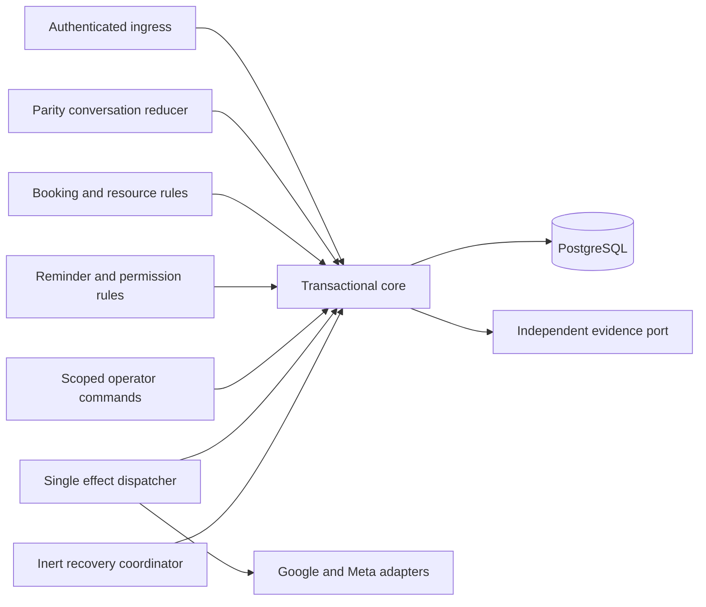

# Proposed data model and module interfaces

Design only; no DDL has been executed. Candidate: strict TypeScript on Node 24.x (verified local v24.19.0), PostgreSQL 17 or 18 subject to managed-service extension/version proof. Use one operational database and one modular monolith artifact with separate ingress, execution and private operator entry points. PostgreSQL is execution truth; Google remains event existence/time/version authority. No broker is needed for the initial load hypothesis.

## Modules and dependency direction



Pure `domain` imports no database, SDK, HTTP, environment, wall clock or randomness. Application use cases receive Clock/Identity/UnitOfWork ports. Only `infrastructure/dispatch` may import mutating provider adapters; read-only reconciliation is a separate capability. UI/reducer cannot send, mutate or choose a tenant. Module import checks and DB grants enforce both directions. Provider SDK retry is disabled at transport level and asserted in adapter tests. Future feature modules use these ports; no feature registry or speculative generic workflow engine is required.

## Entity and authority catalogue

Every tenant-owned table has non-null `business_id` and a unique `(business_id,id)` key. FKs include business on **both** ends; a UUID alone is never authorization. IDs are stable opaque random values allocated once and independently journaled, not rederived after loss.

| Entity | Key / constraints | Purpose and stage |
|---|---|---|
| business / business_execution_head | id; status, status_revision, recovery_epoch, dispatch_enabled=false by default | Synthetic active/suspended/recovery gate in WP1. Actual subscription/payment state later. |
| location | business,id; zone and revision | One default location at P0, no UI. |
| provider_channel | business,id; provider account/WABA + external number unique active binding; mapping_revision | Externally verified route; never sender-selected tenant. Endpoint verifies signed WABA entry and receiving number together. |
| calendar_mapping | business,id; provider account+external calendar globally unique active owner; location, mapping_revision | Calendar belongs to one business; several calendars per business can later support locations. Never `primary` fallback. |
| resource | business,id; location; unique default resource per location; active, schedule_revision | P0 one capacity-one resource. Solo→team preserves that ID and old assignments; optionally attach staff identity later. Calendar is not employee identity. |
| customer / contact_identity | business,id; provider+raw subject key unique within business; verification evidence/revision | Raw WhatsApp identity distinct from normalized display/outbound number. Unknown sender conversation and suppression do not require customer registration. Pending phone replacement cannot transfer consent. |
| conversation / participant | business,channel,raw sender; ownership, state_revision, accepted_sequence, profile_version | P0 recorded human/automated owner. Customer versus business echo versus app output. Future add-on profile disabled. |
| offer / action | business,id; conversation, view_revision, allowed action digest, expiry, policy_version | Original shown choices/slot instants persisted. Repeated action binds original operation; labels never keys. |
| appointment | business,id; calendar,event ID unique; customer, resource, origin, schedule_revision, observed ETag, start/end | APP_CREATED initially. Later OWNER_MANUAL_VALIDATED requires adoption evidence, not copied text/properties. Existence is verified observation, not SQL assertion of Google truth. |
| event_identity / observation | business,calendar,event; mapping revision, create operation or adoption ID, identity digest, fetched_at, ETag | Full trusted authority tuple; append changed observations and preserve original. Partial tombstone does not create a different owner. |
| assignment / protection | business,appointment,resource, interval; active source/target coverage | Current resource and union protection during uncertain changes. Preserve known occupied time. See constraint strategy below. |
| operation / mutation_guard | business,id; input+action uniqueness; appointment; kind, expected versions, state | One unresolved mutator for create/move/cancel/attendance/reassignment; identity and selected resource immutable after admission. |
| attempt | business,id; operation, generation, effect_kind, payload_digest, owner_incarnation, dispatch_epoch | Immutable envelope. At most one potentially effective attempt per logical effect. Result/error evidence appended; never recycle a token. |
| input / batch / admission_seal | business,provider,channel,message ID unique; content hash; batch manifest, independent sequence/root, state | Exact raw-byte signature verified before parsing; normalized per-event evidence retains raw hash/mapping/parser version. Only sealed SQL admissions execute. |
| output_intent / receipt | business,id; conversation sequence+ordinal unique; exact payload; deadline; receipt provider ID/attempt | One ordered intent, many monotonic receipt facts. Unknown head blocks later submissions; expiry applies only definitely unsubmitted. |
| permission_head / permission_event | business,purpose,subject; revision/suppressed; unique evidence reference+digest | Head exists for unknown sender. Grant/withdrawal serialized with dispatcher; grant tied to identity/purpose/wording/question revision. Prior silence stays unknown. |
| reminder_occurrence / schedule | business,appointment,schedule_revision,kind unique; due/deadline, parent target | Exact P0 timing/modes; no backfill. Attendance confirmation is separate from later attendance-outcome provenance. |
| audit / recovery_case | business,id; actor/grant/reason, old/new revision, independent seal | Restricted auditable operator commands, external audit receipt before effectful recovery authorization. |
| secret_reference | business,provider,credential id/version; key version and scoped grant | No plaintext in DB logs/recovery payload. Encryption AAD binds business/provider/credential/version; decrypt only dispatcher. |

Future interfaces, not WP1 tables/UI: service/qualification/weekly hours; event_candidate/adoption; migration_intro (pending/attempted/verified separately from consent); waitlist offer; membership/invitation; subscription/payment ledger; staff_no_show/auto_complete/customer_reported_attendance; export/deletion request and support case. Add these in their own migrations after authorization. Foundations retain origin/participant/revision fields without a commercial scaffold forest.

## Proposed constraint skeleton (planning pseudocode)

```sql
-- Illustrative target DDL: acceptance requires execution against chosen PostgreSQL.
-- CREATE EXTENSION btree_gist is a candidate capability, not an installed dependency.
UNIQUE (business_id, operation_id, appointment_id) ON operation;
FOREIGN KEY (business_id, calendar_mapping_id)
  REFERENCES calendar_mapping(business_id,id);
FOREIGN KEY (business_id, customer_id) REFERENCES customer(business_id,id);
FOREIGN KEY (business_id, resource_id) REFERENCES resource(business_id,id);

-- mutation_guard is the authoritative state-independent guard.
-- Acquired for every mutator; freed only in verified terminal transaction.
PRIMARY KEY (business_id, appointment_id) ON mutation_guard;
FOREIGN KEY (business_id,operation_id,appointment_id)
  REFERENCES operation(business_id,id,appointment_id);

CHECK (start_at < end_at);
CHECK (buffer_minutes BETWEEN 0 AND 1440);
CHECK (NOT isempty(protected_range) AND NOT lower_inf(protected_range)
       AND NOT upper_inf(protected_range)
       AND lower_inc(protected_range) AND NOT upper_inc(protected_range));
-- Protected interval is half-open, includes post-service buffer.
EXCLUDE USING gist (business_id WITH =, resource_id WITH =,
                   protected_range WITH &&)
  WHERE (active) DEFERRABLE INITIALLY IMMEDIATE;
UNIQUE (business_id, provider, channel_id, provider_message_id) ON input;
UNIQUE (business_id, conversation_id, sequence, ordinal) ON output_intent;
UNIQUE (business_id, operation_id, effect_ordinal, generation) ON attempt;
-- Backstop: only one current/potentially effective or already-applied attempt
-- for one logical effect; VERIFIED_NO_EFFECT is excluded only after sealed proof.
CREATE UNIQUE INDEX one_effect_authority ON attempt(business_id,effect_intent_id)
  WHERE state IN ('PREPARED','ARMED','SUBMISSION_ENTERED','UNKNOWN','VERIFIED_APPLIED');
```

Do not put `appointment_id <>` into the exclusion constraint: it admits two mutators of the same event. Guard ownership binds every reservation change to `(business,appointment,operation)`. Resource changes during a mutation require this guard plus ordered resource-head locks; statement privileges alone cannot update protections.

P0 automatic occupancy design uses disjoint protection segments per resource. Booking inserts one. Rescheduling first replaces its old segment with the union of old and target, represented as **merged, disjoint segments**, while holding the appointment guard; overlaps within that union are merged before insert. Other appointments still conflict. Failure restores old protection, verified success retains target, uncertainty retains union. Reassignment later holds both resources in sorted ID order and keeps their original/target protections until verified resolution. Cancellation and attendance retain existing interval. No expiry release after arming.

Commercial intentional manual overlaps need separate observation semantics: raw event occupancies may overlap and must all be preserved; derive a serialized **union busy mask** for admission and check it with app protections. Do not force raw manual events through the automatic-booking exclusion constraint or call an authorized overlap an incident. Unknown manual employee attribution blocks all plausible affected resources until reliable mapping, without sending or silently freeing them. CP2 tests synthetic two-resource mapping; the full materialized busy-mask writer is a later feature, independently reviewed before adoption activates.

Customer non-overlap is a second ordered subject-head check/interval protection within the business for automated bookings. P0 default resource already reproduces single-provider conflicts. Future intentional staff overrides preserve actual occupancies and explicit override evidence; they cannot relax automated admission. Manual external writes can race Google preflight; no distributed transaction can rule out those writers.

## Transaction and port contracts

`TenantContext` is constructed only by verified ingress route or authenticated operator grant. RLS session context is a defense against mistakes, **not authentication**. A shared compromised runtime could act for all its grants. Proposed grants: ingress can stage/seal input/suppression through narrow functions, reducer may finalize local decisions/outbox through UnitOfWork, dispatcher may admit/result through guarded functions, reconciliation may read providers and append evidence, operator role may inspect scoped cases and issue reasoned commands, migration role owns schema and is absent at runtime. Runtime has no table-owner/BYPASSRLS rights. Revoke PUBLIC function execute; fixed search_path, no caller-supplied SQL; pool context set/reset in transaction. Raw multitenant body and credential grants are unavailable to ordinary tenant queries. Admin/break-glass requires individual MFA, short-lived scoped grant, reason and independent audit; no generic “retry uncertain” permission.

```text
Ingress.authenticate(rawBytes, headers) -> VerifiedBatch | reject
Evidence.append(expectedHead, stableKey, digest, encryptedEnvelope) -> DurableSeal | unknown
Core.admit(verifiedEvent, seal, expectedRevisions) -> existing | staged | eligible
Conversation.reduce(savedState, offeredActions, acceptedInput, clock) -> Decision (pure)
Booking.plan(scope, currentObservation, resourcePolicy) -> immutable OperationPlan
Core.reserveAndPrepare(plan, expectedVersions) -> operation + protections + evidenceIntent
Dispatch.claimPrepared(scope, ownerIncarnation) -> unarmed work only
Dispatch.enterSubmission(attempt, latestGateRevisions) -> one nontransferable claim
Provider.submitOnce(immutableEnvelope) -> applied | definitelyRejected | unknown
Core.recordEvidenceAndFinalize(originalAttempt, evidence) -> terminal | hold
Reconcile.read(originalFullIdentity) -> evidence only (cannot call submit)
Recovery.restore(snapshot, independentHead, keys) -> inert database + holds + report
```

`Provider.submitOnce` cannot allocate another attempt, retry SDK calls or infer tenant/recipient. Definite rejection is provider-specific documented evidence; a transport error is unknown. Any new retry generation requires sealed proof the previous generation cannot have produced an effect, original owner containment, and current eligibility. WP1 permits **no automatic new generation**, even after simulated rejection; later bounded rejection retries are a separate adapter proof.

Operation finalization updates appointment observation, protection transfer, guard release, schedule invalidation/enrollment, historical result and output intent in one SQL transaction after independent result evidence is sealed. If transaction fails, protected state remains and the same evidence can finalize idempotently; never repeat external mutation. Terminal result replay refers to historical result; fresh appointment lookup remains a Google read. UI does not confuse those authorities.
