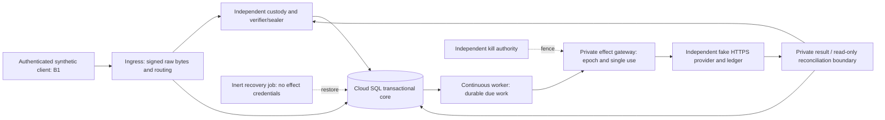

# Cloud Architecture Reconciliation Report

**Author:** Codex. **Status:** proposed planning package; independent Claude
review pending. Date: 2026-11-09 (America/Mexico_City). Source hashes, full paths
and acceptance references are in [evidence](evidence/README.md).

## 1. Conclusion and authority

Keep **ADR-005 Revision 3's GCP architecture**, modular application and PostgreSQL
transactional core. The accepted laptop application supplies substantial reusable
domain/SQL behavior, but it is deliberately protected against cloud/provider use.
It is **not a deployable implementation of ADR-005**. Port infrastructure adapters
and establish trust boundaries in separately authorized increments; do not remove
synthetic guards and expose the existing local server.

No architecture replacement, broker, Redis, HA/automatic failover or Kubernetes
is proposed. No local owner data will seed a cloud proof. A proposed minimum
inventory and cost range are in documents 03/04, not resource authorization.

The owner's clarification resolved an initial evidence ambiguity: the new report
and cost model did not exist and are the deliverables being authored here. Their
absence is **not** alleged to be a defect in an unseen Codex report. Claude must
independently review this new package before any implementation authorization.

The [Revision 3 final check](https://github.com/vanasperena-ux/nukmiris/blob/83907db61daa929fa91ed9301c75b92eaa5f5436/docs/greenfield/reviews/05-CLAUDE-ADR-005-REV3-FINAL-CHECK.md)
approved **Phase 3a test design only**, not deployment. Its early WP1-pending
wording is historical: [WP1 was subsequently closed for bounded synthetic use](https://github.com/vanasperena-ux/nukmiris/pull/4#issuecomment-6620571487).
That closure satisfies the old WP1 prerequisite; it does not close production
009/011/017, 001/F13, 013/016, OPS01 or cloud-specific proof obligations.

## 2. Exact accepted application and evidence hierarchy

| Source | What it establishes | What it does not establish |
|---|---|---|
| PR16 executable `b4d0be0cb98c7f2b69be318e18b93f4de102c511`, tree `03d08322e27d9d54485fa887b482743fe076556b` | Actual accepted synthetic application, ports, SQL, local runtime and tests | A cloud service, production archive, real provider or customer onboarding |
| [Claude final review 6730422478](https://github.com/vanasperena-ux/nukmiris/pull/16#issuecomment-6730422478) | GO WITH CONDITIONS on exact source; reviewed summary/handoff/name behavior; its own execution limits | Universal name semantics or real WhatsApp safety |
| [Owner decision 6731276697](https://github.com/vanasperena-ux/nukmiris/pull/16#issuecomment-6731276697) | Residual capitalized single-word names accepted **only for isolated local synthetic Milestone A** | Permission to extend this exception to real WhatsApp |
| [Owner browser 6754899286](https://github.com/vanasperena-ux/nukmiris/pull/16#issuecomment-6754899286), [native runtime 6754990526](https://github.com/vanasperena-ux/nukmiris/pull/16#issuecomment-6754990526), [completion assessment 6755009222](https://github.com/vanasperena-ux/nukmiris/pull/16#issuecomment-6755009222) | Targeted Windows browser PASS; **46/46 runtime, zero skips**; agreed local synthetic scope satisfied | Production readiness, Services or provider acceptance |
| [Owner Test 17C](https://github.com/vanasperena-ux/nukmiris/pull/16#issuecomment-6728974018) at `7f35b2f…` | Two employees/two bookings, stale/replayed offer rejected, zero Customer4 effects after restart | Real Meta old-button behavior or all future cloud schedules |
| Register v1.4 `59cde023…` read completely | Approved feature IDs, summary rules, business-scoped templates/configuration and deferred features | Latest acceptance status: later comments supersede historical pending/FAIL labels |

This review verified **127 source hashes and 26 evidence artifact hashes**. The
published Linux results are 667 full/657 fault/528 concurrency/380 L2, runtime
44 pass +2 native skips, capacity 4, original browser 1 and focused browser 1,
zero failures; suites overlap. Those are preceding Codex executions, not new runs
in this planning task. Native 46/46 is owner-reported evidence, not this author's
native execution. No cloud experiment or application suite was executed here.

One service per appointment, two suggestions, more/date, known-customer direct
selection, new name after slot, summary trigger distinctions and quiet support
remain binding. NM-006/007 management, NM-034 inbox, NM-039 operator recovery,
Services/configuration, reminders and commercial onboarding are not magically
implemented by hosting. Do not reopen accepted product decisions or implement
these backlogs in this planning package.

## 3. All nine redlines, with Revision 3 refinements

Primary authority: [ADR-005](https://github.com/vanasperena-ux/nukmiris/blob/83907db61daa929fa91ed9301c75b92eaa5f5436/docs/greenfield/12-ADR-005-GCP-CLOUD-ARCHITECTURE.md),
[review 03 RL-1–RL-9](https://github.com/vanasperena-ux/nukmiris/blob/83907db61daa929fa91ed9301c75b92eaa5f5436/docs/greenfield/reviews/03-CLAUDE-ADR-005-INDEPENDENT-REVIEW.md),
[review 04 DR-01–DR-12](https://github.com/vanasperena-ux/nukmiris/blob/83907db61daa929fa91ed9301c75b92eaa5f5436/docs/greenfield/reviews/04-CLAUDE-ADR-005-REV2-DELTA-REVIEW.md).

| Redline | Required reconciliation, including later correction | Current executable / future proof |
|---|---|---|
| RL-1 | One fresh TCP/TLS connection after final check per original effect attempt; no pooling, keep-alive, HTTP/2 reuse or transport retries. Termination proven from platform evidence, never heartbeat absence (DR-01). | `dispatch-once.ts` has a one-use local continuation, not a network gateway/fence. F13 counterexample retained. B1a must measure real cloud behavior. |
| RL-2 | Separate no-new-old-connection claim after fence completion from pre-fence bytes that may arrive later. Classify writes, measure D and fence latency; no zero-late-send promise (DR-12). | Local SQL blocks admission, not a paused external process. No cloud D/termination bound exists. Owner decides proposed threshold and eventual G06 residual. |
| RL-3 | Warm min-1 sealer service in ACK path; no job or request-CPU background work after ACK. Cold start can still fail safely (DR-09). | Local `UnitOfWork.seal` verifies with same-process custody and SQL role. Independent sealer/remote contract missing. |
| RL-4 | Calendar operation-stable base32hex IDs aid reconciliation, **not guaranteed duplicate prevention**; If-Match for updates/cancels; never revoke customer OAuth to fence deployment. Meta fresh epoch A/B credentials subject to verified revocation (DR-03/06). | Synthetic IDs/proofs are not provider contracts. New multi-business credential compatibility must be verified; do not assume customer grants are platform-owned epoch credentials. |
| RL-5 | Mandatory all-traffic VPC, reject no-VPC/private-ranges-only deployments. Google API VIP reachability is distinct from token possession; gateway-only stored-token decrypt. Organization prerequisites remain open (DR-05/08). | No IAM/VPC/KMS cloud adapter. Local SQL explicitly accepts only fixture connections with SSL false. |
| RL-6 | Inert N+1; advance epoch; shift all traffic/remove N tags **before deletion**; old deny rule/identity revocation, platform termination; preserve UNKNOWN; explicitly enable successor. Rollback = old image in new epoch N+2 (DR-02/07/10). | `recoveryEpoch` is not a deployment controller or proof every old instance is gone. No rollout/kill implementation. |
| RL-7 | Epoch-labeled gateway connects/failures, independently correlated fake ledger and platform instance evidence. Heartbeats are alerts only. | Local Needs Attention is useful synthetic diagnostics, not cloud audit or termination evidence. Direct VPC firewall-rule logs cannot supply the promised oracle. |
| RL-8 | Independently administered export/custody/key domain, inert restore, unique create-only exports, no irreversible retention lock before deletion/key design (DR-11). | Same-host SQLite/witness/keys and offline bundle are explicitly synthetic. B2/X1 chain+index-extension vulnerability remains open; signature/monotonic size is insufficient. |
| RL-9 | Separate platform 3a from application 3b, exact SKU/time/budget/cleanup authority and unpriced sensitivities. | WP1 local acceptance is closed; cloud 3a/3b not performed. New cost model replaces reliance on illustrative ~$138.36 subtotal with explicit scenarios. |

Carry review 05 editorial E-1–E-5 without editing historical ADR records: correct
stale gate labels in this report; gateway billing sensitivity is in doc04;
sealer failure and IAM propagation are explicit in doc03. DR-03 supersedes any
earlier claim that a Google duplicate ID reliably returns 409. DR-01 supersedes
heartbeat-based termination. None of these is a new relaxation.

## 4. Target responsibilities and minimal topology

In B2, only separately approved provider assets replace fake destinations. Real
webhooks will require public HTTPS signature verification; B1 may keep ingress
IAM-restricted and use generated signing keys. An owner/browser test endpoint
must not become a publicly selectable business/persona API.

| Role | Cloud responsibility and identity | Denied authority |
|---|---|---|
| Ingress | Bound Meta app/signature context, WABA+receiving-number lookup, bounded partition/admission, original identities and ACK after independent verified custody | Provider sending tokens, dispatch, result invention, custody signing |
| Sealer/verifier | Independent service identity and custody writer/verifier; exact committed membership, chain **and index** extension, original-key absence/inclusion, CAS/freshness | Provider sends, caller-digest-only attestations, unreviewed repair |
| Database | Atomic heads, reservations/buffers, one-use attempts, ordered replies, tenant constraints, current status/permission/mapping and epoch | Physical network fencing or proof of remote acceptance |
| Worker | Durable polling and planning; invoke narrow sealer/gateway capabilities; bounded concurrency and per-tenant fairness | Provider tokens/direct effect route, independent verifier keys, global restore activation |
| Gateway | Authenticate caller/epoch; bind ticket to immutable attempt/payload/tenant/purpose/revisions and deadline; consume once; fresh effect connection; preserve ambiguous outcomes | Allocating a replacement attempt, relying on a lease as a physical fence, unsafe retries |
| Result service | Separate SQL result identity; authenticate original proof/receipt and seal it before atomic finalization; read-only uncertainty reconciliation | Sending or converting absence/timeouts into definitive failure |
| Recovery | Supervised inert restore in isolated destination; suppression/permission precedence, complete custody, new epoch, protected UNKNOWN | Automatically enabling dispatch or replaying old outbox |
| Kill/migration/operator | Separately scoped, named, auditable principals; no normal CI ownership; time-bound access | Automatic promotion, erasing evidence and keys together |

The result boundary can be a private min-0 request service; global restore is an
on-demand inert job. These make previously logical duties explicit, not general
microservice decomposition. Do **not** put purportedly independent principals in
containers sharing a broadly privileged service account and call that separation.
Normal deadline expiry is distinct from privileged global restore. Exact worker/
gateway ticket SQL and identity mapping must be reviewed before implementation.

Local limits matter: `ports.ts` permits only synthetic providers; admission's
`text`/`receipt` schema is a fixture format, not full Meta text/interactive/status
webhooks; `booking-worker.mjs` deliberately enforces loopback and synthetic personas.
Production adapters need separate validated ingress, result and cloud-connection
contracts. Existing app guards and accepted source stay unchanged.

Fixture `remoteId` values must not be assumed to be valid Google event IDs. Allocate
the cloud provider ID mapping from the immutable logical operation **before** its
sealed effect plan, preserve it across attempts/epochs, and validate the allowed
alphabet/length. Do not reinterpret or rewrite already accepted local identities.

## 5. Safety, security and recovery implications

- A single SQL admission/attempt avoids many duplicate schedules but cannot stop
  an already authorized frozen gateway. Preserve F13 as an open physical boundary.
  All transport libraries/proxies must avoid automatic effect retries, including
  timeout/5xx/lost-response cases. Any may-have-entered work stays held with original
  IDs; read-only reconciliation must positively correlate provider facts.
- [Google's event reference](https://developers.google.com/workspace/calendar/api/v3/reference/events)
  expressly leaves collision detection uncertain. Fake Google must sometimes
  accept duplicate IDs. Stable logical-operation IDs, current ETags and inspection
  reduce risk; they cannot establish exactly-once or justify resend/auto-delete.
- Cloud SQL role/bootstrap compatibility is **unverified**: baseline `roles.sql`
  sets BYPASSRLS; scope/recovery functions use `session_user` and literal role
  names. Managed PostgreSQL admin and IAM login names are not identical to the
  Docker superuser/fixture users. Resolve this explicitly; never drop RLS, give
  runtime cloudsqlsuperuser or merely SET ROLE and assume session identity changed.
- Use private database connectivity with verified TLS/IAM or an approved connector,
  UTC, bounded per-role pools and migration reserve. Pin actual managed PG17 minor,
  extensions and maintenance behavior; do not promise Cloud SQL exactly17.11.
- Keep payload/token PII out of logs; independently export critical audit evidence.
  Provider grants are tenant-encrypted SQL records, platform secrets are bounded
  Secret Manager entries, and signing/deletion keys have separate administration.
  Plaintext already cached survives IAM revocation until termination.
- A coherent offline laptop bundle does not prove cloud multi-writer recovery.
  Cloud snapshots/exports must preserve a mutually consistent SQL, custody,
  permission and result-ledger frontier, plus later authoritative suppression.
  Missing chain/index/tail/key evidence broadens holds; never invent a booking
  outcome or release a protected range to make recovery appear successful.
- Retention, cross-border privacy, legal holds and crypto-erasure remain owner/
  qualified-review decisions before real data. Destroying a SQL token row alone
  does not erase wrapped keys from backups. A single owner controlling both admin
  domains remains a shared human-root risk. No retention lock or automatic failover.

## 6. Required changes or clarifications to carry forward

1. **No provider calls in B1.** Old test T-01b proposed an unauthorized Calendar HTTP
   request. That is still a real Calendar call. B1 instead tests GCP infrastructure
   network policy and denied access to synthetic credentials/KMS, with a fake
   Calendar endpoint; real Calendar reachability/permission is **NOT VERIFIED**
   until separately authorized B2. Claude must review this scope reconciliation.
2. **Multi-business Meta is required.** Juanita/Bernard retain their own portfolios,
   WABAs and numbers. Platform-owned test assets in B2 are a bounded exception for
   testing, not the future customer ownership architecture. See doc05.
3. **Explicit customer-name confirmation is mandatory before any real WhatsApp
   pilot.** It is not implemented in the accepted source. No lexicon-only alternative
   closes the owner's newer gate. Cloud B1's eventual authorization must explicitly
   bound synthetic identities/data and disposition the local-only residual; do not
   silently expand the local exception to a hosted public service.
4. **Cost controls need current terminology.** Alerts-only budgets are not caps.
   Newly documented Cloud Run spend caps are service/project scoped, delayed and
   auto-reset; they do not cap SQL/storage/NAT or constitute an effect fence. See04.
5. **Cloud implementation is not yet authorized.** Claude's review, an owner-approved
   implementation charter, and resource-specific provisioning authorization remain
   separate. Do not treat local acceptance or trial credit as any of these gates.
