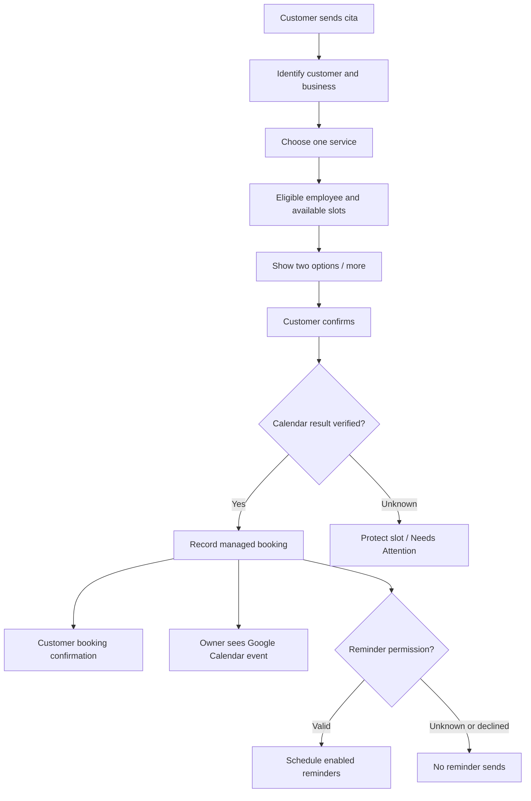
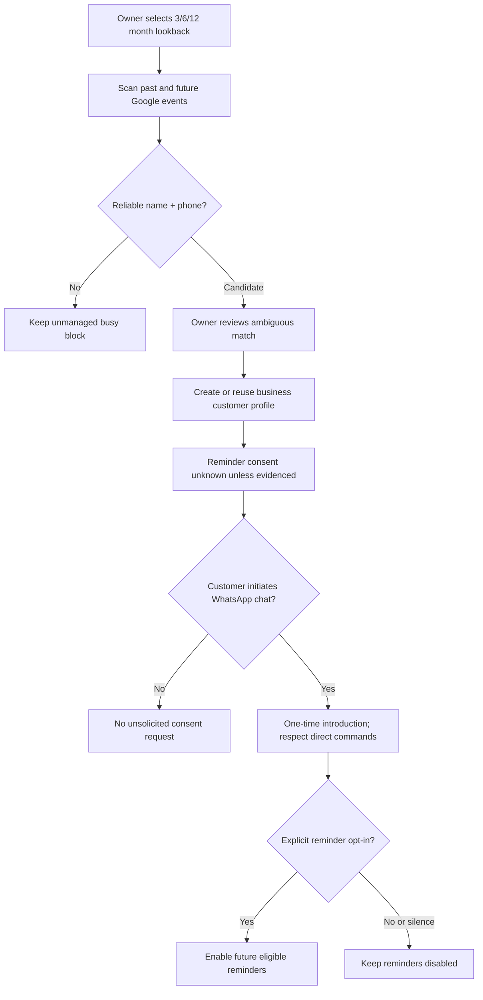
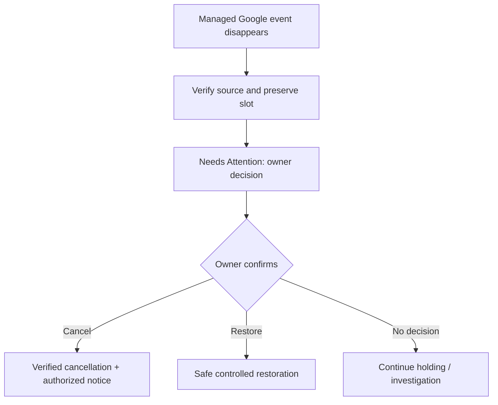

# NukMiris — Persona-Based User Journeys & Capability Validation
**Draft 1 — 2026-10-30** | **Status:** PENDING OWNER APPROVAL  
**Purpose:** End-to-end functional blueprint and review gate before commercial MVP implementation roadmap.  
**Companion:** [Decision reconciliation](01-decision-reconciliation.md).  
**Evidence:** Owner Decisions 1–178, with later amendments; v0.8.1 baseline in `main` and prior architecture challenge. **Design intent, not proof of implemented behavior.**  
**Review key:** ☐ Pending · ✓ Approved · Δ Revise · — Not applicable.  
**Stage:** P0 = preserved v0.8.1 customer UX and safety; MVP = new commercial capabilities.

## Personas and boundaries
| Persona | May do | Important boundary |
|---|---|---|
| Customer (Alberto) | Book one service per appointment, see/reschedule/cancel own appointments, manage per-business reminder consent, accept waitlist offers, use ordinary human chat | Never another customer's bookings; inbound phone identity scoped to business |
| Owner (Juanita) | Configure business, services/staff/working hours; book/edit/cancel in NukMiris or Google; handle customer permissions; view metrics and incidents | Manual overlap possible, never destructive automatic resolution |
| Manager | Manage operations under assigned role permissions | Sensitive changes audited; no automatic global platform access |
| Receptionist | Find customers, book/edit, authorize conflict override if booking permission | Access limited to business/location entitlements |
| Employee (María) | See assigned schedule in restricted view, existing Google access; may book if explicit permission | No unrestricted customer or billing administration |
| NukMiris Admin | Internal tenant support, operational monitoring, authorized recovery and billing support | Individual MFA, strong access/audit; no unauthorized silent fixes |

## Persona-based scenario inventory
| ID | Persona | Scenario | Stage | Decision refs | Review |
|---|---|---|---|---|---|
| C01 | Customer | New appointment via `cita`, one service; collect new customer's name after slot selection; ask reminder consent when unknown | P0+MVP | 19, 30/147, 140–146, 155–161 | Δ Owner requested revision; wording/branch validation pending |
| C02 | Customer | Existing appointment shown on `menu` | P0+MVP | 65, 148 | ✓ Approved 2026-10-30 |
| C03 | Customer | Reschedule existing appointment | P0+MVP | 63, 149 | ✓ Approved 2026-10-30 |
| C04 | Customer | Cancel existing appointment | P0+MVP | 64, 150 | ✓ Approved 2026-10-30 |
| C05 | Customer | All requested slots unavailable; more choices/waitlist | MVP | 31, 33, 68–73, 141 | ☐ |
| C06 | Customer | Past employee preference vs available alternatives | MVP | 21, 142–146 | ☐ |
| C07 | Customer | Appointment reminders and 1-day confirmation | P0+MVP | 36–38 | ☐ |
| C08 | Customer | `permisos`: view, enable, disable, restore consent | MVP | 19, 158–161 | ☐ |
| C09 | Customer | Imported customer first inbound WhatsApp message | MVP | 148, 178 | ☐ |
| C10 | Customer | Normal chat and human assistance | P0+MVP | 41–45, 121 | ☐ |
| C11 | Customer | Staff-initiated employee reassignment | MVP | 22–23 | ☐ |
| C12 | Customer | Post-visit satisfaction/review invitation | MVP | 75–77 | ☐ |
| O01 | Owner | Create business, connect WhatsApp and Google Calendar | MVP | 52–54, 116 | ☐ |
| O02 | Owner | Import calendar customer history 3/6/12 months | MVP | 20, 54, 178 | ☐ |
| O03 | Owner | Configure services, employee qualifications/hours | MVP | 28–29, 133–139 | ☐ |
| O04 | Owner | Create appointment in NukMiris calendar | MVP | 151–157, 177 | ☐ |
| O05 | Owner | Create event in Google without phone | MVP | 54, 93, 177 | ☐ |
| O06 | Owner | Reschedule/modify service through dashboard | MVP | 154, 170–172 | ☐ |
| O07 | Owner | Modify managed appointment in Google | MVP | 91, 173–174 | ☐ |
| O08 | Owner | Delete managed Google Calendar event | MVP | 92; 175 withdrawn | ☐ |
| O09 | Owner | Manually overlap employee appointments | MVP | 172, 176 | ☐ |
| O10 | Owner | Manage no-show and auto-complete | MVP | 34–35, 168–169 | ☐ |
| O11 | Owner | Daily combined calendar, filters, Needs Attention | MVP | 39, 153, 167 | ☐ |
| O12 | Owner | Record consent in person and start authorized messaging | MVP | 155–157 | ☐ |
| O13 | Owner | Change customer's WhatsApp phone number | MVP | 162–165 | ☐ |
| O14 | Owner | Closures, staff absences and breaks | MVP | 24–27, 134–138 | ☐ |
| O15 | Owner | Business with multiple locations | MVP | 58–60 | ☐ |
| O16 | Owner | Review reports, customer export and deletion | MVP | 77–81 | ☐ |
| S01 | Manager/Receptionist | Search customer and manage bookings | MVP | 151–154, 164–165 | ☐ |
| S02 | Employee | Restricted own schedule and permitted booking | MVP | 55–57, 176 | ☐ |
| S03 | Owner | Invite/revoke staff and manage role | MVP | 55–57, 131–132 | ☐ |
| A01 | Platform Admin | Integration down, alerts and safe recovery | P0+MVP | 83–90, 97–110 | ☐ |
| A02 | Platform Admin | Human support tickets and knowledge base | MVP | 120–127 | ☐ |
| A03 | Platform Admin | Tenant-level administrative access and audit | MVP | 127–130 | ☐ |
| B01 | Owner | Trial, subscription, spend cap, failed payment | MVP | 47–51 | ☐ |
| B02 | Owner | Subscription cancellation, export and retention | MVP | 12–13, 80–82 | ☐ |
| P01 | Platform/Owner | Pre-pilot readiness, evidence and approval | MVP→pilot | 110–119 | ☐ |

## Detailed review tables — core journeys

### C01. Customer books one appointment
| Step | Customer Alberto | NukMiris / integrations | Owner/employee |
|---|---|---|---|
| 1 | Sends `cita` or chooses existing booking command | Authenticate inbound WhatsApp business/customer; do not seize unrelated chats | No intervention |
| 2 | Chooses service where business has a service choice | Validate service and one-service-per-appointment rule; duration+buffer, qualified staff | Service catalog maintained in dashboard |
| 3 | For returning customer, may favor last completed same-service employee; first-time customer assigned randomly if no preference | Verify eligible employee and calendar blocks; preserve choice logic of Decisions 143–146 | No intervention |
| 4 | Sees next **two** available slots, requests more if needed; no unapproved date-first redesign | Compute per-employee availability, calendar busy intervals, hours, closure, buffer, horizon | Existing events block time |
| 5 | Chooses preferred date/time. **If new customer**, then provides their name after slot selection; returning customers skip name collection when verified | Use authenticated sender number, collect name only for new customer, preserve chosen slot context; do not commit before booking confirmation | None |
| 6 | Confirms the booking according to existing v0.8.1 flow | Protect chosen slot, safely write event to Google Calendar, reconcile uncertain outcome | Appointment visible on shared Google Calendar and NukMiris dashboard |
| 7 | Receives booking confirmation | Persist verified appointment identity/status. If reminder permission is valid, schedule enabled reminders; if declined, do not prompt again | Sees assigned employee and appointment |
| 8 | **Only when reminder permission is unknown:** sees an explicit optional Accept/Decline reminder-consent question after the booking confirmation; can also ignore it | Save affirmative consent durably before enabling still-eligible reminders. Decline/silence leaves appointment booked without reminders. Keep this distinct from permission for the current customer-initiated response | No extra task merely due to unknown consent |
**Owner review (2026-10-30):** C01 marked **Revise**. Explicit change request: *new customer name is requested only after customer selects the date/time; after successful booking confirmation, if reminder consent is unclear, ask for permission*. Updated expected flow above is proposed for reapproval; **not yet marked Approved**. C02, C03 and C04 approved. **Exceptions:** slot taken after offer; calendar unavailable; uncertain create; duplicate inbound; declined/unknown consent; multiple existing bookings limit. Never claim success or release protected slot on uncertainty.

### C03. Customer reschedules
| Step | Customer | NukMiris | Owner |
|---|---|---|---|
| 1 | Sends `reagendar` / uses existing menu | Shows own future appointments using preserved v0.8.1 selector adapted for multiples | None |
| 2 | Chooses appointment and new offered slot | Availability + horizon + booking constraints; reschedule until start | None |
| 3 | Confirms the change | Safely mutate *same managed appointment*, suppress obsolete reminders, schedule new eligible ones | Updated calendar time |
| 4 | Receives response only after verified result | Quarantine uncertain state; no false success | Needs Attention if unresolved |

### C04. Customer cancels
| Step | Customer | NukMiris | Owner |
|---|---|---|---|
| 1 | Sends `cancelar` | Identifies customer's future appointments; preserve existing selector | None |
| 2 | Chooses and confirms cancellation | Safe Google change, suppress reminders, journal cancellation | Calendar freed only after verified completion |
| 3 | Receives verified confirmation | Optional waiting-list offers after confirmed release | Can inspect cancellation history |

### C08. Customer manages reminders
| Step | Customer | NukMiris | Owner |
|---|---|---|---|
| 1 | Types `permisos` or selects Administrar permisos | Displays **current consent for this business** | No action |
| 2 | Chooses Activar or Desactivar | Records scope/evidence/actor/time; never auto-restore prior opt-out | Permission view updated |
| 3 | Receives concise new-status confirmation | Opt-out suppresses all pending reminders immediately; opt-in schedules still-eligible future reminders for existing appointments | No unnecessary alert |
| 4 | Returns to menu | Preserve existing appointment UX | None |
**Exception:** failed permission commit means no false success; conservatively suppress disputed sends.

### C09 + O02. Imported existing customer first message
| Step | Juanita | NukMiris | Customer |
|---|---|---|---|
| 1 | Selects 3, 6 or 12 months of history; default six; future entries always included | Scans authorized Google events, detects name/phone patterns, normalizes numbers | None |
| 2 | Reviews ambiguous matches and import preview | Creates approved business-scoped candidate profiles; unverified event/number stays unmanaged | None |
| 3 | No mass outbound consent requests | Imported permissions are **unknown** unless evidenced; imported events still block availability | None |
| 4 | None | On first eligible customer-initiated chat after activation, greet once, explain `menu`/`cita` and offer reminder permission if unknown, without hijacking explicit commands | Sends `hola` or `cita` |
| 5 | No manual action unless ambiguity | Record explicit consent decision; if declined/no response continue booking/chat without reminders | May accept, decline, or book directly |
**Critical note:** Phone match from event text is not automatically verified WhatsApp identity. Never reveal past appointments on an ambiguous match.

### O04. Owner creates appointment through NukMiris calendar
| Step | Owner/authorized staff | NukMiris | Customer |
|---|---|---|---|
| 1 | Open mobile daily or combined employee calendar; choose slot | Employee filters, visible statuses | None |
| 2 | Search existing customer by partial name/number or create profile; **WhatsApp number required** | Normalize and exact-match numbers within business | None |
| 3 | Select service, assigned employee | Validate duration/qualification/hours; show manual conflict warning but allow booked-role override | None |
| 4 | Confirm | Persist and safely synchronize; mark uncertain if provider outcome unknown | None |
| 5 | Where customer consent exists, send appointment details; if new permission verbally obtained, staff records consent and audit | Confirmation and reminders based on respective permission scopes | Receives authorized notice and optional reminder choice |
**Exception:** No phone → staff may instead create an unmanaged Google Calendar entry; never fabricate customer identity.

### O05. Google event without phone
| Step | Owner | NukMiris | Customer |
|---|---|---|---|
| 1 | Creates Google event e.g. "Carolina manicure", no phone | Read event as busy block for associated employee/calendar | None |
| 2 | Optionally edits event later | Remains **unmanaged** unless identity and details validated | No WhatsApp messages |
| 3 | Continues ordinary calendar work | Do not auto-create Needs Attention solely for missing number | None |

### O07. Owner changes appointment directly in Google
| Step | Owner | NukMiris | Customer |
|---|---|---|---|
| 1 | Edits time/date/service of managed event | Detect verified event version; recalculate availability promptly | No message yet |
| 2 | Makes another edit soon after | Short coalescing window (candidate 60 seconds) for **notifications only**, not availability | No duplicate interim notice |
| 3 | Stops editing | Once final verified state established, send authorized approved template for consequential change | Receives one accurate update |
| 4 | If changing employee | Must obtain customer approval before treating reassignment as final | Approves or retains original assignment |
**Exception:** ambiguous event changes or provider uncertainty → protect, Needs Attention, no misleading outbound notice.

### O08. Google Calendar deletion of managed event
| Step | Owner | NukMiris | Customer |
|---|---|---|---|
| 1 | Deletes managed event | Treat disappearance as uncertain until verified; protect slot and managed appointment | No cancellation message |
| 2 | Reviews Needs Attention | Ask cancel or restore; distinguish accidental/intentional deletion | Still has booked appointment pending determination |
| 3 | Explicitly confirms cancellation/restore | Perform verified outcome; notification only after confirmed cancellation where authorized | Receives accurate notice if cancelled |
**Authority:** Decision 92. Decision 175 was withdrawn.

### O09. Manual overlap
| Step | Staff | NukMiris | Customer |
|---|---|---|---|
| 1 | Books overlapping slot in Google Calendar | Accept as manual origin; keep both busy blocks | No auto cancellation |
| 2 | Or books overlap through dashboard | Display warning; all staff with booking permission may acknowledge and proceed | Receives notice only if authorized |
| 3 | Later customer requests same slot via WhatsApp | Do **not** offer occupied employee time | Cannot create competing automated booking |

### O10. No-show / automatic completion
| Step | Staff | NukMiris | Customer |
|---|---|---|---|
| 1 | Opens calendar quick action or appointment details | Permit marking No asistió after scheduled start | No automatic penalty |
| 2 | No action on ordinary appointment | After end mark Automatically Completed; **not verified attended** | No required action |
| 3 | Corrects mistaken No-show | Audit correction | No automatic unsolicited notice |

### O13. Change WhatsApp number
| Step | Staff Juanita | NukMiris | Customer Alberto |
|---|---|---|---|
| 1 | Enters new WhatsApp number on existing profile | Mark pending; avoid leaking appointment details | Opens QR/link on new number |
| 2 | Verifies customer's identity in person | Confirm inbound number control and staff approval; reject conflicting existing profile number | Confirms number-change intent |
| 3 | Approves change | Preserve existing appointments/history, stop old-number sends | Explicitly opts in/out for messages on new number |
| 4 | Finalize | Begin new-number messages only with valid permission; audit change | Gets final confirmation |
**Guard:** Old-number permission does not automatically transfer.

### A01. Integration disconnected/uncertain send
| Step | Platform/admin | NukMiris | Owner/customer |
|---|---|---|---|
| 1 | Detect Google or WhatsApp disconnection | Pause only affected automated effects; protect in-flight operations; alert owner | Owner sees actionable reconnect item |
| 2 | Investigate | Reconcile unknown Calendar outcomes **read-only**; unknown WhatsApp delivery must never be blindly resent | Customer never receives fabricated success |
| 3 | Reauthorize/recover | Validate permissions, token, durable journal, stale worker fencing and permission lock before resume | Owner receives meaningful recovery notice when warranted |

### B01. Trial / subscription
| Step | Owner | NukMiris | Admin |
|---|---|---|---|
| 1 | Starts 30-day trial without payment method | Enforce trial allowance and visibility | Can support setup |
| 2 | Selects monthly subscription | Count provider usage; included messages + disclosed overage + cap | Billing/provider configuration still to be decided |
| 3 | Payment fails | 7-day grace, reminders and controlled suspension without data loss | Handles support issues |
| 4 | Cancels | Controlled export/read-only period under approved retention policy | Audit offboarding |

## Core process diagrams

### Customer booking and calendar visibility

### Customer import and first contact

### Google deletion: preserve Decision 92

## First-pass critical gaps to validate (NOT pre-approved)
| Gap ID | Observation | Needed later |
|---|---|---|
| G-01 | WhatsApp Business App/API coexistence, existing human chats and first-contact routing are provider-dependent | Real Meta feasibility/protocol tests before promising rollout |
| G-02 | Calendar-import pattern extraction may associate wrong names/numbers | Preview, provenance, identity validation, and privacy tests |
| G-03 | Some historical conversations may contain consent evidence but not be accessible/authoritative | Manual proof workflow, conservative unknown state |
| G-04 | Billing provider, invoice/tax treatment for initial LATAM market not yet selected | Commercial MVP owner/provider design decision |
| G-05 | End-to-end onboarding readiness checklist and failure-recovery UX not consolidated | Journey-level signoff before external onboarding |
| G-06 | External pilot thresholds and rollback/support staffing not numerically approved | Launch acceptance plan and owner approval |
| G-07 | Distinguish special calendar changes from customer-approved reassignment | Proof of safe policy and truthful messages |
| G-08 | Complete verification against every source decision and actual v0.8.1 UX remains | Decision-by-decision source crosscheck and regression inventory |

## Owner review rubric
For each scenario mark **Approved / Revise / Not applicable** and record: expected user-facing text; integration effects; what happens on uncertainty; customer permission; employee/resource impact; operational owner alerts; non-goals. Use the exact current v0.8.1 prompts/buttons for P0 parity. Do not add alternate booking selectors, multiple services per appointment, AI support workflow or speculative CRM fields.

## Gate and next actions
1. Owner reviews the scenario inventory by persona and signs off corrections in batches.
2. Reconcile every scenario with individual decisions and v0.8.1 accepted tests; convert ambiguous entries into traceable gap tickets rather than guessing.
3. Resolve launch-critical G-issues only; codify exact requirements and acceptance scenarios.
4. Codex proposes stages P0 → commercial MVP → pilot with estimates/test IDs.
5. Claude independently reviews implementation readiness, evidence and contradictions. **No code merge, deployment, provider activation or release without separate owner approval.**

## Owner-review log
| Date | Scenario | Result | Clarification |
|---|---|---|---|
| 2026-10-30 | C01 | **Revise** | New customers: ask name after date/time selection; after confirmed booking, if reminder permission unknown, offer explicit opt-in/decline without blocking appointment |
| 2026-10-30 | C02 | **Approved** | Upcoming appointments + existing menu |
| 2026-10-30 | C03 | **Approved** | Reschedule using existing selection and safe Google synchronization |
| 2026-10-30 | C04 | **Approved** | Cancellation using existing selection and safe Google synchronization |
